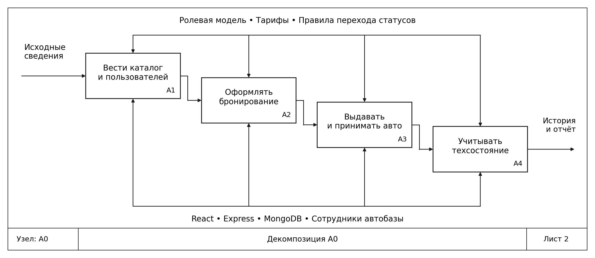
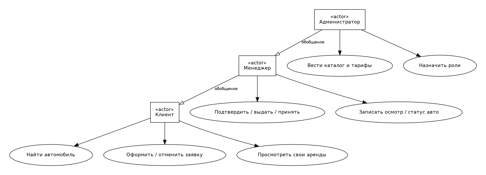

# ВВЕДЕНИЕ

Аренда автомобиля объединяет несколько взаимосвязанных процессов: публикацию сведений об автопарке, согласование срока использования, расчёт стоимости, передачу машины клиенту, приём после поездки и контроль технического состояния. Даже небольшой пункт проката должен одновременно учитывать интересы клиентов и ограничения каждой единицы транспорта. Если заявки записываются в отдельные таблицы, а сведения о ремонте передаются устно, согласованность данных зависит от внимательности сотрудников. Возникает риск двойного бронирования, неверной цены и выдачи автомобиля, который должен находиться на обслуживании.

Актуальность проекта обусловлена необходимостью согласовать заявки, доступность машин и историю обслуживания в единой системе.

Объект исследования - процессы аренды автомобилей и учёта состояния автопарка. Предмет исследования - программные методы автоматизации этих процессов и способы проверки качества веб-приложения. Разрабатываемый продукт получил название «NORDÉ».

Цель курсового проекта - разработать и проверить информационную систему автоматизации аренды и учёта состояния автопарка с клиентским интерфейсом, рабочим пространством сотрудников и базой данных MongoDB.

Для достижения цели поставлены задачи: исследовать предметную область и аналоги; определить функциональные и нефункциональные требования; спроектировать процессы, архитектуру и хранение данных; реализовать регистрацию и разграничение прав; разработать каталог и оформление аренды; реализовать управление автомобилями и техническими осмотрами; проверить расчёты, целостность данных и пользовательские сценарии; выполнить нагрузочное исследование и подготовить документацию.

В работе применены моделирование IDEF0, DFD и UML, анализ граничных значений, разделение входных данных на классы эквивалентности, автоматизированное модульное и интеграционное тестирование, браузерные проверки и измерение производительности. Для хранения документов и выполнения транзакций используется MongoDB [15]. Сервер разработан на Node.js и Express, интерфейс - на React [13, 16, 17].

Практическая значимость - работающий учебный продукт с воспроизводимым запуском и проверяемыми правилами. В границы проекта не входят банковская оплата, юридически значимое подписание договора и автоматическая проверка водительских документов. Документы и расчёт при выдаче проверяет сотрудник.

# РАЗДЕЛ 1. АНАЛИЗ ТРЕБОВАНИЙ И ПРОЕКТИРОВАНИЕ


## 1.1. Описание предметной области и целевой аудитории

NORDÉ рассматривается как учебная служба проката автомобилей в Вологде. Демонстрационные адрес, телефон и сведения о владельце предоставлены для заполнения сайта и не подтверждают существование зарегистрированного предприятия. Требования получены из постановки учебной задачи и последовательных уточнений заказчика; интервью с реальной прокатной компанией и опрос клиентов не проводились. Автопарк и тарифы являются учебными данными.

Пользовательский сценарий начинается с выбора автомобиля. Посетитель просматривает характеристики, задаёт период и дополнительные услуги. После регистрации он отправляет заявку. Система фиксирует рассчитанную стоимость и резервирует выбранный интервал. Менеджер рассматривает заявку, подтверждает её, а затем оформляет фактическую выдачу. После возвращения вводится пробег, аренда завершается и её данные остаются в истории.

Клиенту важны предсказуемая стоимость, понятная форма бронирования и возможность проверить состояние своей заявки. Менеджеру важны отсутствие пересечений по времени, доступ к контактам клиента и ограничения, которые не позволяют случайно нарушить последовательность операций. Администратору нужны средства ведения каталога, тарифов и учётных записей. Все роли используют одну базу, но видят разные операции.

Заявка и фактическая аренда рассматриваются как стадии одной сущности Rental. Это упрощает отслеживание истории: пользователь видит один номер от создания до завершения. Новая заявка уже блокирует интервал. Такое решение исключает ситуацию, когда несколько клиентов ожидают подтверждения одного автомобиля на одинаковые даты. Обратная сторона - менеджер должен своевременно отменять неактуальные заявки; автоматическое истечение ожидания в текущую версию не включено.

## 1.2. Исследование бизнес-процессов

Функциональное моделирование выполнено в нотации IDEF0. Контекстная диаграмма показывает систему как одну функцию. Входами являются запрос клиента и сведения об автомобиле. Управляющими воздействиями служат условия аренды, права пользователей и регламент обслуживания. Механизмы выполнения - люди и программное обеспечение. Выходами становятся оформленные аренды и история состояния.


Соответствующий результат представлен на рисунке 1.


На следующем уровне выделены ведение каталога, оформление бронирования, выдача и приём, учёт технического состояния. Такое разделение позволяет связать функции с интерфейсом и серверными маршрутами. Например, процесс A2 соответствует форме бронирования и команде POST /api/rentals, а A4 - разделу технического обслуживания.


Соответствующий результат представлен на рисунке 2.



Третий уровень детализирует наиболее критичный процесс - оформление бронирования. Сначала проверяется структура запроса и допустимость дат. Затем рассчитывается цена. После этого проверяются исправность автомобиля и отсутствие пересекающихся заявок. Последний шаг атомарно сохраняет заявку и запись журнала. Ошибка на любом этапе приводит к объяснимому отказу, а не к частично созданной аренде.


Соответствующий результат представлен на рисунке 3.


Контекст A-0, декомпозиция A0 и декомпозиция A2 образуют три уровня детализации. На диаграммах управляющие воздействия расположены сверху, механизмы снизу, входы слева и выходы справа. Порядок запросов дополнительно раскрывается диаграммой последовательности.

DFD описывает движение данных между внешними участниками, процессами и хранилищами. Клиент передаёт даты и параметры заказа, а получает стоимость и номер заявки. Сотрудник передаёт решения о выдаче и возврате. Хранилища автомобилей, аренд и осмотров связаны через серверные процессы. Прямого доступа клиента к коллекциям MongoDB нет.


Соответствующий результат представлен на рисунке 4.


Диаграмма вариантов использования отражает роли. Менеджер может пользоваться клиентскими функциями, а администратор имеет функции менеджера и дополнительные операции с каталогом и пользователями. Наследование ролей в диаграмме выражает множество разрешённых действий, а не наследование JavaScript-классов.


Соответствующий результат представлен на рисунке 5.



Последовательность успешного бронирования проходит через браузер, React, Express и MongoDB. Права и CSRF проверяются до изменения данных. Транзакция включает запись версии блокировки машины, проверку пересечений, создание аренды и события. Ответ 201 возвращается после фиксации. Если соединение оборвётся после фиксации, пользователь сможет найти созданную заявку в личном кабинете; отдельный ключ идемпотентности в текущей версии не реализован.


Соответствующий результат представлен на рисунке 6.


Моделирование показало, что основной риск связан с конкурирующими изменениями одного автомобиля. Поэтому блокировка не ограничивается кнопкой в браузере: бизнес-операции сериализуются на уровне документа автомобиля внутри транзакции MongoDB.

## 1.3. Сравнительный анализ систем аналогов

Сравнение проведено по открытым клиентским страницам Яндекс Проката, Turo и SIXT, доступным при исследовании интерфейсов [2, 19, 20]. Внутренние алгоритмы бронирования, панели сотрудников и фактическое покрытие тестами этих сервисов не исследовались. Поэтому таблица характеризует наблюдаемые решения интерфейса, а не качество закрытого программного кода.

| Критерий | Яндекс Прокат | Turo | SIXT | NORDÉ |
|---|---|---|---|---|
| Поиск по месту и датам | Есть | Есть | Есть | Вологда и даты |
| Карточки с ценами | Есть | Есть | Есть | Есть |
| Назначение продукта | Агрегатор | Площадка аренды | Сеть проката | Учебный прокат |
| Граница исследования | Открытые страницы | Открытые страницы | Доступная страница | Открытый код и тесты |
| Рабочие роли | Не исследованы | Не исследованы | Не исследованы | Три роли |
| Учёт состояния | Не исследован | Не исследован | Не исследован | Осмотры и пробег |

Сравнение подтверждает целесообразность простой формы подбора, карточек с полной стоимостью и доступного личного кабинета. Собственное отличие учебного решения состоит в проверяемом сквозном процессе аренды и технического учёта. Коммерческая полнота трёх аналогов не заявляется целью курсового проекта.

## 1.4. Требования к программному продукту

Функциональные требования сформулированы так, чтобы результат можно было проверить запросом к API или действием в браузере. Идентификаторы связывают требования с проверками домена, API и интерфейса. Сервер должен обеспечивать выполнение правил независимо от того, вызвана команда из штатного интерфейса или напрямую.

| Код | Требование | Проверяемый результат |
|---|---|---|
| FR-01 | Регистрация и вход | Создаётся клиент; пароль хранится как хеш |
| FR-02 | Роли клиент/менеджер/администратор | Недопустимые команды дают 401 или 403 |
| FR-03 | Каталог, поиск, класс, сортировка, даты | Возвращается подходящее подмножество машин |
| FR-04 | Характеристики автомобиля | Показаны тариф, залог, описание и параметры |
| FR-05 | Расчёт стоимости | Цена вычисляется сервером с услугами и скидкой |
| FR-06 | Создание аренды | Запись сохраняется в MongoDB с номером |
| FR-07 | Отсутствие двойной брони | При гонке один ответ 201, второй 409 |
| FR-08 | История и отмена своих заявок | Чужие заявки недоступны клиенту |
| FR-09 | Подтверждение, выдача, возврат | Допускаются только разрешённые переходы |
| FR-10 | Управление автомобилями | Администратор добавляет, меняет и архивирует |
| FR-11 | Учёт технического состояния | Осмотр и пробег сохраняются с автором |
| FR-12 | Назначение ролей и аудит | Новая роль действует в существующей сессии |
| FR-13 | Выгрузка списка аренд | CSV доступен только сотруднику |
| FR-14 | Профиль клиента | Сохраняются имя, телефон и условия допуска к аренде |
| FR-15 | Возраст, права и стаж | Требуются 21 год, действующие права и стаж от года |
| FR-16 | Фотографии и галереи | У 12 стандартных машин есть фото; загрузка проверяется |
| FR-17 | Карусель наличия и избранное | Показ соответствует датам; избранное сохраняется в браузере |
| FR-18 | Обновление демо | Заявки и пользовательские фотографии сохраняются |

Перед бронированием пользователь подтверждает, что ему исполнился 21 год и у него есть действующие водительские права; стаж вводится в полных годах, минимум один год. Флажки являются декларацией клиента, а не автоматической проверкой документов. Сервер проверяет допуск повторно; старый профиль должен дополнить условия. Паспорт и права проверяет сотрудник при выдаче.

Срок аренды составляет от одних до тридцати суток. Период задаётся календарными датами в формате YYYY-MM-DD. День возврата не включается в длительность. Новая заявка не может начинаться в прошлом. Даты должны существовать: например, 30 февраля не принимается, даже если стандартный конструктор Date способен нормализовать такое значение.

Итоговая стоимость аренды определяется формулой (1).

FORMULA: C = B × n × k + (I + S) × n | 1

где C - стоимость аренды, руб.; B - суточный тариф, руб.; n - число оплачиваемых суток; k - коэффициент базовой скидки, равный 0,9 при сроке от семи суток и 1 в остальных случаях; I - суточная стоимость выбранной защиты, руб.; S - суточная стоимость выбранного кресла, руб.

Суммы дополнительных услуг включаются только при выборе соответствующей опции. При сроке от семи суток базовая сумма уменьшается на 10%. Защита стоит 600 рублей в сутки, кресло - 300 рублей в сутки. Залог показан отдельно и не прибавляется к цене аренды. Все суммы этой учебной версии выражаются целыми рублями.

| Код | Нефункциональное требование | Критерий приёмки |
|---|---|---|
| NFR-01 | Постоянное хранение | Обновление страницы не теряет заказы; данные находятся в MongoDB |
| NFR-02 | Безопасность доступа | Проверяются роль, владелец, CSRF и длина входных полей |
| NFR-03 | Быстродействие каталога | p99 ответа API менее 2 секунд при 50 соединениях на учебном наборе |
| NFR-04 | Адаптивность | Нет горизонтальной прокрутки на ширине 390 px для основных клиентских страниц |
| NFR-05 | Повторяемость установки | Lockfile, Compose и seed позволяют повторить запуск |
| NFR-06 | Проверяемость | Автоматические тесты домена, API и ключевых UI-сценариев |

## 1.5. Инструментальные средства разработки и тестирования

Node.js предоставляет среду выполнения сервера и встроенный тестовый модуль node:test [16]. Express используется для маршрутизации HTTP-запросов и последовательного подключения middleware [17]. Mongoose описывает структуру документов, индексы и работу с транзакциями [3]. MongoDB выбрана в соответствии с заданием и хорошо подходит для документов с вложенным снимком цены и историей изменения статуса [15].

React отвечает за состояние форм и отображение данных [13]. Vite выполняет разработческую сборку и создание статических файлов [21]. React Router разделяет страницы без полной перезагрузки приложения. Отдельная библиотека глобального состояния не использовалась: для текущего объёма достаточно контекста сеанса и локального состояния компонентов.

Zod проверяет формы запросов на границе API [12]. bcryptjs хеширует пароли; длина ограничена 72 байтами UTF-8 с учётом особенностей алгоритма [5]. express-session и connect-mongo обеспечивают серверные сессии [6, 8]. Helmet задаёт защитные HTTP-заголовки [9]. Разграничение доступа проектировалось с учётом принципа проверки полномочий на каждом защищённом запросе [18].

Интеграционные тесты используют Supertest и отдельную настоящую MongoDB. Playwright запускает Chromium и проверяет взаимодействие через видимые элементы страницы [14]. Для нагрузочного эксперимента выбран Autocannon - инструмент измерения HTTP-производительности в экосистеме Node.js [4]. Он заменяет перечисленные в методичке варианты k6/JMeter по назначению, но не имитирует полноценное поведение браузера.

## 1.6. Проектирование архитектуры и хранения данных

Приложение разделено на три слоя. Представление включает React-компоненты, маршруты, формы и стили. Прикладной слой включает Express API, правила расчёта, управление доступом и последовательность операций. Слой хранения включает Mongoose-модели, индексы и MongoDB. Браузер не подключается к MongoDB напрямую и не может самостоятельно назначить роль.

В режиме разработки Vite направляет запросы /api серверу Express. После сборки Express раздаёт статические файлы из dist и API с одного origin. Это упрощает работу cookie и исключает необходимость открытого CORS. Файлы шрифтов и фотографий хранятся локально: просмотр интерфейса не зависит от внешнего сервиса изображений.

### 1.6.1. Концептуальная и инфологическая модели

Основными сущностями являются пользователь, автомобиль, аренда, осмотр и событие. Пользователь может иметь несколько аренд; автомобиль связан со многими арендами в разные периоды; осмотры относятся к конкретной машине и сотруднику. Внешние ссылки хранятся как ObjectId. Термин ER-модель используется для объяснения связей, хотя физическое хранение является документным.


Соответствующий результат представлен на рисунке 7.


| Коллекция | Ключевые поля | Назначение и ограничения |
|---|---|---|
| users | name, email, phone, passwordHash, role, drivingExperience | Уникальный email; роль только из разрешённого набора |
| cars | brand, model, plate, category, dailyRate, image, gallery, status | Уникальный номер; положительный тариф; неотрицательный пробег |
| rentals | number, user, car, from, to, quote, extras, status, history | Уникальный номер; ссылки; снимок цены и история |
| maintenances | car, author, node, wear, mileage, note | Износ 0-100; пробег не меньше текущего |
| events | actor, action, entity, details, createdAt | Хронология важных операций |
| sessions | идентификатор, содержимое, срок действия | Служебная коллекция connect-mongo с TTL |

Встроенный объект quote хранит длительность, тариф на момент оформления, базовую стоимость, услуги, общую сумму и залог. Это осознанное дублирование: актуальный тариф автомобиля может меняться, а историческая стоимость уже созданной заявки должна оставаться прежней. Поле carName аналогично сохраняет название на момент оформления.

### 1.6.2. Физическая модель, индексы и целостность

MongoDB не обеспечивает внешние ключи так же, как реляционная СУБД. Поэтому приложение проверяет существование ссылочных документов до записи. Пользователи в текущей версии физически не удаляются. Автомобили архивируются логически, что сохраняет ссылки в истории. Структура и диапазоны проверяются схемами Mongoose и Zod; серверные SQL-ограничения в проекте не используются.

Уникальные индексы создаются для email, государственного номера и номера аренды. Составной индекс cars связывает archived, category и dailyRate. Индекс rentals по car, status, from и to поддерживает поиск пересечений. Отдельный индекс user и createdAt ускоряет получение истории клиента. Для осмотров используется car и createdAt, а для событий - createdAt.

Индекс не решает гонку между двумя запросами сам по себе. Проверка «найти пересечение, затем вставить» без согласования может пропустить два одновременных запроса. В проекте обе операции входят в транзакцию, а перед чтением пересечений выполняется запись lockVersion у автомобиля. Это заставляет конкурирующие команды конфликтовать на одном документе. Драйвер повторяет транзакцию после конфликта, и повторная проверка уже видит сохранённую заявку [15].

Два интервала пересекаются при выполнении условия (2).

FORMULA: f1 < t2 и t1 > f2 | 2

где f1 и t1 - начало и конец существующей аренды; f2 и t2 - начало и конец запрашиваемой. Интервалы полуоткрытые: дата возврата не входит в срок, поэтому соседние периоды допустимы.

### 1.6.3. Контрольное заполнение базы

Для фиксации результата создана отдельная учебная база norde_coursework_20261106 с 12 автомобилями и тремя ролевыми аккаунтами. Пример заявки DOC-0001 отменён, чтобы не блокировать автопарк во время нагрузки. Содержимое прочитано штатной консолью mongosh: на иллюстрации показаны фактический вывод команд поиска машин и сохранённой аренды. Для публикации исключены хеши паролей и содержимое сессий. Исходные JSON и текст консоли находятся в docs/reports/norde-final.


Соответствующий результат представлен на рисунке 8.


Отображение заполненных документов подтверждает, что приложение использует постоянное хранилище, а не только состояние React. В режиме с сервером закрытие браузера не удаляет машины и заявки. Отличающийся демонстрационный режим localStorage оставлен для предварительного просмотра интерфейса и не используется в серверных измерениях.

## 1.7. Проектирование пользовательского интерфейса

Интерфейс разделён на клиентские страницы и рабочую панель сотрудников. Клиенту доступны каталог, карточка авто, вход, регистрация и свои заявки. В рабочем пространстве менеджер оформляет выдачу, возврат и технический осмотр, а администратор дополнительно изменяет каталог и роли. Сервер остаётся источником правил; скрытие кнопки не рассматривается как средство защиты.

Интерфейс реализует структуру главной страницы: шапка, заголовок, изображение автомобиля с ценой, форма дат, классы и карточки. На мобильном экране блоки перестраиваются в одну колонку, а навигация открывается кнопкой меню.

## 1.8. Тестовая стратегия и тест-дизайн

Стратегия строится от рисков. Ошибка оформления аренды влияет сразу на клиента, сотрудника и доступность автомобиля, поэтому проверяется на нескольких уровнях. Формула стоимости проверяется модульно; создание документов и доступ - интеграционно; весь путь клиента и менеджера - в браузере. Нагрузочное испытание отдельно характеризует чтение каталога.

Модульные тесты не подключаются к MongoDB и проверяют чистые функции. Интеграционные тесты используют настоящий replica set и изолированную тестовую базу. Подмена MongoDB объектом в памяти не позволила бы проверить конфликты транзакций. E2E-тесты запускают отдельный сервер на порту 3001 и отдельную базу avtobaza_e2e. Основная пользовательская база не должна использоваться как хранилище тестовых фикстур.

| Объект | Класс эквивалентности / граница | Ожидаемый результат |
|---|---|---|
| Длительность | 0 суток | Отказ |
| Длительность | 1-6 суток | Базовый тариф без скидки |
| Длительность | 7-30 суток | Скидка 10% на базовую часть |
| Длительность | 31 и более суток | Отказ |
| Дата | Прошедшая / несуществующая | Отказ |
| Телефон | +7 и 10 цифр; допустим ввод с 8 | Нормализация в +7XXXXXXXXXX |
| Телефон | Только скобки и пробелы | Отказ |
| Пароль | Менее 8 символов / более 72 байт | Отказ |
| Износ | 0-100% | Допустим |
| Износ | Меньше 0 или больше 100% | Отказ |
| Пробег | Ниже сохранённого значения | Отказ |
| Интервалы | Соприкасаются, но не пересекаются | Допустимы обе аренды |

# РАЗДЕЛ 2. РАЗРАБОТКА ЧЕРЕЗ ТЕСТИРОВАНИЕ (TDD)


## 2.1. Применение цикла Red-Green-Refactor

Разработка сопровождалась созданием проверок поведения. Подход Red-Green-Refactor означает три действия: сформулировать проверяемое ожидание, получить подтверждённый отказ, внести минимальное исправление и затем улучшить структуру без изменения поведения. В проекте сохранены реальные результаты падения и последующего прохождения тестов. При этом утверждение, что весь интерфейс разработан строго через TDD, было бы неточным: браузерные проверки добавлялись после реализации соответствующих экранов.

Первый набор контрольных сценариев касается формулы аренды: стоимость трёх суток с услугами, недельная скидка, ошибочные даты и запрещённые переходы статусов. Сохранённый протокол подтверждает прохождение четырёх тестов для calculateQuote и validateTransition. Доменная логика вынесена из HTTP-обработчика и проверяется без базы и браузера. Отдельный протокол первого запуска этого модуля не сохранён, поэтому данный набор описывается как контроль поведения, а подтверждённые красные результаты рассматриваются для следующих двух дефектов валидации.

Контрольный расчёт для тарифа 4000 рублей, трёх суток, расширенной защиты и кресла составляет: 4000 × 3 + 600 × 3 + 300 × 3 = 14700 рублей. Возвратный залог 20000 рублей хранится отдельно. Для семи суток без услуг результат равен 4000 × 7 × 0,9 = 25200 рублей. В тесте проверяется весь объект расчёта, а не только наличие ответа.

Второй пример связан с телефонным номером. Первоначальная проверка ограничивала допустимые символы и общую длину строки. Однако строка «()()()()()» удовлетворяла регулярному выражению, хотя не содержала цифр. Интеграционный тест ожидал HTTP 400 и фактически получил HTTP 200. Это свидетельствовало об ошибке правила. После подсчёта цифр тест получил ожидаемый отказ. Отдельно проверена граница 72 байта UTF-8 для bcrypt: пароль из 40 букв «Я» отклоняется до хеширования. Исправления сохраняют допустимые номера и короткие пароли, что проверяется регрессией.

## 2.2. Модульные тесты и бизнес-правила

Исторический протокол содержит девять модульных тестов node:test: четыре проверки домена, две проверки телефона и три проверки набора автопарка и его обновления. Их предмет - детерминированные функции домена. calculateQuote не обращается к сети и принимает контрольную текущую дату параметром. Это исключает зависимость теста от дня запуска. В обычном приложении используется текущая календарная дата в часовом поясе Europe/Moscow; локализованное представление даты выполняет интерфейс.

Функция parseDate проверяет формат, создаёт дату и сравнивает её обратное представление с исходным значением. При несовпадении отклоняется нормализованная дата, например несуществующее число месяца. Проверка длительности выполняется на разности полуночей UTC, поэтому переходы часового пояса не меняют количество суток.

Функция calculateQuote возвращает объект с раздельными компонентами стоимости. Такая структура полезна для пользователя и теста: цена прозрачна, а ошибка услуги не скрывается в итоговой сумме. Округление применяется к базовой сумме после скидки. Если понадобятся дробные цены, модель следует перевести на целые копейки с единым правилом округления.

validateTransition использует таблицу допустимых состояний. Из новой заявки можно перейти к подтверждению или отмене, из подтверждённой - к выдаче или отмене, из активной - только к завершению. Завершённая и отменённая заявки терминальны. Ограничения календарного периода, пробега и владельца проверяются интеграционно в API, поскольку требуют данных других сущностей.


Модульные проверки включают несколько значений внутри одного сценария. Например, тест дат перебирает несуществующую дату, нулевую длительность, прошлый период и превышение максимального срока. Итоговый счётчик runner равен четырём тестам; отдельные проверки внутри цикла не представляются как дополнительные независимые тесты.

Функции домена имеют полное покрытие исполняемых строк в итоговом отчёте, однако покрытие ветвей меньше 100%. В частности, нельзя делать вывод о полном переборе всех комбинаций ролей и состояний только по покрытию строк. План дальнейшего развития тестов включает параметризованную матрицу переходов и проверки календарных границ года.

К модульным проверкам добавлены нормализация российского номера и безопасное обновление учебного автопарка. Последняя проверка подтверждает наличие локальных JPG для всех 12 машин, сохранение идентификатора, пробега и статуса при замене старой иллюстрации, а также отсутствие перезаписи пользовательской фотографии. Эти сценарии воспроизводят риск обновления уже используемого демо.

## 2.3. Интеграционные тесты и согласованность данных

Сохранённый интеграционный набор содержит 23 теста. Он создаёт отдельную базу с именем avtobaza_test_<pid>, подключает настоящие Mongoose-модели и формирует тестовые аккаунты трёх ролей. После завершения удаляется только эта база. Это позволяет выполнять проверки, не изменяя данные основного сайта.

Supertest отправляет запросы непосредственно в экземпляр Express. Для каждого участника используется отдельный агент с cookie. Перед изменяющей командой получается CSRF-токен. Такой подход проверяет не только тело ответа, но и взаимодействие сессии, ролей и данных MongoDB.

Проверка регистрации убеждается, что email нормализуется в нижний регистр, роль назначается как client, а сохранённая строка не совпадает с паролем и проходит bcrypt.compare. Попытка передать role=admin при публичной регистрации отклоняется строгой схемой. Повторная регистрация с существующим email приводит к конфликту уникального индекса.

Проверка доступа охватывает гостя, клиента и менеджера. Гость не получает рабочую панель, клиент не получает служебные данные, менеджер не получает список пользователей и не добавляет автомобиль. Изменение роли администратором проверяется с существующей сессией пользователя: API читает роль из MongoDB заново, поэтому новые полномочия действуют сразу.

Критический сценарий отправляет две одинаковые заявки параллельно. Ожидаются один ответ 201 и один 409, а в базе - одна новая аренда. Проверка количества документов исключает ложный успех по одним кодам ответа. Транзакция связывает резервирование интервала и журнал события; ошибка не должна оставлять частично созданную заявку. Этот сценарий проверяет фактическое поведение MongoDB, поэтому не заменяется модульным тестом с объектом в памяти.

## 2.4. Реализация графического интерфейса

Внешний вид раскрывают два репрезентативных экрана: каталог автомобилей и панель сотрудников. Снимки взяты из материалов проекта; они не являются подтверждением доступности опубликованного домена.

Интерфейс реализован на React с маршрутизацией по страницам. Общий контекст содержит текущего пользователя, управление окном входа и уведомления. API-клиент отправляет cookie автоматически и добавляет CSRF-токен. После авторизации токен обновляется. Пароль используется только при отправке формы и не сохраняется в localStorage.

Каталог отражает параметры в строке запроса. Это позволяет обновить страницу, сохранив фильтр, либо передать ссылку с выбранными датами. При изменении фильтра выполняется новый запрос к серверу; ответы устаревших запросов не подменяют более позднее состояние. Поиск экранируется перед построением регулярного выражения на сервере.


Соответствующий результат представлен на рисунке 9.


Рабочая панель сотрудников сочетает обзорные показатели и подробные таблицы. В обзоре считаются автомобили, активные аренды, новые заявки и сумма завершённых аренд. Последний показатель рассчитан по заказам и не подтверждает движение денег по банковскому счёту. Журнал показывает автора и время операции.


Соответствующий результат представлен на рисунке 10.


На форме регистрации обязательны имя, телефон, email, пароль, стаж и подтверждения возраста и прав. После регистрации из карточки выбранный автомобиль и даты остаются на странице; отправка заявки требует отдельного нажатия, чтобы пользователь подтвердил действие.

Фотографии стандартного автопарка хранятся локально. Новая фотография загружается администратором, проверяется по формату, размеру и разрешению, затем перекодируется в WebP. Сервер использует sharp и не принимает произвольный исполняемый путь в поле image. В базе сохраняется путь к файлу; резервное копирование включает MongoDB и uploads/ [11].

В итоговом интерфейсе работают избранное, быстрый поиск из закреплённой шапки, галереи и контактный подвал. Контакты владельца и адрес обозначены демонстрационными. Смена темы исключена из принятого объёма, чтобы документация соответствовала окончательному светлому варианту.

# РАЗДЕЛ 3. АВТОМАТИЗАЦИЯ UI И НАГРУЗОЧНОЕ ТЕСТИРОВАНИЕ


## 3.1. Сквозное (E2E) тестирование интерфейса

Численные результаты в этом разделе приведены по сохранённым протоколам docs/reports/norde-final/ от 6 ноября 2026 года. Повторный полный прогон API, браузерных и нагрузочных тестов при подготовке этой редакции не выполнялся. Новые изменения демопрофиля проверены отдельным регрессионным тестом; они не включены в исторические 32 проверки.

Сквозные проверки выполняются Playwright в Chromium [14]. Для них запускается отдельный сервер с отдельной базой и одинаковыми исходными данными. Рабочая база не очищается. Каждая проверка начинается из определённого состояния и обращается к элементам по доступным пользователю ролям и названиям.

Первый сценарий проверяет полный цикл аренды. Клиент входит, открывает карточку Kia Rio, оформляет заявку и видит её в личном кабинете. В отдельном контексте браузера менеджер входит со своими cookie, подтверждает найденную по номеру заявку, выдаёт автомобиль и оформляет возврат. После обновления клиентской страницы отображается завершённая аренда. Такой сценарий доказывает связь двух интерфейсов через общую базу.

Четвёртый сценарий устанавливает ширину окна 390 пикселей, открывает главную страницу, каталог и условия, проверяет отсутствие горизонтальной прокрутки документа и раскрывает мобильное меню. Это полезная геометрическая проверка, но она не заменяет оценку доступности экранным диктором и проверку на реальном мобильном устройстве.

| E2E | Сценарий | Итог |
|---|---|---|
| E2E-01 | Клиент -> бронь -> менеджер -> выдача -> возврат | Пройден |
| E2E-02 | Класс, поиск без совпадений, сброс | Пройден |
| E2E-03 | Добавление, изменение и архив автомобиля | Пройден |
| E2E-04 | Узкий экран и мобильная навигация | Пройден |
| E2E-05 | Регистрация, профиль, отказ в админ-доступе и отмена | Пройден |

Первый запуск обнаружил неоднозначность локатора: слово «Новая» присутствовало в бейдже и скрытой истории заявки. Это была ошибка самого теста, а не двойной статус приложения. Локатор уточнён до бейджа. Одновременно E2E перенесены на выделенный сервер и базу, чтобы повторный запуск не оставлял блокирующие заявки в основном наборе данных.

## 3.2. Нагрузочное тестирование

Измерен публичный маршрут GET /api/cars, формирующий JSON каталога. Это проверка HTTP API чтения, а не измерение времени полной загрузки страницы с фотографиями и не тест одновременного оформления аренд. Для последнего отдельно применяется интеграционная проверка конфликтующих транзакций.

Эксперимент выполнен 6 ноября 2026 года на выделенной учебной базе из 12 автомобилей. Node.js, MongoDB, Express и генератор Autocannon работают в одной облачной среде. Запросы отправляются без клиентской сессии по loopback. Для каждого режима использованы 10 и 50 соединений, конвейеризация равна единице, заданная длительность - пять секунд. Фактическая длительность и полные результаты записаны в JSON [4].

Для сравнения объёма трафика выполнены два режима одного и того же сервера: Accept-Encoding: identity запрашивает несжатый ответ, Accept-Encoding: gzip разрешает сжатие. Не изменяются код, набор документов и маршрут. Такой опыт измеряет включение согласованного с клиентом сжатия; его нельзя описывать как две разные реализации базы или как исторический прогон старого коммита.

| Режим / соединения | Запросов/с | Среднее, мс | p99, мс | Байт/ответ | Ошибки |
|---|---|---|---|---|---|
| identity / 10 | 1107.60 | 8.54 | 18 | 6948 | 0 |
| identity / 50 | 1340.80 | 36.87 | 59 | 6947 | 0 |
| gzip / 10 | 1194.00 | 7.87 | 16 | 2003 | 0 |
| gzip / 50 | 1347.60 | 36.55 | 56 | 2003 | 0 |

Число байтов на ответ оценено отношением измеренных байтов в секунду к запросам в секунду и включает накладные расходы HTTP. Для всех четырёх прогонов сумма errors, timeouts и non2xx равна нулю. Файлы load-identity.json и load-gzip.json находятся в docs/reports/norde-final; они позволяют проверить каждое число таблицы.

## 3.3. Анализ узких мест и оптимизация

При 50 соединениях средняя задержка составила 36.87 мс без сжатия и 36.55 мс с gzip; p99 - соответственно 59 и 56 мс. Результат укладывается в установленный для локального каталога критерий p99 менее 2 секунд при отсутствии ошибочных ответов. Критерий относится к этому набору данных и маршруту, а не ко всем операциям системы.

Средний размер ответа при 50 соединениях уменьшился примерно на 71.2%. Подтверждённый эффект оптимизации - снижение объёма передаваемых данных. Разница задержек невелика; по одному короткому прогону нельзя доказывать устойчивое ускорение. Сжатие расходует процессорное время, а loopback почти не ограничивает пропускную способность. Для мобильной сети необходим отдельный опыт с заданной скоростью и задержкой канала.

Результат измерений интерпретируется с учётом ограничений: одна среда, общий процессор для генератора и сервера, последовательные прогоны, отсутствие статистического ряда повторов. Поэтому значения не переносятся на производственную эксплуатацию или весь интернет. Корректность API и транзакций подтверждается функциональными тестами, а не только высокой частотой ответов.

## 3.4. Регистрация дефектов и регрессионное тестирование

Журнал дефектов разделяет ошибки продукта и ошибки тестового инструментария. Это важно для достоверной оценки качества: падение локатора Playwright не означает сбой сервера, а успешный повтор без исправления причины не означает устранения дефекта.

| ID | Дефект и шаги воспроизведения | Ожидание / факт | Решение и регрессия |
|---|---|---|---|
| BUG-01 | Изменить телефон на ()()()()() | 400 / получен 200 | Добавлен подсчёт цифр; API-тест проходит |
| BUG-02 | Зарегистрировать пароль из 40 букв Я | 400 / получен 201 | Проверка UTF-8 длины ≤72 байт; API-тест проходит |
| TEST-01 | Найти «Новая» во всей карточке | Один элемент / найдено два | Локатор ограничен бейджем; E2E проходит |
| TEST-02 | Выполнить E2E на основной базе | Изоляция / остаётся заявка | Отдельная БД и сервер, сброс только тестовой БД |

Для BUG-01 приоритет средний: неверные контактные данные затрудняли работу менеджера, но не давали дополнительных прав. Для BUG-02 приоритет высокий в контексте корректности аутентификации: скрытое усечение могло привести к неожиданному совпадению длинных паролей. Оба дефекта закрыты после получения зелёного результата тех тестов, которые воспроизводили ошибку.

Регрессия включает неизменённые проверки ролей, расчёта, бронирования и истории. После добавления оптимизации трафика повторяется набор целиком, поскольку middleware влияет на обработку HTTP-ответов. Снимки интерфейса дополнительно используются для визуальной проверки расположения основных блоков.

Вывод по третьему разделу: ключевой пользовательский путь подтверждён в браузере; обнаруженные дефекты имеют воспроизводимые сценарии и регрессионные проверки; проведён локальный нагрузочный опыт и измерено влияние сжатия. Границы эксперимента и непроверенные области отделены от подтверждённых результатов.

# ЗАКЛЮЧЕНИЕ

В ходе курсового проекта разработана информационная система «NORDÉ» для автоматизации аренды и учёта состояния автопарка. Система включает клиентский сайт, рабочую панель менеджера и администратора, сервер Express и постоянную базу MongoDB. Реализован связанный процесс от просмотра автомобиля до завершения аренды и сохранения технической истории.

Задача реализации выполнена в виде работающего приложения. Клиент регистрируется, выбирает автомобиль, получает рассчитанную сервером цену, отправляет и отменяет заявку. Менеджер подтверждает, выдаёт и принимает автомобиль, фиксирует пробег и осмотры. Администратор управляет каталогом, тарифами и ролями. Права проверяются при каждом защищённом запросе.

Основной риск двойного бронирования решён через транзакции MongoDB и запись общего документа автомобиля до проверки пересечений. Интеграционный сценарий подтвердил, что при двух одновременных одинаковых запросах сохраняется одна аренда. Другие проверки подтвердили защиту чужих данных, последовательность статусов и сохранение истории при архивировании.

Сохранённый протокол от 6 ноября 2026 года содержит девять модульных, двадцать три интеграционных и пять браузерных сценариев. Это результаты предыдущего контрольного прогона, а не нового запуска при подготовке документации. Два дефекта проверки ввода выявлены и исправлены; ошибка локатора и проблема изоляции тестовых данных учтены отдельно как дефекты тестовой инфраструктуры. Отчёты сохранены в проекте.

Нагрузочное исследование текущего каталога из 12 автомобилей дало ноль ошибок в четырёх коротких прогонах. При 50 соединениях p99 составил 56 мс с gzip. Средний размер ответа снизился примерно на 71.2% относительно режима identity. Эти данные подтверждают результат для локального чтения каталога; границы воспроизводимости и отсутствие статистической серии повторов явно обозначены.

Практическим результатом является приложение с инструкциями запуска, схемами, тестами и пояснительной запиской. Дальнейшее развитие может включать автоматическое истечение новых заявок, восстановление доступа, уведомления, почасовую аренду, оплату и дополнительные отчёты. Эти функции не заявляются реализованными в текущей версии.

# СПИСОК ИСПОЛЬЗОВАННЫХ ИСТОЧНИКОВ

1. Новые облачные технологии. МойОфис: шрифты XO : [сайт]. - URL: https://myoffice.ru/products/fonts/ (дата обращения: 06.11.2026). - Текст : электронный.

2. Яндекс. Яндекс Прокат: аренда автомобилей : [сайт]. - URL: https://rentacar.yandex.ru/russia/moscow (дата обращения: 06.11.2026). - Текст : электронный.

3. Automattic and contributors. Mongoose 8: Schemas : [сайт]. - URL: https://mongoosejs.com/docs/guide.html (дата обращения: 06.11.2026). - Текст : электронный.

4. Collina, M. and contributors. Autocannon: HTTP/1.1 benchmarking tool : [сайт]. - URL: https://github.com/mcollina/autocannon (дата обращения: 06.11.2026). - Текст : электронный.

5. dcodeIO and contributors. bcrypt.js: Optimized bcrypt in JavaScript : [сайт]. - URL: https://github.com/dcodeIO/bcrypt.js (дата обращения: 06.11.2026). - Текст : электронный.

6. Desboeufs, J. and contributors. connect-mongo: MongoDB session store : [сайт]. - URL: https://github.com/jdesboeufs/connect-mongo (дата обращения: 06.11.2026). - Текст : электронный.

7. Docker Inc.. Docker Compose: How Compose works : [сайт]. - URL: https://docs.docker.com/compose/intro/compose-application-model/ (дата обращения: 06.11.2026). - Текст : электронный.

8. Express contributors. express-session: Session middleware : [сайт]. - URL: https://github.com/expressjs/session (дата обращения: 06.11.2026). - Текст : электронный.

9. Helmet contributors. Helmet: HTTP security headers : [сайт]. - URL: https://helmetjs.github.io/ (дата обращения: 06.11.2026). - Текст : электронный.

10. IMask contributors. IMask: JavaScript input mask : [сайт]. - URL: https://imask.js.org/guide.html (дата обращения: 06.11.2026). - Текст : электронный.

11. Lovell, L. and contributors. sharp: High performance Node.js image processing : [сайт]. - URL: https://sharp.pixelplumbing.com/ (дата обращения: 06.11.2026). - Текст : электронный.

12. McDonnell, C. and contributors. Zod 3: Schema validation : [сайт]. - URL: https://v3.zod.dev/ (дата обращения: 06.11.2026). - Текст : электронный.

13. Meta Platforms, Inc.. React 19: Reference : [сайт]. - URL: https://react.dev/reference/react (дата обращения: 06.11.2026). - Текст : электронный.

14. Microsoft. Playwright: Writing tests : [сайт]. - URL: https://playwright.dev/docs/writing-tests (дата обращения: 06.11.2026). - Текст : электронный.

15. MongoDB, Inc.. MongoDB 8.0: Transactions : [сайт]. - URL: https://www.mongodb.com/docs/v8.0/core/transactions/ (дата обращения: 06.11.2026). - Текст : электронный.

16. Node.js contributors. Node.js 24: Test runner : [сайт]. - URL: https://nodejs.org/docs/latest-v24.x/api/test.html (дата обращения: 06.11.2026). - Текст : электронный.

17. OpenJS Foundation. Express 5: Web framework for Node.js : [сайт]. - URL: https://expressjs.com/en/5x/api.html (дата обращения: 06.11.2026). - Текст : электронный.

18. OWASP Foundation. Authorization Cheat Sheet : [сайт]. - URL: https://cheatsheetseries.owasp.org/cheatsheets/Authorization_Cheat_Sheet.html (дата обращения: 06.11.2026). - Текст : электронный.

19. SIXT SE. SIXT: Car rental : [сайт]. - URL: https://www.sixt.com/ (дата обращения: 06.11.2026). - Текст : электронный.

20. Turo Inc.. Turo: Car rental marketplace : [сайт]. - URL: https://turo.com/ (дата обращения: 06.11.2026). - Текст : электронный.

21. Vite contributors. Vite: Getting Started : [сайт]. - URL: https://vite.dev/guide/ (дата обращения: 06.11.2026). - Текст : электронный.

# Приложение 1

APPENDIX_TITLE: Руководство по запуску и демонстрации

Для запуска требуются Node.js версии 22 или выше, Docker с Compose и свободные порты 3000 и 27017. Зависимости устанавливаются командой npm ci. Команда npm run setup:env создаёт .env со случайным секретом сессии не короче 32 символов. Рабочий файл не включается в репозиторий и архив поставки.

Последовательность запуска: npm run db:up, npm run seed, npm run build, npm start. Первая команда поднимает MongoDB с replica set и проверкой готовности. Seed создаёт учебные записи только вне production и при SEED_DEMO=true. Сборка формирует каталог dist. Сервер запускается на порту 3000. Для разработки используется npm run dev.

Демонстрационные аккаунты: admin@avtobaza.test, manager@avtobaza.test и client@avtobaza.test. Общий учебный пароль - Avtobaza2026!. Эти реквизиты намеренно открыты и предназначены только для локальной демонстрации. Для реального сервиса нужна отдельная база без таких аккаунтов.

Сценарий защиты: показать каталог и фильтры; открыть карточку и изменить услуги; войти клиентом и создать заявку; открыть отдельный сеанс менеджера; подтвердить и выдать автомобиль; оформить возврат с пробегом; показать клиенту завершённую заявку; открыть осмотры; показать API-тест гонки и итоговые отчёты. Для выдачи начало аренды должно приходиться на текущий день.

Интеграционные тесты запускаются npm test, отчёт покрытия - npm run test:coverage. Для Playwright требуется Chromium; стандартная установка - npx playwright install chromium. E2E запускаются npm run test:e2e, нагрузка - npm run test:load при работающем основном сервере.

Команда docker compose down сохраняет постоянный том. Удаление тома с параметром -v уничтожает данные, поэтому для обычной остановки этот параметр не используется. При невозможности транзакции нужно проверить, что MongoDB работает как replica set, а не standalone.

Для автономного просмотра интерфейса применяется npm run demo. В этом режиме заявки хранятся в localStorage браузера и не синхронизируются между устройствами. Стандартный менеджер - Дмитрий. Старое стандартное имя обновляется без удаления заявок; пользовательское имя сохраняется. В полной версии имя в MongoDB обновляется повторным запуском seed.

# Приложение 2

APPENDIX_TITLE: Фрагмент алгоритма бронирования

Условие пересечения двух полуоткрытых интервалов:

```javascript
existing.from < requested.to && existing.to > requested.from
```

Схема критической части операции бронирования:

```javascript
await mongoose.connection.transaction(async session => {
  const car = await Car.findOneAndUpdate(
    {_id: carId, archived: false},
    {$inc: {lockVersion: 1}}, {new: true, session});
  // Проверка состояния, даты и пересечения выполняется здесь.
  // Rental и Event сохраняются с той же session.
});
```

Фрагмент отражает порядок операции, а полный код с проверками находится в server/app.js. Доменный расчёт расположен в server/domain.js. Подменять полный алгоритм сокращённым фрагментом при запуске нельзя.
