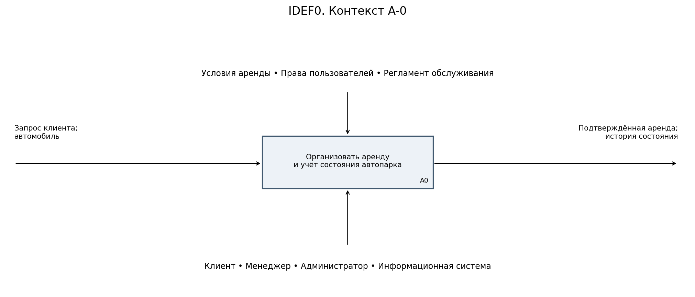
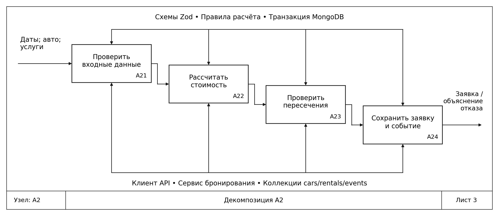
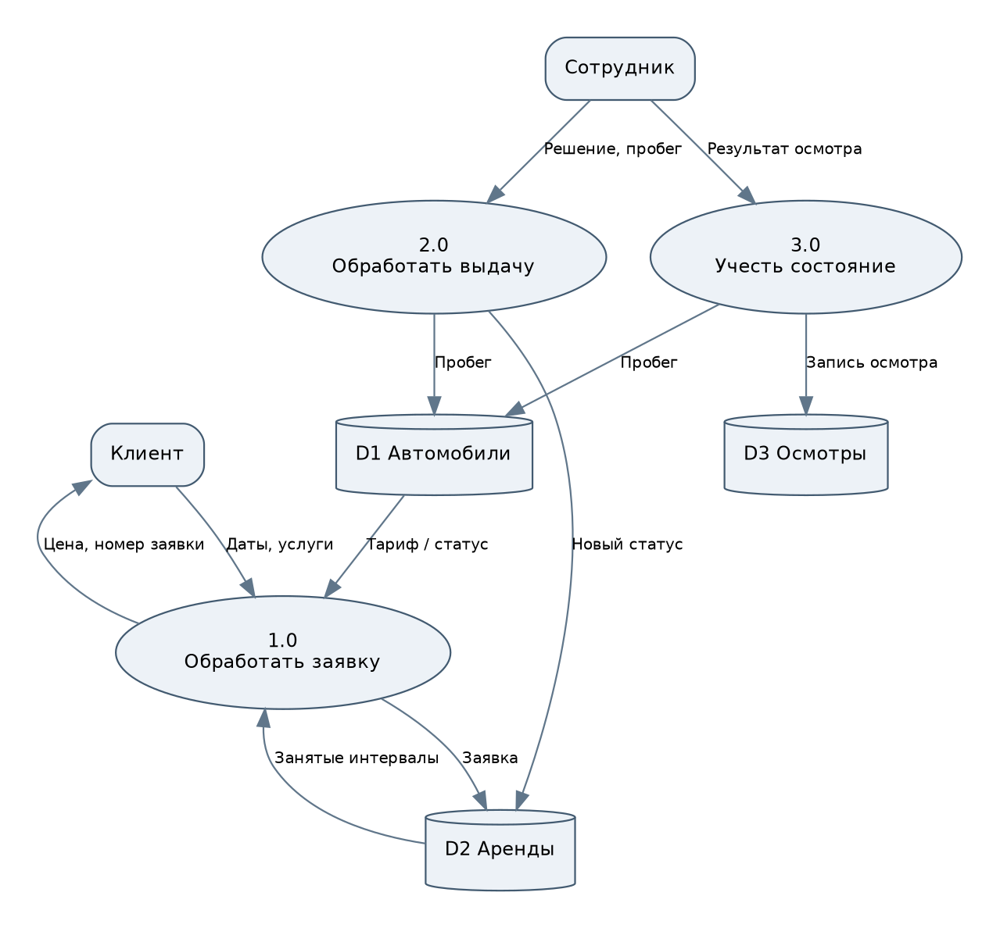
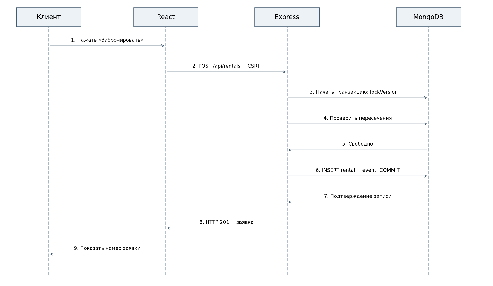
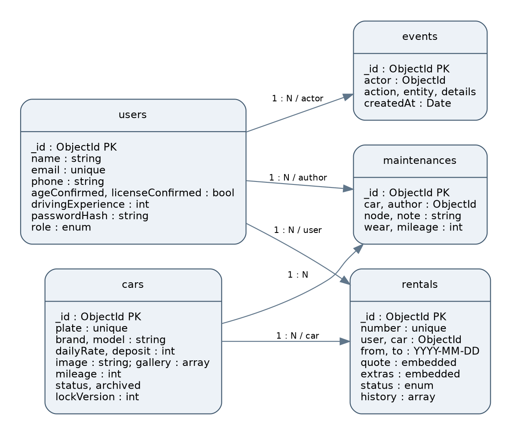
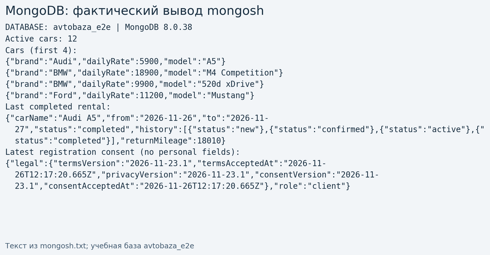
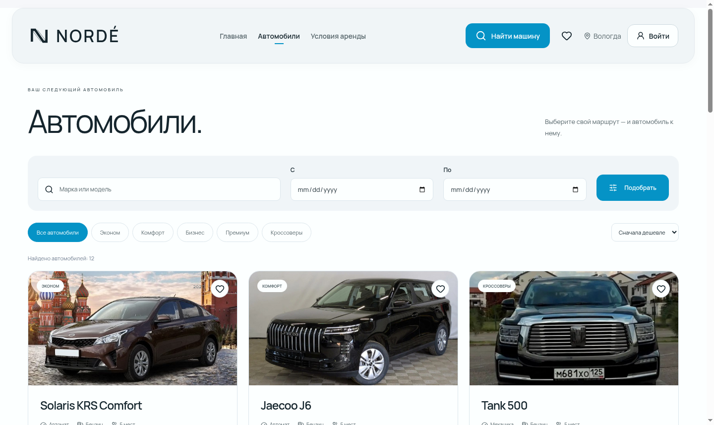
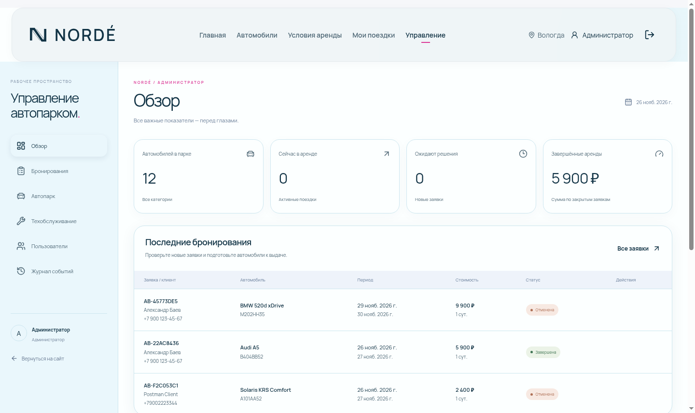

# ВВЕДЕНИЕ

Аренда автомобиля объединяет несколько взаимосвязанных процессов: публикацию сведений об автопарке, согласование срока использования, расчёт стоимости, передачу машины клиенту, приём после поездки и контроль технического состояния. Если заявки записываются в отдельные таблицы, а сведения о ремонте передаются устно, согласованность данных зависит от внимательности сотрудников. Возникает риск двойного бронирования, неверной цены и выдачи автомобиля, который должен находиться на обслуживании.

Актуальность проекта обусловлена необходимостью согласовать заявки, доступность машин и историю обслуживания в единой системе.

Объект исследования - процессы аренды автомобилей и учёта состояния автопарка. Предмет исследования - программные методы автоматизации этих процессов и способы проверки качества веб-приложения. Разрабатываемый продукт получил название «NORDÉ».

Цель курсового проекта - разработать и проверить информационную систему автоматизации аренды и учёта состояния автопарка с клиентским интерфейсом, рабочим пространством сотрудников и базой данных MongoDB.

Для достижения цели поставлены задачи: исследовать предметную область и аналоги; определить функциональные и нефункциональные требования; спроектировать процессы, архитектуру и хранение данных; реализовать регистрацию и разграничение прав; разработать каталог и оформление аренды; реализовать управление автомобилями и техническими осмотрами; проверить расчёты, целостность данных и пользовательские сценарии; выполнить нагрузочное исследование и подготовить документацию.

В работе применены функциональное моделирование IDEF0 (Integration Definition for Function Modeling), диаграммы потоков данных DFD (Data Flow Diagram), унифицированный язык моделирования UML (Unified Modeling Language), анализ границ ввода и автоматизированные проверки. Для хранения документов и выполнения транзакций используется MongoDB [13]. Сервер разработан на Node.js и Express, интерфейс - на React [12, 14, 15].

Практическая значимость - работающий учебный продукт с воспроизводимым запуском и проверяемыми правилами. В границы проекта не входят банковская оплата, юридически значимое подписание договора и автоматическая проверка водительских документов. Документы и расчёт при выдаче проверяет сотрудник.

# РАЗДЕЛ 1. АНАЛИЗ ТРЕБОВАНИЙ И ПРОЕКТИРОВАНИЕ


## 1.1. Описание предметной области и целевой аудитории

NORDÉ рассматривается как учебная служба проката автомобилей в Вологде. Демонстрационные адрес, телефон и сведения о владельце предоставлены для заполнения сайта и не подтверждают существование зарегистрированного предприятия. Требования получены из постановки учебной задачи и последовательных уточнений заказчика; интервью с реальной прокатной компанией и опрос клиентов не проводились. Автопарк и тарифы являются учебными данными.

Пользовательский сценарий начинается с выбора автомобиля. Посетитель просматривает характеристики, задаёт период и дополнительные услуги. После регистрации он отправляет заявку. Система фиксирует рассчитанную стоимость и резервирует выбранный интервал. Менеджер рассматривает заявку, подтверждает её, а затем оформляет фактическую выдачу. После возвращения вводится пробег, аренда завершается и её данные остаются в истории.

Клиенту важны предсказуемая стоимость, понятная форма бронирования и возможность проверить состояние своей заявки. Менеджеру важны отсутствие пересечений по времени, доступ к контактам клиента и ограничения, которые не позволяют случайно нарушить последовательность операций. Администратору нужны средства ведения каталога, тарифов и учётных записей. Все роли используют одну базу, но видят разные операции.

Заявка и фактическая аренда представлены одной сущностью Rental с единым номером. Новая заявка резервирует интервал до решения сотрудника, поэтому неактуальные заявки нужно своевременно отменять. Автоматическое истечение ожидания в текущей версии отсутствует.

## 1.2. Исследование бизнес-процессов

Функциональное моделирование выполнено в нотации IDEF0. Контекстная диаграмма показывает систему как одну функцию. Входами являются запрос клиента и сведения об автомобиле. Управляющими воздействиями служат условия аренды, права пользователей и регламент обслуживания. Механизмы выполнения - люди и программное обеспечение. Выходами становятся оформленные аренды и история состояния.


Соответствующий результат представлен на рисунке 1.



На следующем уровне выделены ведение каталога, оформление бронирования, выдача и приём, учёт технического состояния. Такое разделение позволяет связать функции с интерфейсом и серверными маршрутами. Например, процесс A2 соответствует форме бронирования и команде прикладного программного интерфейса API (Application Programming Interface) POST /api/rentals, а A4 - разделу технического обслуживания.


Соответствующий результат представлен на рисунке 2.


Третий уровень детализирует наиболее критичный процесс - оформление бронирования. Сначала проверяется структура запроса и допустимость дат. Затем рассчитывается цена. После этого проверяются исправность автомобиля и отсутствие пересекающихся заявок. Последний шаг атомарно сохраняет заявку и запись журнала. Ошибка на любом этапе приводит к объяснимому отказу, а не к частично созданной аренде.


Соответствующий результат представлен на рисунке 3.



Контекст A-0, декомпозиция A0 и декомпозиция A2 образуют три уровня детализации. На диаграммах управляющие воздействия расположены сверху, механизмы снизу, входы слева и выходы справа. Порядок запросов дополнительно раскрывается диаграммой последовательности.

DFD описывает движение данных между внешними участниками, процессами и хранилищами. Клиент передаёт даты и параметры заказа, а получает стоимость и номер заявки. Сотрудник передаёт решения о выдаче и возврате. Хранилища автомобилей, аренд и осмотров связаны через серверные процессы. Прямого доступа клиента к коллекциям MongoDB нет.


Соответствующий результат представлен на рисунке 4.



Диаграмма вариантов использования отражает роли. Менеджер может пользоваться клиентскими функциями, а администратор имеет функции менеджера и дополнительные операции с каталогом и пользователями. Наследование ролей в диаграмме выражает множество разрешённых действий, а не наследование JavaScript-классов.


Соответствующий результат представлен на рисунке 5.


Последовательность успешного бронирования проходит через браузер, React, Express и MongoDB. Права и защита от межсайтовой подделки запросов CSRF (Cross-Site Request Forgery) проверяются до изменения данных. Транзакция включает запись версии блокировки машины, проверку пересечений, создание аренды и события. Ответ 201 возвращается после фиксации. Если соединение оборвётся после фиксации, пользователь сможет найти созданную заявку в личном кабинете; отдельный ключ идемпотентности в текущей версии не реализован.


Соответствующий результат представлен на рисунке 6.



Моделирование показало, что основной риск связан с конкурирующими изменениями одного автомобиля. Поэтому блокировка не ограничивается кнопкой в браузере: бизнес-операции сериализуются на уровне документа автомобиля внутри транзакции MongoDB.

## 1.3. Сравнительный анализ систем аналогов

Сравнение проведено по открытым клиентским страницам Яндекс Проката, Turo и SIXT, доступным при исследовании интерфейсов [2, 22, 23]. Внутренние алгоритмы бронирования, панели сотрудников и фактическое покрытие тестами этих сервисов не исследовались. Поэтому таблица характеризует наблюдаемые решения интерфейса, а не качество закрытого программного кода.

| Критерий | Яндекс Прокат | Turo | SIXT | NORDÉ |
|---|---|---|---|---|
| Поиск по месту и датам | Есть | Есть | Есть | Вологда и даты |
| Карточки с ценами | Есть | Есть | Есть | Есть |
| Назначение продукта | Агрегатор | Площадка аренды | Сеть проката | Учебный прокат |
| Граница исследования | Открытые страницы | Открытые страницы | Доступная страница | Открытый код и тесты |
| Рабочие роли | Не исследованы | Не исследованы | Не исследованы | Три роли |
| Учёт состояния | Не исследован | Не исследован | Не исследован | Осмотры и пробег |

Сравнение подтверждает целесообразность простой формы подбора, карточек с полной стоимостью и доступного личного кабинета. Собственное отличие учебного решения состоит в проверяемом сквозном процессе аренды и технического учёта. Коммерческая полнота трёх аналогов не заявляется целью курсового проекта.

## 1.4. Требования к программному продукту

Функциональные требования FR (Functional Requirement) проверяются запросом к API или действием в браузере. CSV (Comma-Separated Values) обозначает текстовую выгрузку с разделителями. Идентификаторы связывают требования с проверками домена, API и интерфейса. Сервер должен обеспечивать выполнение правил независимо от того, вызвана команда из штатного интерфейса или напрямую.

| Код | Требование | Проверяемый результат |
|---|---|---|
| FR-01 | Регистрация и вход | Создаётся клиент; пароль хранится как хеш |
| FR-02 | Роли клиент/менеджер/администратор | Недопустимые команды дают 401 или 403 |
| FR-03 | Каталог, поиск, класс, сортировка, даты | Возвращается подходящее подмножество машин |
| FR-04 | Характеристики автомобиля | Показаны тариф, залог, описание и параметры |
| FR-05 | Расчёт стоимости | Цена вычисляется сервером с услугами и скидкой |
| FR-06 | Создание аренды | Запись сохраняется в MongoDB с номером |
| FR-07 | Отсутствие двойной брони | При гонке один ответ 201, второй 409 |
| FR-08 | История и отмена своих заявок | Чужие заявки недоступны клиенту |
| FR-09 | Подтверждение, выдача, возврат | Допускаются только разрешённые переходы |
| FR-10 | Управление автомобилями | Администратор добавляет, меняет и архивирует |
| FR-11 | Учёт технического состояния | Осмотр и пробег сохраняются с автором |
| FR-12 | Назначение ролей и аудит | Новая роль действует в существующей сессии |
| FR-13 | Выгрузка списка аренд | CSV доступен только сотруднику |
| FR-14 | Профиль клиента | Сохраняются имя, телефон и условия допуска к аренде |
| FR-15 | Возраст, права и стаж | Требуются 21 год, действующие права и стаж от года |
| FR-16 | Фотографии и галереи | У 12 стандартных машин есть фото; загрузка проверяется |
| FR-17 | Карусель наличия и избранное | Показ соответствует датам; избранное сохраняется в браузере |
| FR-18 | Обновление демо | Заявки и пользовательские фотографии сохраняются |

Перед бронированием пользователь подтверждает, что ему исполнился 21 год и у него есть действующие водительские права; стаж вводится в полных годах, минимум один год. Флажки являются декларацией клиента, а не автоматической проверкой документов. Сервер проверяет допуск повторно; старый профиль должен дополнить условия. Паспорт и права проверяет сотрудник при выдаче.

Срок аренды составляет от одних до тридцати суток. Период задаётся календарными датами в формате YYYY-MM-DD. День возврата не включается в длительность. Новая заявка не может начинаться в прошлом. Даты должны существовать: например, 30 февраля не принимается, даже если стандартный конструктор Date способен нормализовать такое значение.

Итоговая стоимость аренды определяется формулой (1).

FORMULA: C = B × n × k + (I + S) × n | 1

где C - стоимость аренды, руб.; B - суточный тариф, руб.; n - число оплачиваемых суток; k - коэффициент базовой скидки, равный 0,9 при сроке от семи суток и 1 в остальных случаях; I - суточная стоимость выбранной защиты, руб.; S - суточная стоимость выбранного кресла, руб.

Суммы дополнительных услуг включаются только при выборе соответствующей опции. При сроке от семи суток базовая сумма уменьшается на 10%. Защита стоит 600 рублей в сутки, кресло - 300 рублей в сутки. Залог показан отдельно и не прибавляется к цене аренды. Все суммы этой учебной версии выражаются целыми рублями.

Нефункциональные требования обозначены NFR (Non-Functional Requirement).

| Код | Нефункциональное требование | Критерий приёмки |
|---|---|---|
| NFR-01 | Постоянное хранение | Обновление страницы не теряет заказы; данные находятся в MongoDB |
| NFR-02 | Безопасность доступа | Проверяются роль, владелец, CSRF и длина входных полей |
| NFR-03 | Быстродействие каталога | p99 ответа API менее 2 секунд при 50 соединениях на учебном наборе |
| NFR-04 | Адаптивность | Нет горизонтальной прокрутки на ширине 390 px для основных клиентских страниц |
| NFR-05 | Повторяемость установки | Lockfile, Compose и seed позволяют повторить запуск |
| NFR-06 | Проверяемость | Автоматические тесты домена, API и ключевых сценариев интерфейса UI (User Interface) |

## 1.5. Инструментальные средства разработки и тестирования

Node.js предоставляет среду выполнения JavaScript на сервере [14]. Express используется для маршрутизации запросов по протоколу передачи гипертекста HTTP (Hypertext Transfer Protocol) и последовательного подключения middleware [15]. Mongoose описывает структуру документов, индексы и работу с транзакциями [3]. MongoDB выбрана в соответствии с заданием и хорошо подходит для документов с вложенным снимком цены и историей изменения статуса [13].

React отвечает за состояние форм и отображение данных [12]. Маска ввода телефона реализована библиотекой IMask [9]. Vite выполняет разработческую сборку и создание статических файлов [24]. React Router разделяет страницы без полной перезагрузки приложения. Отдельная библиотека глобального состояния не использовалась: для текущего объёма достаточно контекста сеанса и локального состояния компонентов.

Zod проверяет формы запросов на границе API [11]. bcryptjs хеширует пароли; длина ограничена 72 байтами кодировки Unicode UTF-8 (Unicode Transformation Format, 8-bit) с учётом особенностей алгоритма [4]. express-session и connect-mongo обеспечивают серверные сессии [5, 7]. Helmet задаёт защитные HTTP-заголовки [8]. Разграничение доступа проектировалось с учётом принципа проверки полномочий на каждом защищённом запросе [16].

Автоматизация выполнена на Python: pytest собирает сценарии, параметризует входные данные и формирует отчёты [18]. Selenium WebDriver управляет настоящим Chromium и проверяет видимые элементы страницы [21]. Postman описывает последовательности HTTP-запросов, а Newman запускает коллекцию из командной строки [17]. Нагрузку создают потоки ThreadPoolExecutor и HTTP-клиент Requests; фиксируются задержки, ошибки и объём ответа [19, 20].

Для повторяемого запуска базы применяется Docker Compose [6]. Оформление записки использует шрифт XO Thames из пакета МойОфис [1].

## 1.6. Проектирование архитектуры и хранения данных

В обмене используется формат JSON (JavaScript Object Notation). Приложение разделено на три слоя. Представление включает React-компоненты, маршруты, формы и стили. Прикладной слой включает Express API, правила расчёта, управление доступом и последовательность операций. Слой хранения включает Mongoose-модели, индексы и MongoDB. Браузер не подключается к MongoDB напрямую и не может самостоятельно назначить роль.

В режиме разработки Vite направляет запросы /api серверу Express. После сборки Express раздаёт статические файлы из dist и API с одного origin. Это упрощает работу cookie и исключает необходимость междоменных запросов CORS (Cross-Origin Resource Sharing). Файлы шрифтов и фотографий хранятся локально: просмотр интерфейса не зависит от внешнего сервиса изображений.

### 1.6.1. Концептуальная и инфологическая модели

Основными сущностями являются пользователь, автомобиль, аренда, осмотр и событие. Пользователь может иметь несколько аренд; автомобиль связан со многими арендами в разные периоды; осмотры относятся к конкретной машине и сотруднику. Внешние ссылки хранятся как ObjectId. Термин ER-модель (Entity-Relationship, «сущность - связь») используется для объяснения связей, хотя физическое хранение является документным.


Соответствующий результат представлен на рисунке 7.



| Коллекция | Ключевые поля | Назначение и ограничения |
|---|---|---|
| users | name, email, phone, passwordHash, role, legal | Уникальный email; роль только из разрешённого набора |
| cars | brand, model, plate, category, dailyRate, image, gallery, status | Уникальный номер; положительный тариф; неотрицательный пробег |
| rentals | number, user, car, from, to, quote, extras, status, history | Уникальный номер; ссылки; снимок цены и история |
| maintenances | car, author, node, wear, mileage, note | Износ 0-100; пробег не меньше текущего |
| events | actor, action, entity, details, createdAt | Хронология важных операций |
| sessions | идентификатор, содержимое, срок действия | Служебная коллекция connect-mongo с временем жизни TTL (Time to Live) |

Встроенный объект quote хранит длительность, тариф на момент оформления, базовую стоимость, услуги, общую сумму и залог. Это осознанное дублирование: актуальный тариф автомобиля может меняться, а историческая стоимость уже созданной заявки должна оставаться прежней. Поле carName аналогично сохраняет название на момент оформления.

### 1.6.2. Физическая модель, индексы и целостность

MongoDB не обеспечивает внешние ключи так же, как реляционная СУБД. Поэтому приложение проверяет существование ссылочных документов до записи. Пользователи в текущей версии физически не удаляются. Автомобили архивируются логически, что сохраняет ссылки в истории. Схемы Mongoose и Zod проверяют данные. SQL (Structured Query Language, язык запросов) не используется.

Уникальные индексы заданы для email, государственного номера и номера аренды. Составные индексы поддерживают фильтрацию машин, поиск пересечений по автомобилю и периоду, историю клиента, осмотры и хронологию событий.

Индекс не решает гонку между двумя запросами сам по себе. Проверка «найти пересечение, затем вставить» без согласования может пропустить два одновременных запроса. В проекте обе операции входят в транзакцию, а перед чтением пересечений выполняется запись lockVersion у автомобиля. Это заставляет конкурирующие команды конфликтовать на одном документе. Драйвер повторяет транзакцию после конфликта, и повторная проверка уже видит сохранённую заявку [13].

Два интервала пересекаются при выполнении условия (2).

FORMULA: f1 < t2 и t1 > f2 | 2

где f1 - начало существующей аренды; t2 - конец запрашиваемой аренды; t1 - конец существующей аренды; f2 - начало запрашиваемой аренды. Интервалы полуоткрытые: дата возврата не входит в срок, поэтому соседние периоды допустимы.

### 1.6.3. Контрольное заполнение базы

Для фиксации результата используется отдельная учебная база avtobaza_e2e с 12 активными автомобилями и тестовыми аккаунтами. Консоль mongosh показывает фактические документы после новых проверок регистрации, жизненного цикла аренды и архивирования. Вывод ограничен именами, ролями, версиями согласий и служебными полями аренды; хеши паролей и содержимое сессий не публикуются. Текст команд и их вывода сохранён в docs/reports/selenium-pytest-postman/mongosh.txt.


Соответствующий результат представлен на рисунке 8.



Отображение заполненных документов подтверждает, что приложение использует постоянное хранилище, а не только состояние React. В режиме с сервером закрытие браузера не удаляет машины и заявки. Отличающийся демонстрационный режим localStorage оставлен для предварительного просмотра интерфейса и не используется в серверных измерениях.

## 1.7. Проектирование пользовательского интерфейса

Интерфейс разделён на клиентские страницы и рабочую панель сотрудников. Клиенту доступны каталог, карточка авто, вход, регистрация и свои заявки. В рабочем пространстве менеджер оформляет выдачу, возврат и технический осмотр, а администратор дополнительно изменяет каталог и роли. Сервер остаётся источником правил; скрытие кнопки не рассматривается как средство защиты.

Интерфейс реализует структуру главной страницы: шапка, заголовок, изображение автомобиля с ценой, форма дат, классы и карточки. На мобильном экране блоки перестраиваются в одну колонку, а навигация открывается кнопкой меню.

## 1.8. Тестовая стратегия и тест-дизайн

Приоритет проверок определяется рисками. Стоимость проверяется модульно, сохранение и права - интеграционно, путь клиента и менеджера - в браузере. Нагрузка отдельно характеризует чтение каталога.

Модульные тесты не подключаются к MongoDB и проверяют чистые функции. Интеграционные тесты используют настоящий replica set и изолированную тестовую базу. Подмена MongoDB объектом в памяти не позволила бы проверить конфликты транзакций. Сквозные тесты E2E (End-to-End) запускают отдельный сервер на порту 3001 и отдельную базу avtobaza_e2e. Основная пользовательская база не должна использоваться как хранилище тестовых фикстур.

| Объект | Класс эквивалентности / граница | Ожидаемый результат |
|---|---|---|
| Длительность | 0 суток | Отказ |
| Длительность | 1-6 суток | Базовый тариф без скидки |
| Длительность | 7-30 суток | Скидка 10% на базовую часть |
| Длительность | 31 и более суток | Отказ |
| Дата | Прошедшая / несуществующая | Отказ |
| Телефон | +7 и 10 цифр; допустим ввод с 8 | Нормализация в +7XXXXXXXXXX |
| Телефон | Только скобки и пробелы | Отказ |
| Пароль | Менее 8 символов / более 72 байт | Отказ |
| Износ | 0-100% | Допустим |
| Износ | Меньше 0 или больше 100% | Отказ |
| Пробег | Ниже сохранённого значения | Отказ |
| Интервалы | Соприкасаются, но не пересекаются | Допустимы обе аренды |

Вывод по первому разделу: реализация выполнима выбранными средствами. Единая модель данных связывает роли, бронирование и осмотры; транзакции защищают от конкурирующих заявок. Границы продукта исключают онлайн-оплату, автоматическую проверку документов и юридически значимое подписание договора.

# РАЗДЕЛ 2. РАЗРАБОТКА ЧЕРЕЗ ТЕСТИРОВАНИЕ (TDD)


## 2.1. Применение цикла Red-Green-Refactor

Тестируемое ожидание формулируется до изменения правила, затем проверяется отказ, вносится исправление и повторяется регрессия. Данный цикл Red-Green-Refactor используется для работы с конкретными дефектами. При этом текущая миграция автоматизации не доказывает, что весь ранее созданный интерфейс разрабатывался через TDD: новые сценарии Selenium добавлены к существующему приложению.

В проекте ранее исправлялись два дефекта ввода: телефон из одних скобок и пароль длиннее 72 байт UTF-8. В новой редакции вместо переноса старого счётчика выполнены отдельные проверки действующих правил. Успех нового прогона подтверждает состояние текущего кода; исторические красные результаты не выдаются за падения pytest или Postman.

Во время подготовки новой автоматизации получены и устранены ошибки тестов: несовместимый Intl в песочнице Newman, неверный CSS-селектор кнопки профиля, попытка прочитать скрытое поле passwordHash без явной проекции. Отдельно сработал лимит входа после повторных прогонов на одном процессе. Исправлены сценарии и введён единый запуск с новым изолированным сервером; защита приложения не отключалась.

Контрольный расчёт для тарифа 4000 рублей, трёх суток, защиты и кресла составляет 4000 × 3 + 600 × 3 + 300 × 3 = 14700 рублей. Возвратный залог 20000 рублей хранится отдельно. Для семи суток с теми же услугами сумма равна 4000 × 7 × 0,9 + 900 × 7 = 31500 рублей. Эти значения прямо сопоставляются с результатом функции.

## 2.2. Модульные тесты и бизнес-правила

Файл tests/python/test_domain.py содержит 6 параметризованных случаев pytest: два расчёта цены, один отказ по дате, один запрет перехода статуса и две проверки телефона. Параметризация создаёт отдельный результат для каждого набора входных значений, поэтому их можно однозначно сопоставить с JUnit-протоколом.

Продукт написан на JavaScript, поэтому Python не воспроизводит его формулы. Каждый случай запускает Node.js и импортирует действительные calculateQuote, validateTransition и normalizeRussianPhone. Значение передаётся и возвращается как JSON. Такой адаптер добавляет стоимость запуска процесса, но исключает проверку отдельной копии бизнес-логики.

Для стоимости проверены сроки 3 и 7 суток: обычный тариф и недельная скидка. Залог сравнивается отдельно. Для календаря используется контрольная дата 1 декабря 2026 года; проверяется отклонение несуществующего 30 февраля. Тест не зависит от даты запуска.

Для статусов оставлен запрет выдачи автомобиля клиентом. Разрешённый цикл подтверждения, выдачи и возврата проверяется интеграционно, поэтому повторять его все варианты в модульном наборе не требуется. Телефон проверяется в допустимом российском формате и в недопустимом варианте из одних скобок. Сокращённый набор содержит наиболее показательные случаи; полный перебор границ и всех комбинаций не заявляется.

Отчёт pytest фиксирует количество случаев и время. Процент покрытия JavaScript этим прогоном не измеряется: Python coverage не отражал бы строки серверного приложения. Уровень уверенности оценивается по проверенным правилам и рискам, а не по перенесённому числу из старого отчёта покрытия.

## 2.3. Интеграционные тесты и согласованность данных

HTTP-проверки разделены между коллекцией Postman и пятью сценариями pytest с Requests. Оба набора обращаются к настоящему Express и одноузловому MongoDB replica set. Общий запуск scripts/run-quality.py пересоздаёт только avtobaza_e2e и останавливает тестовый сервер после окончания. Основная база приложения не очищается.

Коллекция docs/postman_collection.json содержит 15 запросов и 15 автоматических утверждений по HTTP-коду. Последовательность включает здоровье сервера, сессию и CSRF, каталог, ошибочные даты, расчёт, регистрацию без согласия и с согласиями, запрет доступа клиенту, бронирование и отмену, ошибочный пароль и вход администратора. Проверки фотографий, хранения и истории оставлены в pytest, чтобы сократить повторение.

Newman сохраняет cookie между запросами. После входа заменяется CSRF-токен; номер заявки, идентификатор автомобиля передаются через переменные коллекции. Поэтому проверяется связанный процесс, а не набор независимых успешных ответов. Ожидаемые отказы 400, 401, 403 и 409 считаются успехом сценария только при совпадении с заранее заданным кодом.

pytest дополнительно читает MongoDB через Mongoose: проверяет сохранение версии и времени согласия, наличие хеша вместо открытого пароля, историю аренды и результат конкурирующих транзакций. Проекция passwordHash включается только внутри локального теста; публичный ответ не должен содержать это поле.

Для гонки используются два независимых сеанса клиента и два параллельных запроса на один автомобиль и период. Получены ответы 201 и 409; запрос к базе подтверждает ровно одну новую аренду. После проверки она отменяется. Это функциональная проверка согласованности, а не замена длительному нагрузочному испытанию бронирования.

Другой сценарий проходит подтверждение, выдачу и возврат. Запрещены подтверждение клиентом, пропуск стадии и уменьшение пробега. После завершения сохранены новый пробег и четыре элемента истории. Проверка четырёх фотографий учитывает структуру данных: одна обложка image и три дополнительных пути gallery. Архивирование скрывает автомобиль, сохраняя осмотр.

## 2.4. Реализация графического интерфейса

Внешний вид раскрывают два репрезентативных экрана: каталог автомобилей и панель сотрудников. Снимки заново получены Selenium 26 ноября 2026 года на текущей сборке с локальным сервером. Они не являются подтверждением доступности опубликованного домена.

Интерфейс реализован на React с маршрутизацией по страницам. Общий контекст содержит текущего пользователя, управление окном входа и уведомления. API-клиент отправляет cookie автоматически и добавляет CSRF-токен. После авторизации токен обновляется. Пароль используется только при отправке формы и не сохраняется в localStorage.

Каталог отражает параметры в строке запроса. Это позволяет обновить страницу, сохранив фильтр, либо передать ссылку с выбранными датами. При изменении фильтра выполняется новый запрос к серверу; ответы устаревших запросов не подменяют более позднее состояние. Поиск экранируется перед построением регулярного выражения на сервере.


Соответствующий результат представлен на рисунке 9.



Рабочая панель сотрудников сочетает обзорные показатели и подробные таблицы. В обзоре считаются автомобили, активные аренды, новые заявки и сумма завершённых аренд. Последний показатель рассчитан по заказам и не подтверждает движение денег по банковскому счёту. Журнал показывает автора и время операции.


Соответствующий результат представлен на рисунке 10.



На форме регистрации обязательны имя, телефон, email, пароль, стаж, подтверждения возраста и прав, а также два отдельных согласия со ссылками на документы. Без обоих согласий кнопка регистрации недоступна; сервер повторяет проверку. Политика, соглашение и согласие опубликованы отдельными страницами. После регистрации из карточки выбранный автомобиль и даты остаются на странице; отправка заявки требует отдельного нажатия, чтобы пользователь подтвердил действие.

Фотографии стандартного автопарка хранятся локально. Новая фотография загружается администратором, проверяется по формату, размеру и разрешению, затем перекодируется в WebP. Сервер использует sharp и не принимает произвольный исполняемый путь в поле image. Для машины доступны четыре фотографии: обложка и три дополнительных снимка. В базе сохраняются пути к файлам; резервное копирование включает MongoDB и uploads/ [10].

В итоговом интерфейсе работают избранное, быстрый поиск из закреплённой шапки, галереи и контактный подвал. Контакты владельца и адрес обозначены демонстрационными. Смена темы исключена из принятого объёма, чтобы документация соответствовала окончательному светлому варианту.

# РАЗДЕЛ 3. АВТОМАТИЗАЦИЯ UI И НАГРУЗОЧНОЕ ТЕСТИРОВАНИЕ


## 3.1. Сквозное (E2E) тестирование интерфейса

Новый контрольный прогон выполнен 26 ноября 2026 года. pytest выполнил 15 функциональных случаев: 6 доменных, 5 интеграционных и 4 браузерных; все пройдены. Postman/Newman выполнил 15 запросов, все 15 утверждений успешны. Исходные тексты, XML, текстовые журналы и сводный JSON находятся в проекте. Число запросов, утверждений и тестовых функций учитывается раздельно.

Selenium WebDriver открывает Chromium в headless-режиме, а pytest управляет подготовкой и закрытием браузера [21, 18]. Явные ожидания WebDriverWait ожидают видимый элемент или изменение состояния. CSS-селекторы и aria-label связывают действия с реальным интерфейсом. Для ввода используются send_keys, для выделения текста - ActionChains. JavaScript не подменяет отправку пользовательских форм.

| E2E | Сценарий | Итог |
|---|---|---|
| E2E-01 | Главная, каталог, галерея, правовые страницы; ширины 320, 390, 1440 | Пройден |
| E2E-02 | Оба согласия, регистрация, профиль после перезагрузки | Пройден |
| E2E-03 | Панель, автопарк, осмотры; выделение текста за окно | Пройден |
| E2E-04 | Отказ при 5 фото, загрузка 4, сохранение и переключение галереи | Пройден |

В регистрации тест сначала проверяет недоступность кнопки без согласий, затем отмечает только соглашение и повторяет проверку. Отправка разрешается после отдельного согласия на обработку персональных данных. После регистрации имя меняется в профиле и сверяется после перезагрузки. Так проверяется сохранение, а не только отображение введённого значения.

Для регрессии модального окна Selenium начинает выделение внутри поля и отпускает кнопку мыши снаружи. Диалог должен остаться открытым и сохранить текст. Затем проверяется явное закрытие крестиком. Фотографии проверяются через реальный файловый input и серверную загрузку: пять отклоняются, четыре сохраняются и доступны в галерее.

Сняты новые экраны главной, каталога, карточки, регистрации, кабинета, админки, автопарка, осмотров, подвала и мобильной версии. Манифест фиксирует URL, время, размер окна и SHA-256 файла. Отсутствие горизонтальной прокрутки проверено автоматически; полноценная проверка доступности и реальных мобильных устройств в этот прогон не входит.

## 3.2. Нагрузочное тестирование

Исследован маршрут GET /api/cars на локальной полной версии с 12 активными автомобилями. Сервер Express, MongoDB и генератор работают на одной машине. Статический сайт Render не нагружался. Измерения характеризуют JSON каталога, без загрузки фотографий, выполнения React и одновременного массового создания аренд.

Нагрузка реализована в tests/python/test_load.py: pytest задаёт четыре сочетания параметров, ThreadPoolExecutor создаёт 10 или 50 потоков, каждый использует отдельный Requests Session [19, 20]. Барьер синхронизирует начало. Поток повторяет запрос после получения ответа; это замкнутая модель нагрузки, а не фиксированный входящий поток запросов.

Для каждой пары соединений и сжатия выполнено три повтора по 5 секунд, всего 12 прогонов. Между режимами код и состав каталога не меняются. Accept-Encoding: identity отключает сжатие для данного ответа, gzip разрешает его. Критерий принят заранее: ноль ошибок и p99 менее 2000 мс для каждого повтора.

| Режим / соединения | Запросов/с | Среднее, мс | p99, мс | Байт/ответ | Ошибки |
|---|---|---|---|---|---|
| identity / 10 | 610.00 | 16.37 | 55.45 | 6298 | 0 |
| identity / 50 | 593.46 | 83.31 | 193.11 | 6298 | 0 |
| gzip / 10 | 573.26 | 17.42 | 70.87 | 1329 | 0 |
| gzip / 50 | 562.11 | 88.38 | 204.94 | 1329 | 0 |

В таблице приведена медиана трёх измерений каждого показателя; столбец ошибок содержит сумму за три повтора. Задержка измеряется perf_counter от начала запроса до полного чтения тела и его проверки. p99 вычисляется по отсортированным задержкам успешных ответов. Ошибками считаются сетевые исключения, HTTP не 200 и неверное содержимое каталога. Полные результаты каждого повтора сохранены в четырёх load-*.json.

## 3.3. Анализ узких мест и оптимизация

При 50 соединениях медиана p99 составила 193.11 мс без сжатия и 204.94 мс с gzip. Медианы средних задержек равны 83.31 и 88.38 мс. Все повторы удовлетворили принятому критерию. Объём тела ответа уменьшился с 6298 до 1329 байт, на 78.9%. Измеренный эффект сжатия относится к трафику; разница задержек в коротком опыте не доказывает устойчивое ускорение.

Размер измеряется по сырым байтам тела до декодирования gzip и не включает HTTP-заголовки. Данные не следует сравнивать с прежними измерениями другого генератора как с ускорением новой версии. Сжатие снижает трафик, но требует процессорного времени; в loopback-среде канал почти не ограничивает передачу, поэтому уменьшение байтов не гарантирует ускорения.

Три коротких повтора позволяют заметить разброс, но не подтверждают предельную мощность сервиса. Не выполнены многочасовой прогон, проверка восстановления после отказа, нагрузка распределённым генератором и замер из регионов пользователей. При дальнейшем исследовании нужно разделить сервер и генератор, увеличить длительность, собрать CPU, память, пул MongoDB и реальные сетевые задержки.

## 3.4. Регистрация дефектов и регрессионное тестирование

Новый журнал отделяет ошибки сценария от ошибки продукта. Например, HTTP 429 после повторных входов показывает срабатывание защиты, а не неверный пароль. Для воспроизводимости каждый полный прогон начинает новый тестовый сервер; лимиты приложения остаются включёнными.

| ID | Наблюдение | Причина | Решение и регрессия |
|---|---|---|---|
| TEST-01 | Intl is not defined в Newman | API недоступен в песочнице | ISO-дата с UTC+3; 15 утверждений пройдены |
| TEST-02 | Не найдена кнопка профиля | Неверный CSS-селектор | Уточнён локатор; сохранение проверено после refresh |
| TEST-03 | HTTP 429 после повторов | Общий лимит входа старого процесса | Новый сервер на полный прогон; лимит сохранён |
| TEST-04 | Четыре пути gallery отклонены | Обложка учитывается отдельно | image + gallery из трёх; четыре фото проверены в UI |

История разработки хранится в Git; итоговый сокращённый прогон представлен в pytest.xml. Запуск после исправления причин выполнен полностью. Отчёт не называет эти отказы четырьмя найденными уязвимостями сайта и не заменяет исходные HTTP-коды желаемыми значениями.

Вывод по третьему разделу: текущие правила проверены pytest, работа интерфейса - Selenium, HTTP-последовательности - Postman/Newman. Выполнены новые измерения нагрузки и обновлены иллюстрации. Подтверждены заявленные сценарии; ограничения окружения и непроверенные виды испытаний указаны отдельно.

Руководство по запуску приведено в приложении 1, фрагмент алгоритма бронирования - в приложении 2.

# ЗАКЛЮЧЕНИЕ

В ходе курсового проекта разработана информационная система «NORDÉ» для автоматизации аренды и учёта состояния автопарка. Система включает клиентский сайт, рабочую панель менеджера и администратора, сервер Express и постоянную базу MongoDB. Реализован связанный процесс от просмотра автомобиля до завершения аренды и сохранения технической истории.

Задача реализации выполнена в виде работающего приложения. Клиент регистрируется, выбирает автомобиль, получает рассчитанную сервером цену, отправляет и отменяет заявку. Менеджер подтверждает, выдаёт и принимает автомобиль, фиксирует пробег и осмотры. Администратор управляет каталогом, тарифами и ролями. Права проверяются при каждом защищённом запросе.

Основной риск двойного бронирования решён через транзакции MongoDB и запись общего документа автомобиля до проверки пересечений. Интеграционный сценарий подтвердил, что при двух одновременных одинаковых запросах сохраняется одна аренда. Другие проверки подтвердили защиту чужих данных, последовательность статусов и сохранение истории при архивировании.

Новый прогон подтвердил 15 функциональных случаев pytest, включая четыре сценария Selenium. Коллекция Postman выполнена Newman: 15 запросов и 15 успешных утверждений. Проверены регистрация с двумя обязательными согласиями, сохранение четырёх фотографий, жизненный цикл аренды и конфликт двух одновременных заявок. Ошибки подготовки тестов задокументированы отдельно. Все скриншоты интерфейса получены заново.

Нагрузочное исследование каталога включало четыре режима и по три повтора каждого. Во всех двенадцати прогонах ошибок не зафиксировано. При 50 соединениях медиана p99 с gzip составила 204.94 мс; тело ответа уменьшилось на 78.9%. Эти результаты относятся к локальному чтению каталога, не характеризуют предельную мощность и не переносятся на опубликованную статическую версию.

Практический результат - приложение с инструкциями и проверками. Исходный код: https://github.com/alexander2007B/cursovaya. Демоверсия на Render: https://cursovaya-xvwl.onrender.com. Она хранит данные в браузере; серверная версия запускается отдельно с MongoDB. Дальнейшее развитие включает уведомления, восстановление доступа и оплату; эти функции пока не реализованы.

# СПИСОК ИСПОЛЬЗОВАННЫХ ИСТОЧНИКОВ

1. Новые облачные технологии. МойОфис: шрифты XO : [сайт]. - URL: https://myoffice.ru/products/fonts/ (дата обращения: 26.11.2026). - Текст : электронный.

2. Яндекс. Яндекс Прокат: аренда автомобилей : [сайт]. - URL: https://rentacar.yandex.ru/russia/moscow (дата обращения: 26.11.2026). - Текст : электронный.

3. Automattic and contributors. Mongoose 8: Schemas : [сайт]. - URL: https://mongoosejs.com/docs/guide.html (дата обращения: 26.11.2026). - Текст : электронный.

4. dcodeIO and contributors. bcrypt.js: Optimized bcrypt in JavaScript : [сайт]. - URL: https://github.com/dcodeIO/bcrypt.js (дата обращения: 26.11.2026). - Текст : электронный.

5. Desboeufs, J. and contributors. connect-mongo: MongoDB session store : [сайт]. - URL: https://github.com/jdesboeufs/connect-mongo (дата обращения: 26.11.2026). - Текст : электронный.

6. Docker Inc.. Docker Compose: How Compose works : [сайт]. - URL: https://docs.docker.com/compose/intro/compose-application-model/ (дата обращения: 26.11.2026). - Текст : электронный.

7. Express contributors. express-session: Session middleware : [сайт]. - URL: https://github.com/expressjs/session (дата обращения: 26.11.2026). - Текст : электронный.

8. Helmet contributors. Helmet: HTTP security headers : [сайт]. - URL: https://helmetjs.github.io/ (дата обращения: 26.11.2026). - Текст : электронный.

9. IMask contributors. IMask: JavaScript input mask : [сайт]. - URL: https://imask.js.org/guide.html (дата обращения: 26.11.2026). - Текст : электронный.

10. Lovell, L. and contributors. sharp: High performance Node.js image processing : [сайт]. - URL: https://sharp.pixelplumbing.com/ (дата обращения: 26.11.2026). - Текст : электронный.

11. McDonnell, C. and contributors. Zod 3: Schema validation : [сайт]. - URL: https://v3.zod.dev/ (дата обращения: 26.11.2026). - Текст : электронный.

12. Meta Platforms, Inc.. React 19: Reference : [сайт]. - URL: https://react.dev/reference/react (дата обращения: 26.11.2026). - Текст : электронный.

13. MongoDB, Inc.. MongoDB 8.0: Transactions : [сайт]. - URL: https://www.mongodb.com/docs/v8.0/core/transactions/ (дата обращения: 26.11.2026). - Текст : электронный.

14. Node.js contributors. Node.js 24: Documentation : [сайт]. - URL: https://nodejs.org/docs/latest-v24.x/api/ (дата обращения: 26.11.2026). - Текст : электронный.

15. OpenJS Foundation. Express 5: Web framework for Node.js : [сайт]. - URL: https://expressjs.com/en/5x/api.html (дата обращения: 26.11.2026). - Текст : электронный.

16. OWASP Foundation. Authorization Cheat Sheet : [сайт]. - URL: https://cheatsheetseries.owasp.org/cheatsheets/Authorization_Cheat_Sheet.html (дата обращения: 26.11.2026). - Текст : электронный.

17. Postman, Inc.. Newman: Command-line collection runner : [сайт]. - URL: https://learning.postman.com/docs/collections/using-newman-cli/command-line-integration-with-newman/ (дата обращения: 26.11.2026). - Текст : электронный.

18. pytest developers. pytest: How to parametrize fixtures and test functions : [сайт]. - URL: https://docs.pytest.org/en/stable/how-to/parametrize.html (дата обращения: 26.11.2026). - Текст : электронный.

19. Python Software Foundation. concurrent.futures: ThreadPoolExecutor : [сайт]. - URL: https://docs.python.org/3/library/concurrent.futures.html (дата обращения: 26.11.2026). - Текст : электронный.

20. Requests contributors. Requests: Advanced Usage : [сайт]. - URL: https://requests.readthedocs.io/en/latest/user/advanced/ (дата обращения: 26.11.2026). - Текст : электронный.

21. Selenium project. Selenium WebDriver : [сайт]. - URL: https://www.selenium.dev/documentation/webdriver/ (дата обращения: 26.11.2026). - Текст : электронный.

22. SIXT SE. SIXT: Car rental : [сайт]. - URL: https://www.sixt.com/ (дата обращения: 26.11.2026). - Текст : электронный.

23. Turo Inc.. Turo: Car rental marketplace : [сайт]. - URL: https://turo.com/ (дата обращения: 26.11.2026). - Текст : электронный.

24. Vite contributors. Vite: Getting Started : [сайт]. - URL: https://vite.dev/guide/ (дата обращения: 26.11.2026). - Текст : электронный.

# Приложение 1

APPENDIX_TITLE: Руководство по запуску и демонстрации

Для запуска требуются Node.js версии 22 или выше, Docker с Compose и свободные порты 3000 и 27017. Зависимости устанавливаются командой npm ci. Команда npm run setup:env создаёт .env со случайным секретом сессии не короче 32 символов. Рабочий файл не включается в репозиторий и архив поставки.

Последовательность запуска: npm run db:up, npm run seed, npm run build, npm start. Первая команда поднимает MongoDB с replica set и проверкой готовности. Seed создаёт учебные записи только вне production и при SEED_DEMO=true. Сборка формирует каталог dist. Сервер запускается на порту 3000. Для разработки используется npm run dev.

Демонстрационные аккаунты: admin@avtobaza.test, manager@avtobaza.test и client@avtobaza.test. Общий учебный пароль - Avtobaza2026!. Эти реквизиты намеренно открыты и предназначены только для локальной демонстрации. Для реального сервиса нужна отдельная база без таких аккаунтов.

Сценарий защиты: показать каталог и фильтры; открыть карточку и изменить услуги; войти клиентом и создать заявку; открыть отдельный сеанс менеджера; подтвердить и выдать автомобиль; оформить возврат с пробегом; показать клиенту завершённую заявку; открыть осмотры; показать API-тест гонки и итоговые отчёты. Для выдачи начало аренды должно приходиться на текущий день.

Для проверок установите Python 3.12, Chromium и зависимости requirements-test.txt в виртуальное окружение. Команда npm run test:all собирает приложение, пересоздаёт только avtobaza_e2e и последовательно запускает Newman, pytest и нагрузку. MongoDB должна быть запущена заранее; порт 3001 должен быть свободен. Отдельные команды и полный порядок приведены в руководстве администратора. Отчёт покрытия JavaScript новым набором не формируется.

Команда docker compose down сохраняет постоянный том. Удаление тома с параметром -v уничтожает данные, поэтому для обычной остановки этот параметр не используется. При невозможности транзакции нужно проверить, что MongoDB работает как replica set, а не standalone.

Для автономного просмотра интерфейса применяется npm run demo. В этом режиме заявки хранятся в localStorage браузера и не синхронизируются между устройствами. Стандартный менеджер - Дмитрий. Старое стандартное имя обновляется без удаления заявок; пользовательское имя сохраняется. В полной версии имя в MongoDB обновляется повторным запуском seed.

# Приложение 2

APPENDIX_TITLE: Фрагмент алгоритма бронирования

Условие пересечения двух полуоткрытых интервалов:

```javascript
existing.from < requested.to && existing.to > requested.from
```

Схема критической части операции бронирования:

```javascript
await mongoose.connection.transaction(async session => {
  const car = await Car.findOneAndUpdate(
    {_id: carId, archived: false},
    {$inc: {lockVersion: 1}}, {new: true, session});
  // Проверка состояния, даты и пересечения выполняется здесь.
  // Rental и Event сохраняются с той же session.
});
```

Фрагмент отражает порядок операции, а полный код с проверками находится в server/app.js. Доменный расчёт расположен в server/domain.js. Подменять полный алгоритм сокращённым фрагментом при запуске нельзя.
