# Актуальные экраны NORDÉ

Снимки получены Selenium 27.11.2026 на текущей сборке с локальным Flask и MongoDB. Это приложение с тем же интерфейсом; доступность опубликованного Render этими снимками не подтверждается. Манифест URL, времени и контрольных сумм находится в docs/reports/python-final/screenshots.json.

## 1. Главная страница

Крупная общая шапка и популярные предложения.

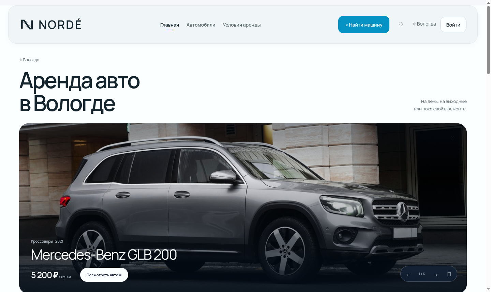

## 2. Каталог

Фильтры, классы и текущий автопарк.

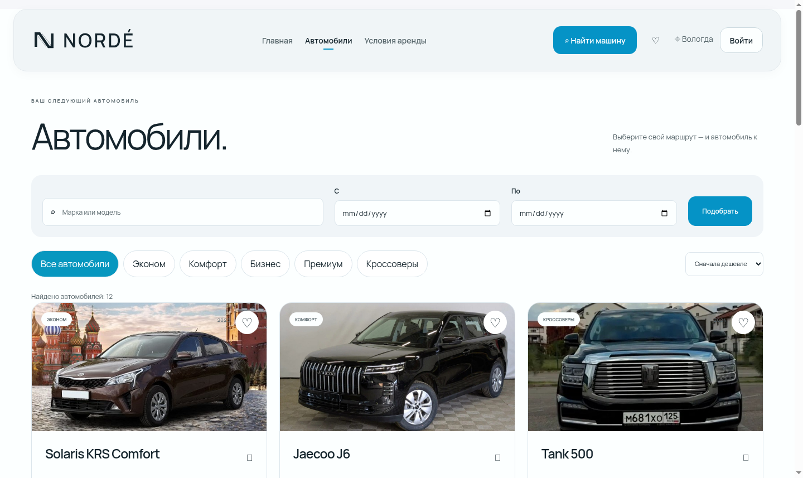

## 3. Карточка автомобиля

Характеристики и переключаемая галерея.

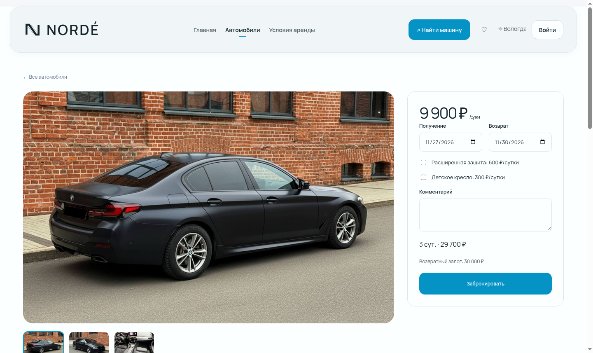

## 4. Регистрация

Данные клиента, возраст, права и стаж.

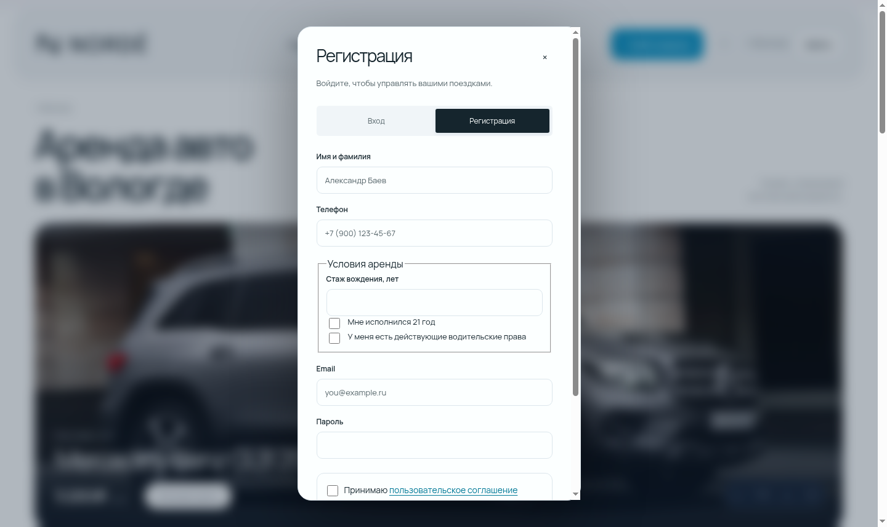

## 5. Подтверждения при регистрации

Соглашение и отдельное согласие на обработку данных.

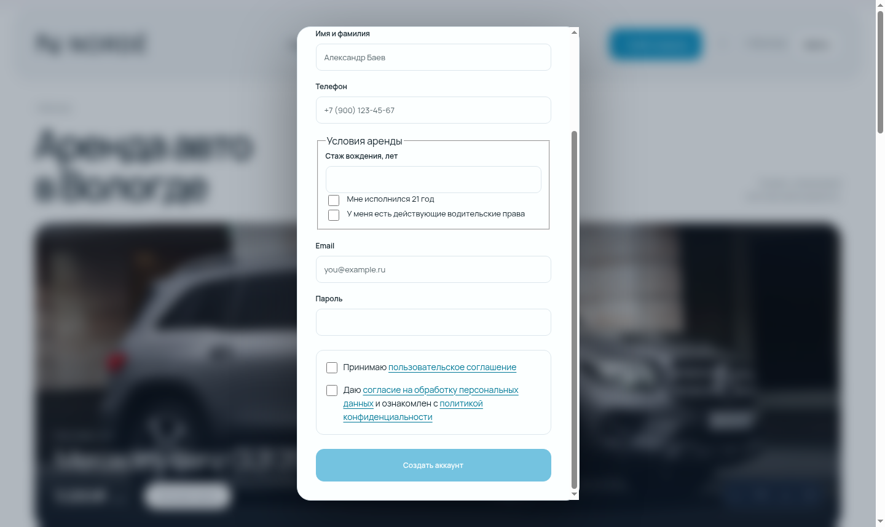

## 6. Личный кабинет

Поездки и редактирование профиля.

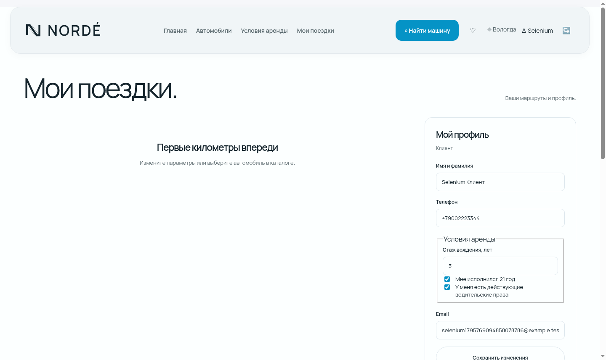

## 7. Обзор администратора

Общая шапка и показатели.

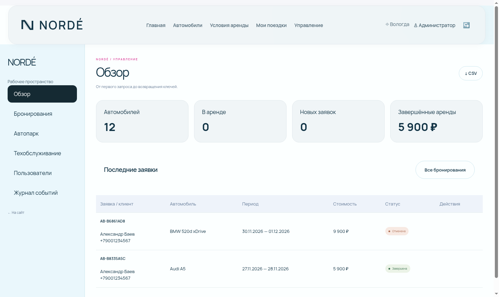

## 8. Управление автопарком

Тарифы, технический статус и добавление машин.

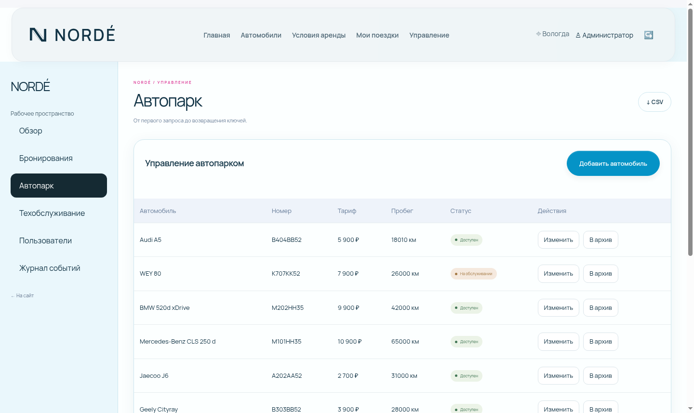

## 9. Четыре фотографии

Реальная загрузка обложки и трёх дополнительных снимков.

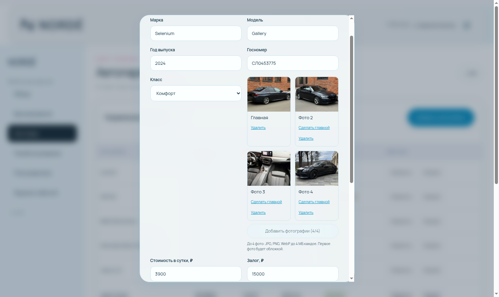

## 10. Технические осмотры

История узлов, пробега и износа.

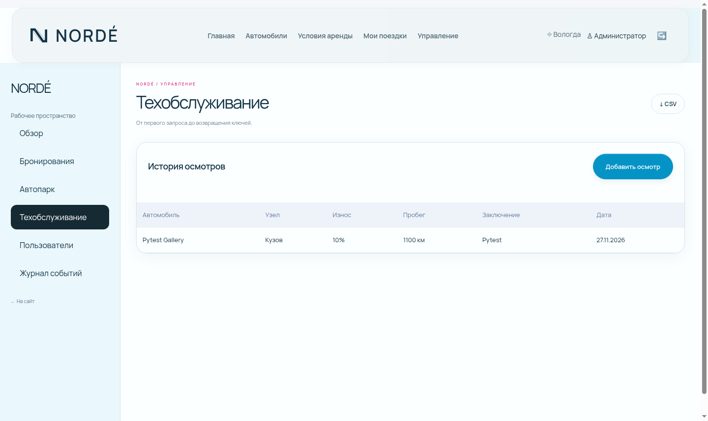

## 11. Подвал

Навигация, контакты и правовые ссылки.

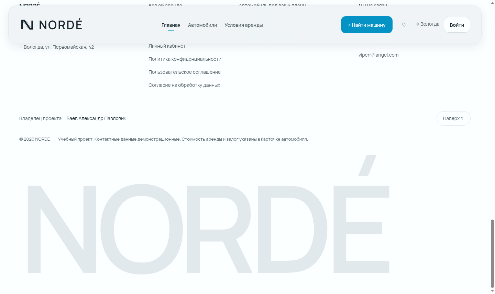

## 12. Мобильная версия

Снимок узкого окна Chromium; это не реальный телефон.

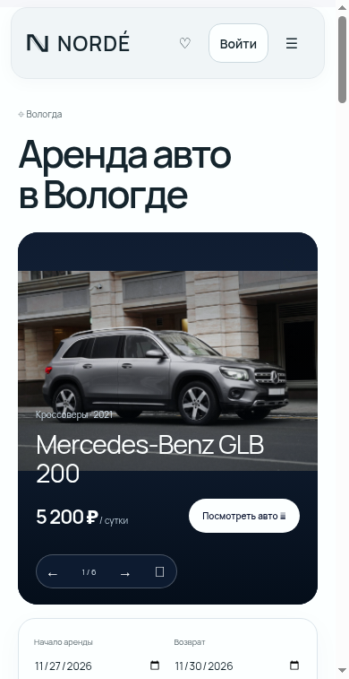

## 13. Политика

Текущая отдельная правовая страница.

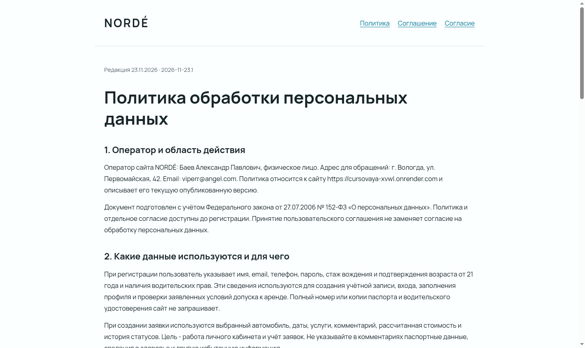

## 14. Соглашение

Текущая отдельная правовая страница.

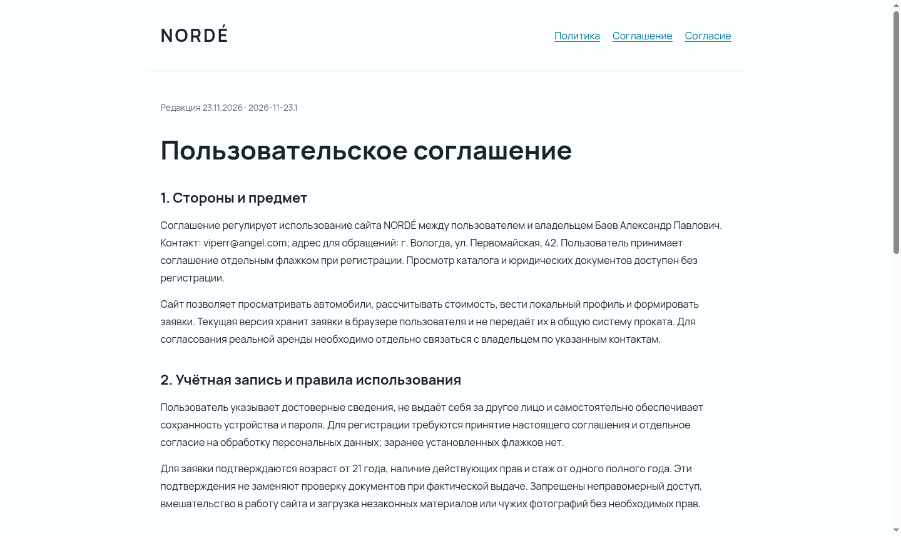

## 15. Согласие

Текущая отдельная правовая страница.

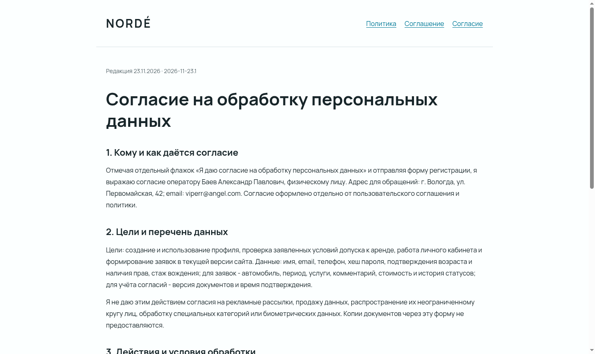

