# ВВЕДЕНИЕ

Аренда автомобиля объединяет несколько взаимосвязанных процессов: публикацию сведений об автопарке, согласование срока использования, расчёт стоимости, передачу машины клиенту, приём после поездки и контроль технического состояния. Даже небольшой пункт проката должен одновременно учитывать интересы клиентов и ограничения каждой единицы транспорта. Если заявки записываются в отдельные таблицы, а сведения о ремонте передаются устно, согласованность данных зависит от внимательности сотрудников. Возникает риск двойного бронирования, неверной цены и выдачи автомобиля, который должен находиться на обслуживании.

Актуальность работы связана с потребностью в едином информационном пространстве для клиента и сотрудников автобазы. Клиенту нужен понятный каталог и возможность самостоятельно проверить стоимость поездки. Менеджеру необходимы актуальные заявки, доступные переходы статусов и история операций. Администратор должен управлять каталогом и правами доступа. Для устойчивой работы недостаточно создать набор экранов: требуется серверная проверка правил и постоянное хранилище данных.

Объект исследования — процессы аренды автомобилей и учёта состояния автопарка. Предмет исследования — программные методы автоматизации этих процессов и способы проверки качества веб-приложения. Разрабатываемый продукт получил название «АВТОБАЗА».

Цель курсового проекта — разработать и проверить информационную систему автоматизации аренды и учёта состояния автопарка с клиентским интерфейсом, рабочим пространством сотрудников и базой данных MongoDB.

Для достижения цели поставлены задачи: исследовать предметную область и аналоги; определить функциональные и нефункциональные требования; спроектировать процессы, архитектуру и хранение данных; реализовать регистрацию и разграничение прав; разработать каталог и оформление аренды; реализовать управление автомобилями и техническими осмотрами; проверить расчёты, целостность данных и пользовательские сценарии; выполнить нагрузочное исследование и подготовить документацию.

В работе применены моделирование IDEF0, DFD и UML, анализ граничных значений, разделение входных данных на классы эквивалентности, автоматизированное модульное и интеграционное тестирование, браузерные проверки и измерение производительности. Для хранения документов и выполнения транзакций используется MongoDB [4]. Сервер разработан на Node.js и Express, интерфейс — на React [1; 2; 5].

Исходными материалами послужили описание темы «baev.docx», таблица распределения тем и методические рекомендации по МДК «Поддержка и тестирование программных модулей». Переданные HTML-примеры использованы как материал для анализа функций. Приложение реализовано заново с сервером и базой данных. Сведения об интервью с реальными клиентами не собирались; требования сформированы из задания и моделирования типового пункта аренды.

Практическая значимость проекта заключается в создании работающего учебного продукта, который можно запустить локально, исследовать, изменять и демонстрировать. Границы проекта исключают банковский эквайринг, юридически значимое подписание договора и автоматическую проверку водительских документов. Эти действия остаются за сотрудником при получении автомобиля. Такое ограничение позволяет сосредоточиться на согласованности данных, разделении ролей и проверяемой бизнес-логике.

# 1. АНАЛИЗ ТРЕБОВАНИЙ И ПРОЕКТИРОВАНИЕ

## 1.1. Предметная область и целевая аудитория

Предметная область — небольшой пункт аренды легковых автомобилей. Автопарк включает несколько классов: эконом, комфорт, бизнес и кроссоверы. Для каждого автомобиля учитываются марка, модель, год выпуска, государственный номер, тариф, залог, пробег, вместимость, коробка передач и вид топлива. Технический статус отражает возможность эксплуатации, а занятость определяется заявками на конкретные даты.

Пользовательский сценарий начинается с выбора автомобиля. Посетитель просматривает характеристики, задаёт период и дополнительные услуги. После регистрации он отправляет заявку. Система фиксирует рассчитанную стоимость и резервирует выбранный интервал. Менеджер рассматривает заявку, подтверждает её, а затем оформляет фактическую выдачу. После возвращения вводится пробег, аренда завершается и её данные остаются в истории.

Клиенту важны предсказуемая стоимость, понятная форма бронирования и возможность проверить состояние своей заявки. Менеджеру важны отсутствие пересечений по времени, доступ к контактам клиента и ограничения, которые не позволяют случайно нарушить последовательность операций. Администратору нужны средства ведения каталога, тарифов и учётных записей. Все роли используют одну базу, но видят разные операции.

Заявка и фактическая аренда рассматриваются как стадии одной сущности Rental. Это упрощает отслеживание истории: пользователь видит один номер от создания до завершения. Новая заявка уже блокирует интервал. Такое решение исключает ситуацию, когда несколько клиентов ожидают подтверждения одного автомобиля на одинаковые даты. Обратная сторона — менеджер должен своевременно отменять неактуальные заявки; автоматическое истечение ожидания в текущую версию не включено.

Технический осмотр — самостоятельная запись о состоянии выбранного узла. В ней сохраняются автор, дата, пробег, процент износа и заключение. Результат осмотра не переписывает прошлые записи. Система сохраняет историю изменений, чтобы сотрудник мог восстановить основания принятых решений.

| Термин | Значение в проекте |
|---|---|
| Тариф | Стоимость одних суток без дополнительных услуг |
| Залог | Возвратная сумма, учитываемая отдельно от аренды |
| Интервал аренды | Период [дата начала, дата возврата), не включающий день возврата |
| Технический статус | Доступен, на обслуживании или неисправен |
| Активная аренда | Автомобиль фактически выдан и ещё не принят |
| Архивирование | Скрытие машины из каталога при сохранении истории |

До автоматизации эти сведения могут существовать в бумажных журналах и электронных таблицах. Проблема заключается не в самом формате таблицы, а в отсутствии единой точки проверки правил. Разработанное приложение переносит правила в серверные команды: браузер показывает результат, но окончательное решение о записи принимает сервер.

## 1.2. Исследование бизнес-процессов

Функциональное моделирование выполнено в нотации IDEF0. Контекстная диаграмма показывает систему как одну функцию. Входами являются запрос клиента и сведения об автомобиле. Управляющими воздействиями служат условия аренды, права пользователей и регламент обслуживания. Механизмы выполнения — люди и программное обеспечение. Выходами становятся оформленные аренды и история состояния.

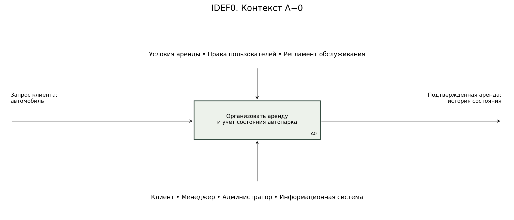

На следующем уровне выделены ведение каталога, оформление бронирования, выдача и приём, учёт технического состояния. Такое разделение позволяет связать функции с интерфейсом и серверными маршрутами. Например, процесс A2 соответствует форме бронирования и команде POST /api/rentals, а A4 — разделу технического обслуживания.

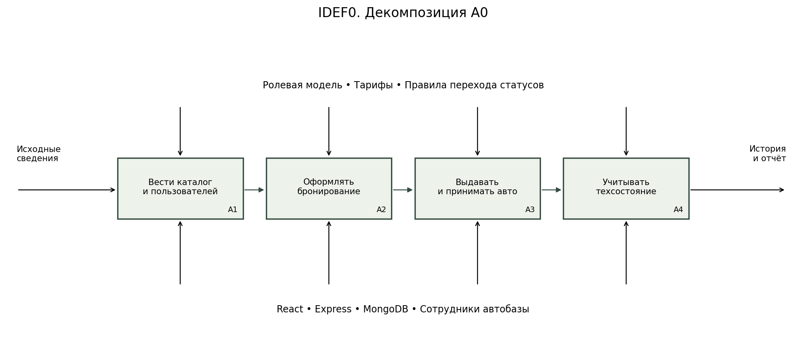

Третий уровень детализирует наиболее критичный процесс — оформление бронирования. Сначала проверяется структура запроса и допустимость дат. Затем рассчитывается цена. После этого проверяются исправность автомобиля и отсутствие пересекающихся заявок. Последний шаг атомарно сохраняет заявку и запись журнала. Ошибка на любом этапе приводит к объяснимому отказу, а не к частично созданной аренде.

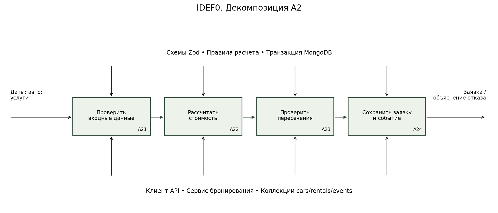

Контекст A−0, декомпозиция A0 и декомпозиция A2 образуют три уровня детализации. На диаграммах управляющие воздействия расположены сверху, механизмы снизу, входы слева и выходы справа. Последовательность операций внутри оформления дополнительно раскрывается диаграммами деятельности и последовательности.

DFD описывает движение данных между внешними участниками, процессами и хранилищами. Клиент передаёт даты и параметры заказа, а получает стоимость и номер заявки. Сотрудник передаёт решения о выдаче и возврате. Хранилища автомобилей, аренд и осмотров связаны через серверные процессы. Прямого доступа клиента к коллекциям MongoDB нет.

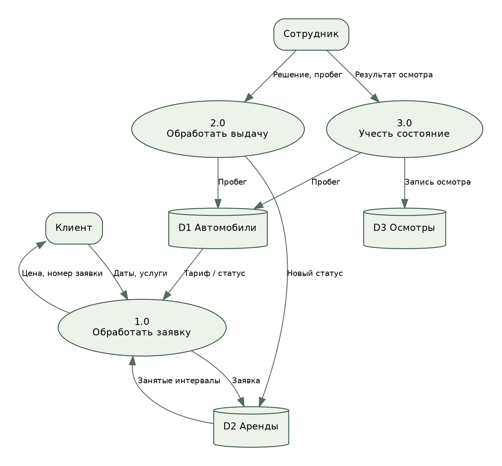

Диаграмма вариантов использования отражает роли. Менеджер может пользоваться клиентскими функциями, а администратор имеет функции менеджера и дополнительные операции с каталогом и пользователями. Наследование ролей в диаграмме выражает множество разрешённых действий, а не наследование JavaScript-классов.

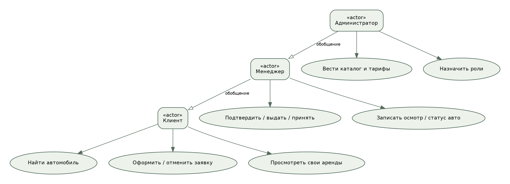

Диаграмма классов представляет логическую модель предметной области. В реализации сущности описаны Mongoose-схемами, а операции находятся в функциях домена и обработчиках API. Методы reserveInterval, changeStatus и archive на схеме обозначают ответственность сущностей, а не дословные имена методов моделей. Объект Quote входит в аренду как неизменяемый снимок расчёта.

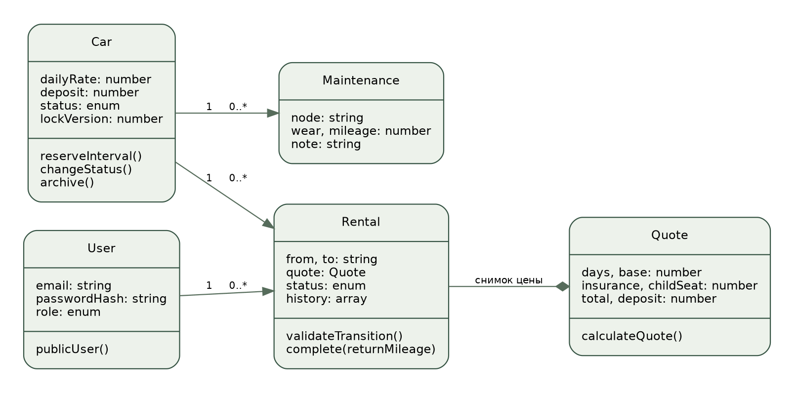

Последовательность успешного бронирования проходит через браузер, React, Express и MongoDB. Права и CSRF проверяются до изменения данных. Транзакция включает запись версии блокировки машины, проверку пересечений, создание аренды и события. Ответ 201 возвращается после фиксации. Если соединение оборвётся после фиксации, пользователь сможет найти созданную заявку в личном кабинете; отдельный ключ идемпотентности в текущей версии не реализован.

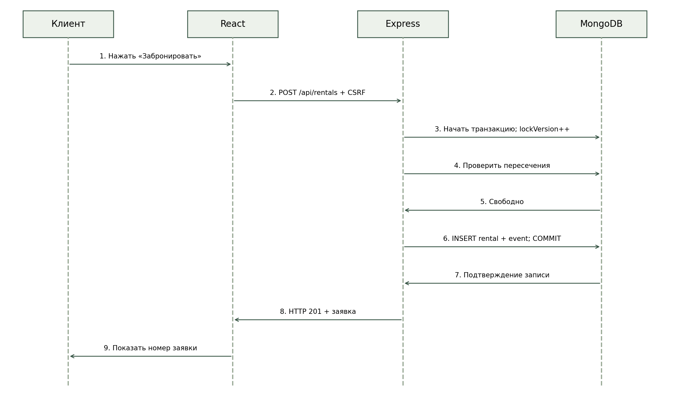

На диаграмме деятельности обозначены ветвления по корректности ввода и доступности. Отказ — полноценный результат операции, позволяющий изменить даты или выбрать другую машину. Сервер возвращает коды ошибок, которые интерфейс переводит в понятные сообщения.

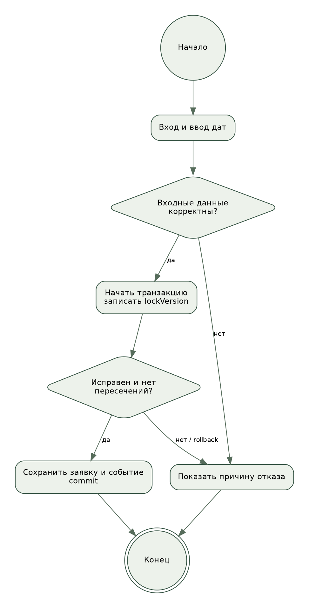

Моделирование показало, что основной риск связан с конкурирующими изменениями одного автомобиля. Поэтому блокировка не ограничивается кнопкой в браузере: бизнес-операции сериализуются на уровне документа автомобиля внутри транзакции MongoDB.

## 1.3. Сравнительный анализ аналогов

Для сравнения выбраны три открытых веб-проекта: BookCars, Rent a Ride и Car Rental Website Project. Оценивались опубликованные README, доступные на дату подготовки работы [16–18]. Приложения-аналоги не разворачивались и не подвергались собственному аудиту. Поэтому отметка «заявлено» означает наличие описания в источнике, а отсутствие сведений не приравнивается к отсутствию функции.

BookCars позиционируется как многоплатформенная система с административной панелью, адаптивным веб-интерфейсом и мобильным приложением. В README описаны управление поставщиками, гибкие тарифы, разные валюты и платёжные шлюзы. Продукт значительно шире учебной системы. Для проекта полезны разделение клиентской и административной частей и явное управление ограничениями бронирования [16].

Rent a Ride реализует роли пользователя, администратора и поставщика. В опубликованном описании указаны React, Express, MongoDB, управление заказами, уведомления и внешние интеграции. Наличие отдельной роли поставщика отвечает задачам агрегатора. Для одной автобазы вместо неё целесообразна роль менеджера, который отвечает за выдачу и техническое состояние собственного парка [17].

Car Rental Website Project — учебный проект на PHP и MySQL с XAMPP. Его README описывает каталог, резервирование, возврат и административное подтверждение. Это близкий по масштабу пример, позволяющий сравнить привычную реляционную реализацию с выбранным документным хранилищем. Специализированный учёт износа узлов в прочитанном описании не заявлен [18].

| Критерий | BookCars | Rent a Ride | Car Rental Website | АВТОБАЗА |
|---|---|---|---|---|
| Каталог и бронирование | Заявлены | Заявлены | Заявлены | Реализованы и проверены |
| Административная часть | Заявлена | Заявлена | Заявлена | Реализована и проверена |
| Отдельный менеджер автобазы | Не установлено | Роль поставщика | Не установлено | Реализован |
| Учёт износа узлов | Не установлено | Не установлено | Не заявлен в README | Осмотры с историей |
| Хранилище | Не оценивалось в сравнении | MongoDB | MySQL | MongoDB |
| Онлайн-платежи | Заявлены Stripe/PayPal | Заявлен Razorpay | Описана пользовательская история | Не входят в объём |
| Собственная проверка защиты от гонки | Не проводилась | Не проводилась | Не проводилась | Выполнена API-тестом |

Цель разработки не состоит в замене зрелой коммерческой платформы. Преимущество учебного решения — соответствие узкой теме, контролируемый объём и прозрачная связь между требованиями, реализацией и тестами. Из аналогов приняты разделение интерфейсов и целостный жизненный цикл заявки. Избыточные для курсовой интеграции сознательно не включены.

## 1.4. Требования к программному продукту

Функциональные требования сформулированы так, чтобы результат можно было проверить запросом к API или действием в браузере. Каждый идентификатор используется в матрице покрытия. Сервер должен обеспечивать выполнение правил независимо от того, вызвана команда из штатного интерфейса или напрямую.

| Код | Требование | Проверяемый результат |
|---|---|---|
| FR-01 | Регистрация и вход | Создаётся клиент; пароль хранится как хеш |
| FR-02 | Роли клиент/менеджер/администратор | Недопустимые команды дают 401 или 403 |
| FR-03 | Каталог, поиск, класс, сортировка, даты | Возвращается подходящее подмножество машин |
| FR-04 | Характеристики автомобиля | Показаны тариф, залог, описание и параметры |
| FR-05 | Расчёт стоимости | Цена вычисляется сервером с услугами и скидкой |
| FR-06 | Создание аренды | Запись сохраняется в MongoDB с номером |
| FR-07 | Отсутствие двойной брони | При гонке один ответ 201, второй 409 |
| FR-08 | История и отмена своих заявок | Чужие заявки недоступны клиенту |
| FR-09 | Подтверждение, выдача, возврат | Допускаются только разрешённые переходы |
| FR-10 | Управление автомобилями | Администратор добавляет, меняет и архивирует |
| FR-11 | Учёт технического состояния | Осмотр и пробег сохраняются с автором |
| FR-12 | Назначение ролей и аудит | Новая роль действует в существующей сессии |
| FR-13 | Выгрузка списка аренд | CSV доступен только сотруднику |
| FR-14 | Профиль клиента | Разрешено изменение имени и телефона |

Срок аренды составляет от одних до тридцати суток. Период задаётся календарными датами в формате YYYY-MM-DD. День возврата не включается в длительность. Новая заявка не может начинаться в прошлом. Даты должны существовать: например, 30 февраля не принимается, даже если стандартный конструктор Date способен нормализовать такое значение.

Цена определяется по формуле: стоимость = базовая аренда с возможной скидкой + расширенная защита + детское кресло. При сроке от семи суток базовая сумма уменьшается на 10%. Защита стоит 600 рублей в сутки, кресло — 300 рублей в сутки. Залог показан отдельно и не прибавляется к цене аренды. Все суммы этой учебной версии выражаются целыми рублями.

Новая и подтверждённая заявки могут быть отменены владельцем или сотрудником. Выданный автомобиль принимает только сотрудник, который вводит пробег. Завершённая и отменённая заявки не возвращаются в активное состояние. Это ограничивает неоднозначные повторные операции и сохраняет последовательность истории.

| Код | Нефункциональное требование | Критерий приёмки |
|---|---|---|
| NFR-01 | Постоянное хранение | Обновление страницы не теряет заказы; данные находятся в MongoDB |
| NFR-02 | Безопасность доступа | Проверяются роль, владелец, CSRF и длина входных полей |
| NFR-03 | Быстродействие каталога | p99 ответа API менее 2 секунд при 50 соединениях на учебном наборе |
| NFR-04 | Адаптивность | Нет горизонтальной прокрутки на ширине 390 px для основных клиентских страниц |
| NFR-05 | Повторяемость установки | Lockfile, Compose и seed позволяют повторить запуск |
| NFR-06 | Проверяемость | Автоматические тесты домена, API и ключевых UI-сценариев |

Критерии ограничены описанной средой и набором данных. Успешная проверка NFR-03 не означает, что все маршруты выдержат такую же нагрузку или что сайт готов к публичному запуску. Тест регистрации с bcrypt существенно отличается от чтения каталога. Многопользовательский учебный сценарий, а не промышленная эксплуатация, является границей текущего проекта.

## 1.5. Средства разработки и тестирования

JavaScript выбран единым языком интерфейса и сервера. Это уменьшает количество разных синтаксисов, которые необходимо поддерживать в курсовой, и позволяет повторно использовать принципы проверки данных. При этом клиентский код не считается доверенным: общность языка не отменяет обязательную серверную валидацию.

Node.js предоставляет среду выполнения сервера и встроенный тестовый модуль node:test [1]. Express используется для маршрутизации HTTP-запросов и последовательного подключения middleware [2]. Mongoose описывает структуру документов, индексы и работу с транзакциями [3]. MongoDB выбрана в соответствии с заданием и хорошо подходит для документов с вложенным снимком цены и историей изменения статуса [4].

React отвечает за состояние форм и отображение данных [5]. Vite выполняет разработческую сборку и создание статических файлов [6]. React Router разделяет страницы без полной перезагрузки приложения. Отдельная библиотека глобального состояния не использовалась: для текущего объёма достаточно контекста сеанса и локального состояния компонентов.

Zod проверяет формы запросов на границе API [8]. bcryptjs хеширует пароли; длина ограничена 72 байтами UTF-8 с учётом особенностей алгоритма [9]. express-session и connect-mongo обеспечивают серверные сессии [10; 11]. Helmet задаёт защитные HTTP-заголовки [12]. Разграничение доступа проектировалось с учётом принципа проверки полномочий на каждом защищённом запросе [14].

Интеграционные тесты используют Supertest и отдельную настоящую MongoDB. Playwright запускает Chromium и проверяет взаимодействие через видимые элементы страницы [7]. Для нагрузочного эксперимента выбран Autocannon — инструмент измерения HTTP-производительности в экосистеме Node.js [13]. Он заменяет перечисленные в методичке варианты k6/JMeter по назначению, но не имитирует полноценное поведение браузера.

Docker Compose описывает локальную MongoDB и постоянный том [15]. Git используется как система контроля версий. Исходный репозиторий — alexander2007B/cursovaya. Внешняя публикация и отправка коммитов не выполнялись в рамках проверки; рабочие файлы подготовлены локально. Для редактирования подойдёт Visual Studio Code; факт использования конкретной версии этой IDE не заявляется.

Точные версии установленных зависимостей закреплены в package-lock.json и перечислены в приложении с результатами окружения. При проверке использовался Node.js 24.22.1. Такой подход точнее указания только названия технологии: результаты относятся к реально установленному набору, а не к абстрактной версии стека.

## 1.6. Архитектура и хранение данных

Приложение разделено на три слоя. Представление включает React-компоненты, маршруты, формы и стили. Прикладной слой включает Express API, правила расчёта, управление доступом и последовательность операций. Слой хранения включает Mongoose-модели, индексы и MongoDB. Браузер не подключается к MongoDB напрямую и не может самостоятельно назначить роль.

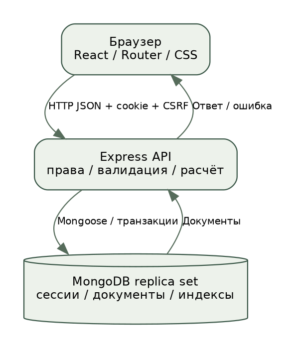

В режиме разработки Vite направляет запросы /api серверу Express. После сборки Express раздаёт статические файлы из dist и API с одного origin. Это упрощает работу cookie и исключает необходимость открытого CORS. Файлы шрифтов и иллюстраций хранятся локально: просмотр интерфейса не зависит от внешнего сервиса изображений.

Структура каталогов отражает ответственность частей: client содержит интерфейс, server — сервер и модели, tests — проверки, scripts — вспомогательные команды, docs — схемы, отчёты и пояснительную записку. Файл .env хранит настройки экземпляра и исключён из Git. Файл .env.example содержит только образцы и не является рабочим секретом.

### 1.6.1. Концептуальная и инфологическая модели

Основными сущностями являются пользователь, автомобиль, аренда, осмотр и событие. Пользователь может иметь несколько аренд; автомобиль связан со многими арендами в разные периоды; осмотры относятся к конкретной машине и сотруднику. Внешние ссылки хранятся как ObjectId. Термин ER-модель используется для объяснения связей, хотя физическое хранение является документным.

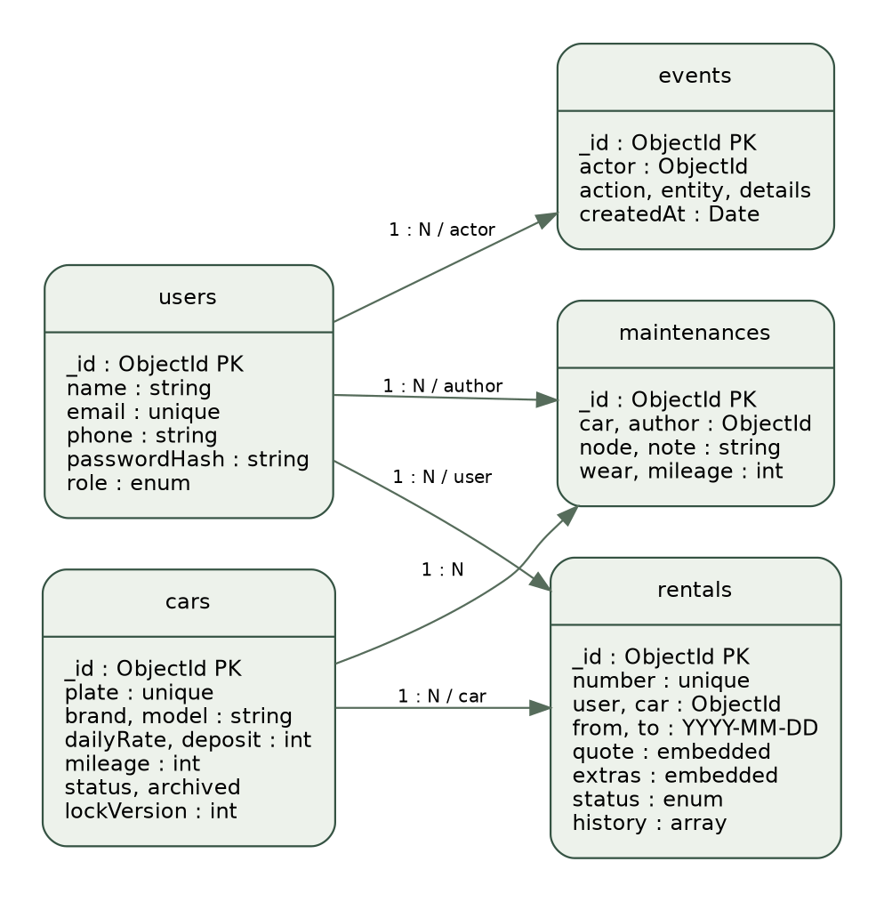

| Коллекция | Ключевые поля | Назначение и ограничения |
|---|---|---|
| users | name, email, phone, passwordHash, role | Уникальный email; роль только из разрешённого набора |
| cars | brand, model, plate, category, dailyRate, deposit, mileage, status | Уникальный номер; положительный тариф; неотрицательный пробег |
| rentals | number, user, car, from, to, quote, extras, status, history | Уникальный номер; ссылки; снимок цены и история |
| maintenances | car, author, node, wear, mileage, note | Износ 0–100; пробег не меньше текущего |
| events | actor, action, entity, details, createdAt | Хронология важных операций |
| sessions | идентификатор, содержимое, срок действия | Служебная коллекция connect-mongo с TTL |

Встроенный объект quote хранит длительность, тариф на момент оформления, базовую стоимость, услуги, общую сумму и залог. Это осознанное дублирование: актуальный тариф автомобиля может меняться, а историческая стоимость уже созданной заявки должна оставаться прежней. Поле carName аналогично сохраняет название на момент оформления.

Массив history принадлежит конкретной аренде и имеет небольшой ограниченный жизненным циклом размер. В него удобно включить статус, время и автора перехода. Технические осмотры вынесены в отдельную коллекцию, поскольку их количество растёт независимо от количества аренд и они нужны для отдельного журнала.

### 1.6.2. Физическая модель, индексы и целостность

MongoDB не обеспечивает внешние ключи так же, как реляционная СУБД. Поэтому приложение проверяет существование ссылочных документов до записи. Пользователи в текущей версии физически не удаляются. Автомобили архивируются логически, что сохраняет ссылки в истории. Структура и диапазоны проверяются схемами Mongoose и Zod; серверные SQL-ограничения в проекте не используются.

Уникальные индексы создаются для email, государственного номера и номера аренды. Составной индекс cars связывает archived, category и dailyRate. Индекс rentals по car, status, from и to поддерживает поиск пересечений. Отдельный индекс user и createdAt ускоряет получение истории клиента. Для осмотров используется car и createdAt, а для событий — createdAt.

Индекс не решает гонку между двумя запросами сам по себе. Проверка «найти пересечение, затем вставить» без согласования может пропустить два одновременных запроса. В проекте обе операции входят в транзакцию, а перед чтением пересечений выполняется запись lockVersion у автомобиля. Это заставляет конкурирующие команды конфликтовать на одном документе. Драйвер повторяет транзакцию после конфликта, и повторная проверка уже видит сохранённую заявку [4].

Все команды, способные изменить доступность машины, используют тот же порядок: сначала записывается документ автомобиля, затем проверяются и изменяются зависимые аренды. Иначе транзакция бронирования не была бы согласована с отправкой на обслуживание или архивированием. Журнал события для аренды записывается в той же транзакции, чтобы не получить заявку без аудита либо событие без заявки.

Технический статус хранит available, maintenance и broken. Значение «В аренде» вычисляется по активной записи Rental. Такое представление устраняет необходимость вручную синхронизировать одинаковую информацию в двух документах. При выдаче дополнительно проверяется отсутствие любой другой активной аренды, включая просроченную.

### 1.6.3. Операции с данными и аналогия DDL/DML/DQL/DCL

Методические рекомендации предлагают рассмотреть DDL, DML, DQL и DCL на примере SQL. Поскольку задание пользователя предусматривает MongoDB, ниже приведены функциональные аналоги команд mongosh. Они показывают соответствующие классы операций и не выдают MongoDB за SQL-систему. Основное приложение создаёт модели и индексы через Mongoose.

DDL-аналог задаёт коллекцию и уникальный индекс. В рабочей установке это выполняют модели, а не ручной повторный запуск команды.

```javascript
// Пример структуры и индекса, не команда миграции действующей базы.
db.createCollection('cars');
db.cars.createIndex({plate: 1}, {unique: true});
```

DML-аналог изменяет документ. В прикладной системе изменение тарифа проходит через API с проверкой роли и записью события, поэтому прямой запрос ниже предназначен только для объяснения синтаксиса.

```javascript
db.cars.updateOne(
  {plate: 'А101АА52'},
  {$set: {dailyRate: 2600}}
);
```

DQL-аналог получает доступные по техническому статусу машины. Сам по себе запрос не проверяет даты: для этого прикладной алгоритм использует коллекцию аренд.

```javascript
db.cars.find({archived: false, status: 'available'})
  .sort({dailyRate: 1});
```

DCL-аналог описывает разграничение прав на уровне СУБД. В локальном Compose доступ ограничен loopback-интерфейсом, а аутентификация MongoDB для учебного запуска не включена. Пример создания роли предназначен для отдельного защищённого развёртывания и не выполнялся в текущей базе.

```javascript
// Иллюстративный пример для развёртывания с включённой авторизацией.
db.createRole({role: 'fleetReader',
  privileges: [{resource: {db: 'avtobaza', collection: 'cars'},
                actions: ['find']}], roles: []});
```

Триггеры и представления MongoDB не используются. Правила записи сосредоточены в API и транзакциях. Это снижает число мест, где меняется бизнес-логика, и делает её доступной для интеграционных проверок.

## 1.7. Проектирование интерфейса

Клиентский интерфейс построен вокруг выбора автомобиля и оформления заявки. Главная страница объясняет назначение сервиса, показывает подбор по датам и несколько автомобилей. Каталог содержит поиск, фильтры и сортировку. Карточка объединяет характеристики, занятые периоды и калькулятор. Личный кабинет показывает историю и доступные действия по каждой заявке.

Визуальная система использует светлый фон, тёмно-зелёные акценты, единые отступы и локальный шрифт Manrope. Цвета статусов сопровождаются текстом, поэтому значение не передаётся только цветом. Иллюстрации обозначают класс автомобиля; они не выдаются за фотографии конкретных машин. Интерфейс адаптируется к узкому экрану: сетка карточек становится одноколоночной, навигация сворачивается в меню.

Административная часть отделена от рекламно-информационной структуры главной страницы. Сотрудник видит боковую навигацию, показатели, таблицы заявок, автопарк, осмотры и журнал. Администратору дополнительно доступен раздел пользователей. Окончательное решение о доступе всё равно принимает API: скрытая кнопка не является механизмом защиты.

Формы используют видимые подписи, ограничения длины, типы email/date/number и серверные сообщения об ошибках. Для опасных действий — отмены, архивирования и изменения роли — предусмотрено подтверждение. Модальное окно реализовано HTML-элементом dialog, который обеспечивает модальное взаимодействие и возврат фокуса средствами браузера.

При загрузке данных пользователь видит индикатор ожидания. Пустой каталог предлагает изменить фильтры. Ошибка подключения отображается отдельно с возможностью повторить запрос. После сохранения действия выводится уведомление, а данные запрашиваются заново, чтобы интерфейс отражал состояние базы.

## 1.8. Тестовая стратегия и тест-дизайн

Стратегия строится от рисков. Ошибка оформления аренды влияет сразу на клиента, сотрудника и доступность автомобиля, поэтому проверяется на нескольких уровнях. Формула стоимости проверяется модульно; создание документов и доступ — интеграционно; весь путь клиента и менеджера — в браузере. Нагрузочное испытание отдельно характеризует чтение каталога.

Модульные тесты не подключаются к MongoDB и проверяют чистые функции. Интеграционные тесты используют настоящий replica set и изолированную тестовую базу. Подмена MongoDB объектом в памяти не позволила бы проверить конфликты транзакций. E2E-тесты запускают отдельный сервер на порту 3001 и отдельную базу avtobaza_e2e. Основная пользовательская база не должна использоваться как хранилище тестовых фикстур.

| Объект | Класс эквивалентности / граница | Ожидаемый результат |
|---|---|---|
| Длительность | 0 суток | Отказ |
| Длительность | 1–6 суток | Базовый тариф без скидки |
| Длительность | 7–30 суток | Скидка 10% на базовую часть |
| Длительность | 31 и более суток | Отказ |
| Дата | Прошедшая / несуществующая | Отказ |
| Телефон | 10–15 цифр с разделителями | Допустим |
| Телефон | Только скобки и пробелы | Отказ |
| Пароль | Менее 8 символов / более 72 байт | Отказ |
| Износ | 0–100% | Допустим |
| Износ | Меньше 0 или больше 100% | Отказ |
| Пробег | Ниже сохранённого значения | Отказ |
| Интервалы | Соприкасаются, но не пересекаются | Допустимы обе аренды |

Для переходов статусов применяется таблица решений. Клиент не может подтверждать заявку или выдавать автомобиль. Менеджер не может назначать роли и добавлять машину. Для просмотра своей истории недостаточно знания номера чужой заявки: сервер сверяет владельца.

Критерии окончания проверки: все реализованные автоматические сценарии проходят; ошибки расчёта и прав доступа устранены; зафиксированы условия нагрузочного опыта; документы соответствуют текущему поведению. Покрытие кода рассматривается как дополнительная метрика, а не самостоятельное доказательство качества.

Вывод по первому разделу: спроектирована система с ясной областью ответственности, тремя ролями и документным хранилищем. Ключевой архитектурный выбор — серверное выполнение правил и транзакционная защита от конкурирующих операций с автомобилем. Модели и требования определяют проверяемые сценарии последующей реализации.
# 2. РАЗРАБОТКА И ПРОВЕРКА ПРОГРАММНЫХ МОДУЛЕЙ

## 2.1. Применение цикла Red–Green–Refactor

Разработка сопровождалась созданием проверок поведения. Подход Red–Green–Refactor означает три действия: сформулировать проверяемое ожидание, получить подтверждённый отказ, внести минимальное исправление и затем улучшить структуру без изменения поведения. В проекте сохранены реальные результаты падения и последующего прохождения тестов. При этом утверждение, что весь интерфейс разработан строго через TDD, было бы неточным: браузерные проверки добавлялись после реализации соответствующих экранов.

Первый пример касается формулы аренды. До создания server/domain.js были записаны четыре теста: стоимость трёх суток с услугами, недельная скидка, ошибочные даты и запрещённые переходы статусов. Первый запуск завершился ошибкой отсутствия модуля. После появления calculateQuote и validateTransition эти сценарии прошли. Доменная логика вынесена из HTTP-обработчика, чтобы её можно было проверять без базы и браузера.

Контрольный расчёт для тарифа 4000 рублей, трёх суток, расширенной защиты и кресла составляет: 4000 × 3 + 600 × 3 + 300 × 3 = 14700 рублей. Возвратный залог 20000 рублей хранится отдельно. Для семи суток без услуг результат равен 4000 × 7 × 0,9 = 25200 рублей. В тесте проверяется весь объект расчёта, а не только наличие ответа.

Второй пример связан с телефонным номером. Первоначальная проверка ограничивала допустимые символы и общую длину строки. Однако строка «()()()()()» удовлетворяла регулярному выражению, хотя не содержала цифр. Интеграционный тест ожидал HTTP 400 и фактически получил HTTP 200. Это свидетельствовало об ошибке правила, а не о неполадке окружения.

Исправление добавило отдельную проверку количества цифр после удаления разделителей. Теперь номер должен содержать от 10 до 15 цифр. Разделители по-прежнему допустимы, поэтому привычная запись «+7 900 123-45-67» не ухудшается. Проверка вынесена в общую схему phone и применяется как при регистрации, так и при редактировании профиля.

Третий пример касается пароля с кириллицей. bcrypt ограничивает обрабатываемый ввод 72 байтами, а не 72 символами [9]. Пароль из сорока букв «Я» содержит 80 байт в UTF-8. Первоначальная схема принимала такой ввод, и тест получил HTTP 201 вместо ожидаемого 400. Исправление использует Buffer.byteLength и отвергает строку до хеширования. Это предотвращает скрытое усечение пароля.

| Пример | Красный результат | Изменение | Зелёный результат |
|---|---|---|---|
| Расчёт и переходы | Модуль домена отсутствует | Чистые функции расчёта и переходов | 4 unit-теста проходят |
| Телефон | 200 вместо 400 для одних скобок | Подсчёт цифр после нормализации | Интеграционный тест проходит |
| Пароль UTF-8 | 201 вместо 400 для 80 байт | Ограничение длины в байтах | Интеграционный тест проходит |

Последние два примера были выявлены в одном красном прогоне: 20 тестов прошли, два упали. Файл docs/reports/tdd-validation-red.txt сохраняет исходные ожидания и фактические результаты. Итоговый зелёный прогон находится в docs/reports/tests-coverage.txt. Таким образом, хронология подтверждается артефактами, а не реконструируется только для текста курсовой.

## 2.2. Модульные тесты и бизнес-правила

Модульный слой содержит четыре теста node:test. Их предмет — детерминированные функции домена. calculateQuote не обращается к сети и принимает контрольную текущую дату параметром. Это исключает зависимость теста от дня запуска. В обычном приложении используется текущая календарная дата в часовом поясе Europe/Moscow; локализованное представление даты выполняет интерфейс.

Функция parseDate проверяет формат, создаёт дату и сравнивает её обратное представление с исходным значением. При несовпадении отклоняется нормализованная дата, например несуществующее число месяца. Проверка длительности выполняется на разности полуночей UTC, поэтому переходы часового пояса не меняют количество суток.

Функция calculateQuote возвращает объект с раздельными компонентами стоимости. Такая структура полезна для пользователя и теста: цена прозрачна, а ошибка услуги не скрывается в итоговой сумме. Округление применяется к базовой сумме после скидки. Если понадобятся дробные цены, модель следует перевести на целые копейки с единым правилом округления.

validateTransition использует таблицу допустимых состояний. Из новой заявки можно перейти к подтверждению или отмене, из подтверждённой — к выдаче или отмене, из активной — только к завершению. Завершённая и отменённая заявки терминальны. Ограничения календарного периода, пробега и владельца проверяются интеграционно в API, поскольку требуют данных других сущностей.

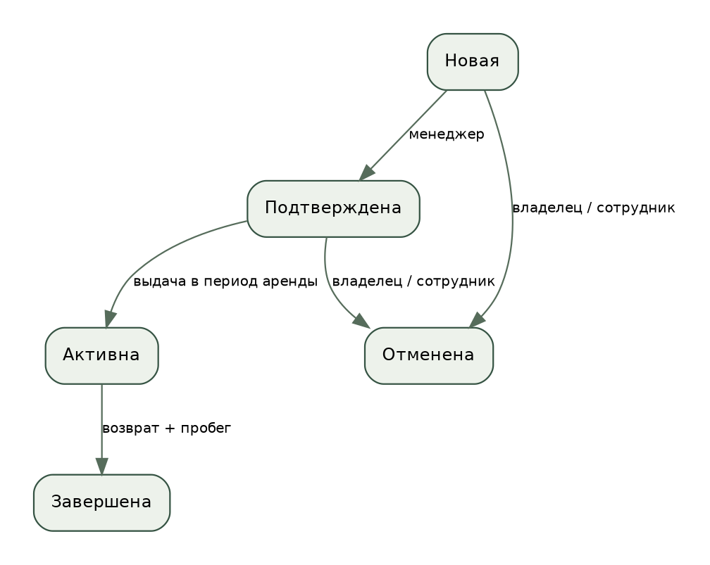

Модульные проверки включают несколько значений внутри одного сценария. Например, тест дат перебирает несуществующую дату, нулевую длительность, прошлый период и превышение максимального срока. Итоговый счётчик runner равен четырём тестам; отдельные проверки внутри цикла не представляются как дополнительные независимые тесты.

Функции домена имеют полное покрытие исполняемых строк в итоговом отчёте, однако покрытие ветвей меньше 100%. В частности, нельзя делать вывод о полном переборе всех комбинаций ролей и состояний только по покрытию строк. План дальнейшего развития тестов включает параметризованную матрицу переходов и проверки календарных границ года.

## 2.3. Интеграционные тесты и согласованность данных

Интеграционный набор содержит 18 тестов. Он создаёт отдельную базу с именем avtobaza_test_<pid>, подключает настоящие Mongoose-модели и формирует тестовые аккаунты трёх ролей. После завершения удаляется только эта база. Это позволяет выполнять проверки, не изменяя данные основного сайта.

Supertest отправляет запросы непосредственно в экземпляр Express. Для каждого участника используется отдельный агент с cookie. Перед изменяющей командой получается CSRF-токен. Такой подход проверяет не только тело ответа, но и взаимодействие сессии, ролей и данных MongoDB.

Проверка регистрации убеждается, что email нормализуется в нижний регистр, роль назначается как client, а сохранённая строка не совпадает с паролем и проходит bcrypt.compare. Попытка передать role=admin при публичной регистрации отклоняется строгой схемой. Повторная регистрация с существующим email приводит к конфликту уникального индекса.

Проверка доступа охватывает гостя, клиента и менеджера. Гость не получает рабочую панель, клиент не получает служебные данные, менеджер не получает список пользователей и не добавляет автомобиль. Изменение роли администратором проверяется с существующей сессией пользователя: API читает роль из MongoDB заново, поэтому новые полномочия действуют сразу.

Особое значение имеет тест конкурирующих бронирований. Он одновременно отправляет две одинаковые заявки на одну машину. Ожидается ровно одна запись Rental, одно событие создания и набор кодов ответа [201, 409]. Проверка количества документов необходима: два разных HTTP-ответа сами по себе не доказывают отсутствие лишней записи.

Соседние интервалы проверяются отдельно. Возврат в дату начала следующей аренды не считается пересечением. Это соответствует полуоткрытым интервалам и исключает искусственное блокирование дополнительного дня. Завершённые и отменённые аренды не участвуют в проверке занятости.

| Группа интеграционных проверок | Проверяемые последствия |
|---|---|
| Авторизация и регистрация | Роль, хеш, нормализация email, повторный email, неверный пароль |
| Доступ | Гость, клиент, менеджер; CSRF; чужие заявки; изменение роли |
| Бронирование | Серверная цена, гонка, фильтр дат, соседние интервалы, отмена |
| Жизненный цикл | Запрещённые переходы, подтверждение, выдача, возврат, пробег |
| Автопарк | Добавление, редактирование, архив, запрет работы с занятым авто |
| Техсостояние | Запись осмотра, предел износа, запрет брони неисправного авто |
| Сервисные функции | CSV, неверный ObjectId, завершение сессии |
| Границы ввода | Телефон без цифр, слишком длинный пароль UTF-8 |

После выполнения 22 серверных тестов получено покрытие исполняемых серверных файлов: 98,28% строк, 81,71% ветвей и 93,75% функций в зафиксированном прогоне до добавления middleware сжатия. В окончательном приложении отчёт пересчитывается и прилагается отдельно. Метрика относится к файлам app.js, db.js, domain.js и models.js, участвующим в тестировании; она не описывает React-компоненты, seed и вспомогательные сценарии.

Непокрытые пути преимущественно связаны с обработкой непредвиденных внутренних ошибок и отдельными ветвями ответов. Положительный результат не означает независимого аудита безопасности. Не проверялись распределённый отказ кластера, атаки большого масштаба, компрометация администраторского аккаунта и восстановление резервной копии.

## 2.4. Реализация графического интерфейса

Интерфейс реализован на React с маршрутизацией по страницам. Общий контекст содержит текущего пользователя, управление окном входа и уведомления. API-клиент отправляет cookie автоматически и добавляет CSRF-токен. После авторизации токен обновляется. Пароль используется только при отправке формы и не сохраняется в localStorage.

Главная страница содержит короткое объяснение сервиса и форму подбора. Наличие на ней каталога и условий помогает посетителю перейти к целевому действию без знакомства с внутренним устройством проекта. Технические детали сервера и базы вынесены в документацию, а не в поток оформления аренды.


Каталог отражает параметры в строке запроса. Это позволяет обновить страницу, сохранив фильтр, либо передать ссылку с выбранными датами. При изменении фильтра выполняется новый запрос к серверу; ответы устаревших запросов не подменяют более позднее состояние. Поиск экранируется перед построением регулярного выражения на сервере.

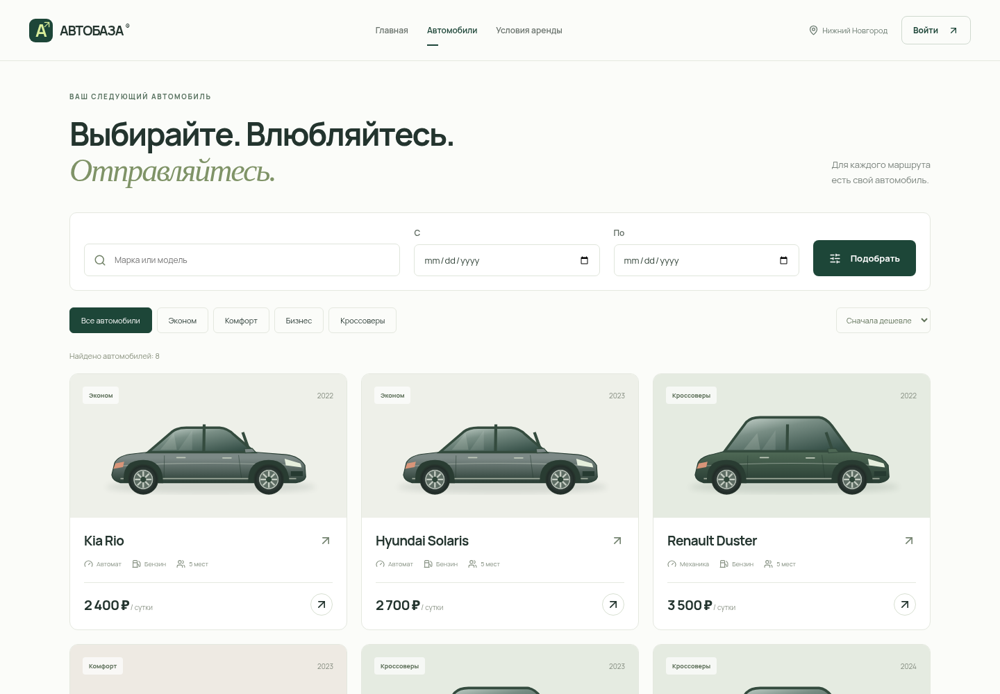

В карточке автомобиля расчёт обновляется при изменении дат и услуг. Пока актуальная цена не получена, отправка отключена. Недоступность на выбранный период показывается явно. Оформление требует входа, а окончательная цена снова вычисляется в команде создания аренды. Поэтому изменение клиентского JavaScript не позволяет отправить произвольную сумму.

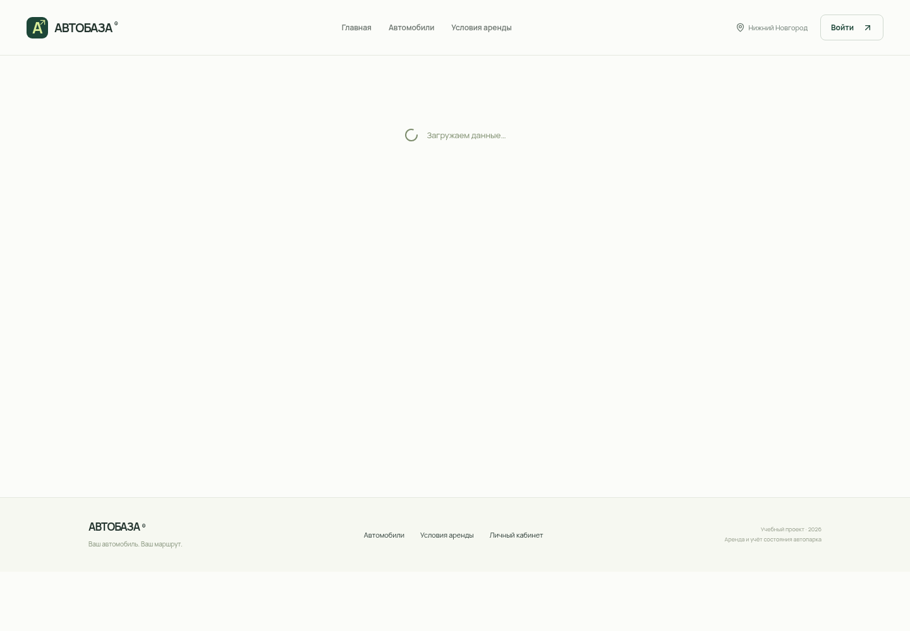

Рабочая панель сотрудников сочетает обзорные показатели и подробные таблицы. В обзоре считаются автомобили, активные аренды, новые заявки и сумма завершённых аренд. Последний показатель рассчитан по заказам и не подтверждает движение денег по банковскому счёту. Журнал показывает автора и время операции.

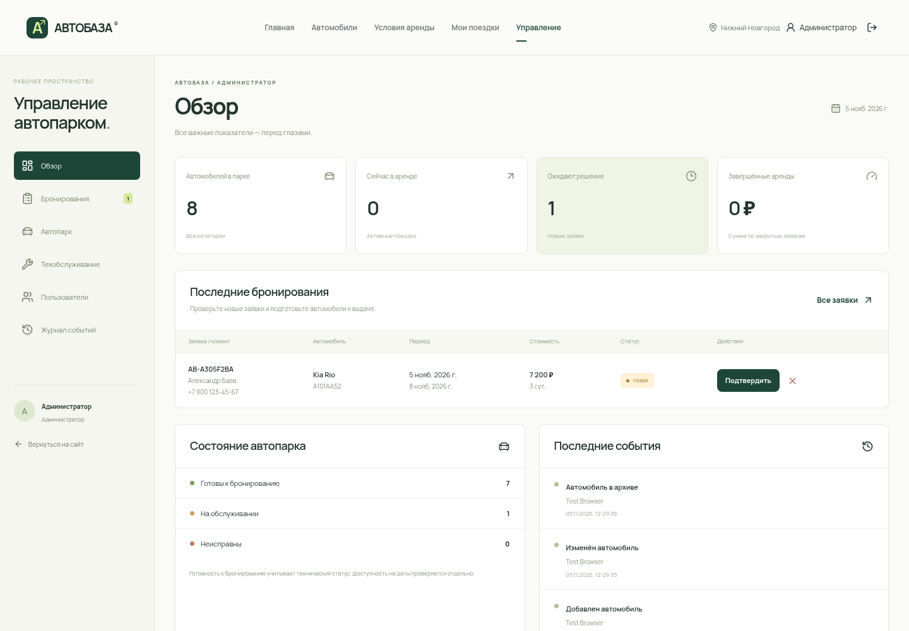

Раздел автопарка позволяет редактировать тариф, залог, пробег, описание и технический статус. Менеджер видит только разрешённое изменение статуса. При архивировании машина исчезает из клиентского каталога, но её документ и история остаются в MongoDB. Физическое удаление не используется.

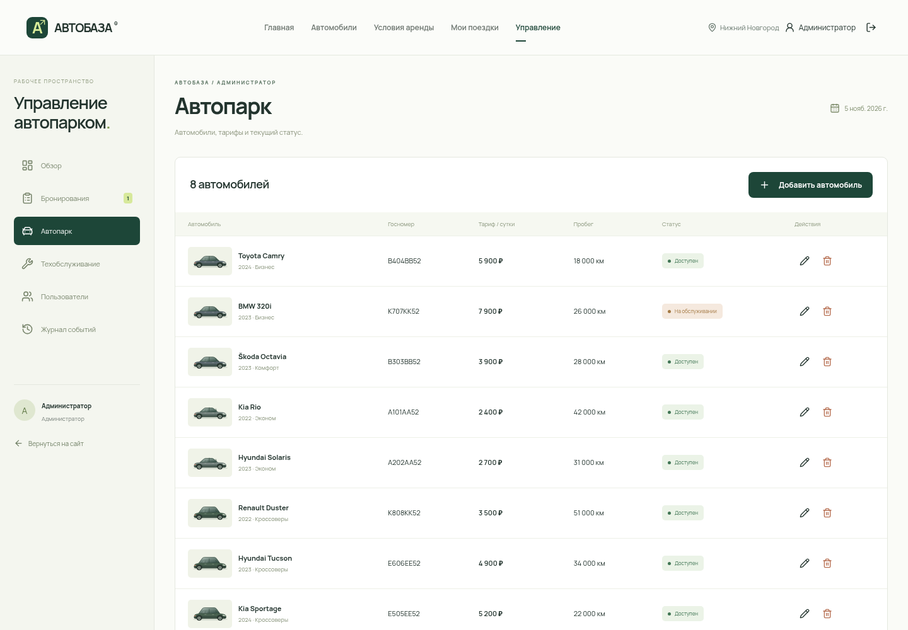

Журнал техобслуживания отображает автомобиль, узел, износ, пробег, замечание, дату и сотрудника. Высокий износ выделяется визуально, но окончательное решение о ремонте принимает менеджер. Осмотр сам по себе не меняет статус машины: это отдельная явная операция с проверкой незавершённых аренд.

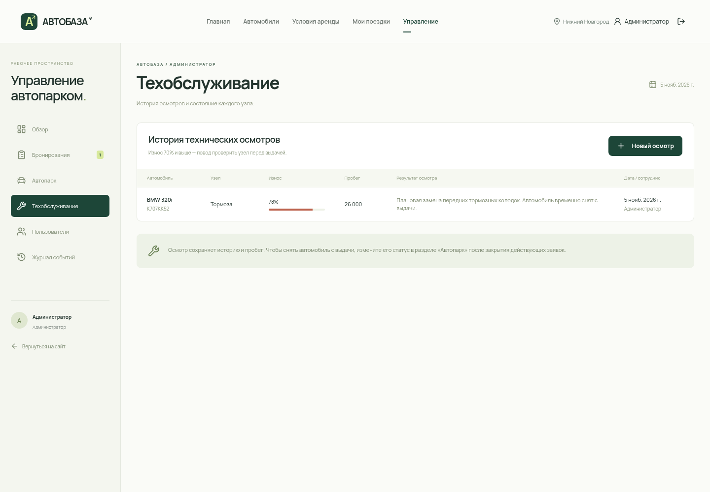

Вывод по второму разделу: реализованы серверная бизнес-логика, постоянное хранение и интерфейсы трёх ролей. Проверки подтвердили расчёт, разграничение доступа, основные операции и устойчивость к двум одновременным заявкам. Найденные ошибки ввода исправлены и закреплены регрессионными тестами.

# 3. АВТОМАТИЗАЦИЯ UI И НАГРУЗОЧНОЕ ТЕСТИРОВАНИЕ

## 3.1. Сквозное тестирование интерфейса

Сквозные проверки выполняются Playwright в Chromium [7]. Для них запускается отдельный сервер с отдельной базой и одинаковыми исходными данными. Рабочая база не очищается. Каждая проверка начинается из определённого состояния и обращается к элементам по доступным пользователю ролям и названиям.

Первый сценарий проверяет полный цикл аренды. Клиент входит, открывает карточку Kia Rio, оформляет заявку и видит её в личном кабинете. В отдельном контексте браузера менеджер входит со своими cookie, подтверждает найденную по номеру заявку, выдаёт автомобиль и оформляет возврат. После обновления клиентской страницы отображается завершённая аренда. Такой сценарий доказывает связь двух интерфейсов через общую базу.

Второй сценарий выбирает кроссоверы, проверяет количество результатов, вводит несуществующее название и получает пустое состояние. После сброса фильтров возвращается полный каталог. Третий сценарий проверяет добавление, изменение тарифа и архивирование автомобиля администратором. Тестовая машина существует только в базе E2E.

Четвёртый сценарий устанавливает ширину окна 390 пикселей, открывает главную страницу, каталог и условия, проверяет отсутствие горизонтальной прокрутки документа и раскрывает мобильное меню. Это полезная геометрическая проверка, но она не заменяет оценку доступности экранным диктором и проверку на реальном мобильном устройстве.

| E2E | Сценарий | Итог |
|---|---|---|
| E2E-01 | Клиент → бронь → менеджер → выдача → возврат | Пройден |
| E2E-02 | Класс, поиск без совпадений, сброс | Пройден |
| E2E-03 | Добавление, изменение и архив автомобиля | Пройден |
| E2E-04 | Узкий экран и мобильная навигация | Пройден |
| E2E-05 | Регистрация, профиль, отказ в админ-доступе и отмена | Пройден |

Пятый сценарий дополнительно проверяет регистрацию через форму с кириллическим именем, изменение профиля, отказ клиенту в доступе к панели и отмену своей заявки. После перезагрузки отменённый статус сохраняется в базе.

Первый запуск обнаружил неоднозначность локатора: слово «Новая» присутствовало в бейдже и скрытой истории заявки. Это была ошибка самого теста, а не двойной статус приложения. Локатор уточнён до бейджа. Одновременно E2E перенесены на выделенный сервер и базу, чтобы повторный запуск не оставлял блокирующие заявки в основном наборе данных.

После исправления все пять сценариев прошли. При отдельном сборе скриншотов не зафиксировано ошибок pageerror JavaScript. Это наблюдение ограничено открытыми страницами и не приравнивается к отсутствию всех возможных ошибок приложения. HTML-отчёт и трассировки доступны через стандартные средства Playwright.

## 3.2. Методика нагрузочного тестирования

Нагрузочное испытание выполнено для маршрута GET /api/cars. Выбран каталог, поскольку его читает каждый посетитель, в том числе без входа. Инструмент Autocannon создаёт несколько одновременных HTTP-соединений и измеряет завершённые ответы [13]. Параллелизм соединений не равен числу реальных пользователей: один пользователь читает страницы, делает паузы и выполняет разные запросы.

Условия опыта: сервер Node.js и MongoDB работают локально в облачной машине, база содержит восемь неархивных автомобилей, запрос выполняется без сессии пользователя, длительность каждого прогона — десять секунд, число соединений — сначала десять, затем пятьдесят. Генератор нагрузки находится на той же машине. Такой опыт характеризует короткий серверный путь и не включает задержку публичного интернета.

Собираются число запросов, средняя пропускная способность, средняя задержка, p50, p97,5, p99, число ошибок, тайм-аутов и ответов вне диапазона 2xx. Перцентиль p99 означает, что 99% измеренных ответов укладываются в соответствующее время. Для оценки требования NFR-03 используется именно p99, поскольку среднее может скрывать редкие медленные ответы.

Первое измерение до оптимизации трафика показало отсутствие ошибок на обоих уровнях нагрузки. При пятидесяти соединениях средняя задержка составляла около 38 мс, p99 — 62 мс, а пропускная способность — около 1312 запросов в секунду. Эти числа относятся только к указанному первому прогону. Далее проведён отдельный сопоставимый опыт до и после HTTP-сжатия.

Результаты сохраняются программно в JSON вместе с временем и версией Node.js. Исходные файлы прилагаются, поэтому таблицы можно проверить и пересоздать. Нагрузочный тест является читающим и не создаёт новые аренды. Регистрация и конкурентная запись измерялись функционально, но не нагрузочно.

## 3.3. Анализ и оптимизация

При увеличении числа соединений средняя задержка растёт, а рост пропускной способности замедляется. Это ожидаемо для общего процесса Node.js, пула MongoDB и локального генератора. По одному короткому опыту нельзя определить окончательный предел производительности или локализовать узкое место до конкретной функции без профилирования.

Вместо выдуманного ускорения SQL-запросов выбрана проверяемая оптимизация передаваемых данных — HTTP-сжатие. JSON каталога содержит повторяющиеся имена полей и текстовые значения, а JavaScript и CSS хорошо сжимаются. Middleware compression включён для ответов, в которых это допустимо. Ответы с аутентификацией и токенами исключены из динамического сжатия; публичный каталог и статические файлы могут сжиматься.

Для сравнения клиент в обоих прогонах посылает Accept-Encoding: gzip. В исходном варианте сервер отвечает без сжатия, в изменённом — с gzip. Не меняются маршрут, набор автомобилей, число соединений и длительность. Измеряется также средний объём передаваемых байтов в секунду. Деление этого показателя на число запросов в секунду позволяет оценить средний размер HTTP-ответа с заголовками.

{{LOAD_COMPARISON}}

Вывод делается отдельно по времени и объёму трафика. Снижение переданных байтов не обязательно увеличивает число запросов в секунду на loopback: сжатие расходует CPU, а сеть здесь почти не ограничивает скорость. Для мобильного соединения меньший объём может быть полезен, но это требует отдельного измерения на ограниченном канале. Облачная машина является общей для сервера, БД, генератора и служебных процессов; нагрузка среды могла повлиять на сравнение задержек. Повторные прогоны с доверительными интервалами в текущую курсовую не включены.

База уже имеет индексы для ключевых выборок. На восьми автомобилях нельзя убедительно продемонстрировать преимущество индекса по времени: небольшая коллекция полностью помещается в памяти, а накладные расходы HTTP могут доминировать. Поэтому в работе не приводится вымышленное кратное ускорение от индексации. Следующий этап — синтетический набор большего размера, explain-планы и независимые нагрузочные сценарии записи.

Практический результат оптимизации — уменьшение размера публичных ответов при сохранении корректности. После изменения повторяются серверные и браузерные проверки. Секретные ответы не включаются в демонстрационный сценарий сжатия. Кэширование динамических заявок не вводилось, чтобы не создавать дополнительные проблемы актуальности.

## 3.4. Регистрация дефектов и регрессионное тестирование

Журнал дефектов разделяет ошибки продукта и ошибки тестового инструментария. Это важно для достоверной оценки качества: падение локатора Playwright не означает сбой сервера, а успешный повтор без исправления причины не означает устранения дефекта.

| ID | Дефект и шаги воспроизведения | Ожидание / факт | Решение и регрессия |
|---|---|---|---|
| BUG-01 | Изменить телефон на ()()()()() | 400 / получен 200 | Добавлен подсчёт цифр; API-тест проходит |
| BUG-02 | Зарегистрировать пароль из 40 букв Я | 400 / получен 201 | Проверка UTF-8 длины ≤72 байт; API-тест проходит |
| TEST-01 | Найти «Новая» во всей карточке | Один элемент / найдено два | Локатор ограничен бейджем; E2E проходит |
| TEST-02 | Выполнить E2E на основной базе | Изоляция / остаётся заявка | Отдельная БД и сервер, сброс только тестовой БД |

Для BUG-01 приоритет средний: неверные контактные данные затрудняли работу менеджера, но не давали дополнительных прав. Для BUG-02 приоритет высокий в контексте корректности аутентификации: скрытое усечение могло привести к неожиданному совпадению длинных паролей. Оба дефекта закрыты после получения зелёного результата тех тестов, которые воспроизводили ошибку.

Регрессия включает неизменённые проверки ролей, расчёта, бронирования и истории. После добавления оптимизации трафика повторяется набор целиком, поскольку middleware влияет на обработку HTTP-ответов. Снимки интерфейса дополнительно используются для визуальной проверки расположения основных блоков.

| Требования | Автоматизированное доказательство |
|---|---|
| FR-01, FR-02, FR-12, FR-14 | Регистрация, хеширование, прямые запросы разных ролей, профиль |
| FR-03, FR-04 | Каталог API, фильтры дат, каталог и карточка в E2E |
| FR-05 | Unit-расчёт и отказ от присланной суммы |
| FR-06, FR-07 | Создание записи, параллельные транзакции, количество документов |
| FR-08, FR-09 | Чужие заявки, отмена, полный жизненный цикл |
| FR-10, FR-11 | CRUD, архив, осмотр, пробег и недоступность неисправной машины |
| FR-13 | Ответ CSV через сотрудника |
| NFR-03, NFR-04 | Нагрузочный отчёт и проверка ширины страницы |

Матрица показывает наличие хотя бы одного доказательства для группы требований, но не означает исчерпывающего покрытия всех комбинаций. Например, проверка мобильного меню не доказывает соответствие всем требованиям WCAG, а тест CSRF не заменяет моделирование всех угроз.

Вывод по третьему разделу: ключевой пользовательский путь подтверждён в браузере; обнаруженные дефекты имеют воспроизводимые сценарии и регрессионные проверки; проведён локальный нагрузочный опыт и измерено влияние сжатия. Границы эксперимента и непроверенные области отделены от подтверждённых результатов.

# ЗАКЛЮЧЕНИЕ

В ходе курсового проекта разработана информационная система «АВТОБАЗА» для автоматизации аренды и учёта состояния автопарка. Система включает клиентский сайт, рабочую панель менеджера и администратора, сервер Express и постоянную базу MongoDB. Реализован связанный процесс от просмотра автомобиля до завершения аренды и сохранения технической истории.

Задача анализа выполнена через описание ролей, словарь предметной области и сравнение трёх открытых аналогов. Для проектирования использованы три уровня IDEF0, DFD, UML-варианты использования, классы, последовательность и деятельность. Спроектированы коллекции, ссылки и индексы MongoDB. Выбор документного хранилища согласован с вложенным снимком стоимости и историей заявки.

Задача реализации выполнена в виде работающего приложения. Клиент регистрируется, выбирает автомобиль, получает рассчитанную сервером цену, отправляет и отменяет заявку. Менеджер подтверждает, выдаёт и принимает автомобиль, фиксирует пробег и осмотры. Администратор управляет каталогом, тарифами и ролями. Права проверяются при каждом защищённом запросе.

Основной риск двойного бронирования решён через транзакции MongoDB и запись общего документа автомобиля до проверки пересечений. Интеграционный сценарий подтвердил, что при двух одновременных одинаковых запросах сохраняется одна аренда. Другие проверки подтвердили защиту чужих данных, последовательность статусов и сохранение истории при архивировании.

Итоговый автоматизированный набор содержит четыре модульных, восемнадцать интеграционных и пять браузерных сценариев. Они выполнены, а не только описаны. Два дефекта проверки ввода выявлены и исправлены; ошибка локатора и проблема изоляции тестовых данных учтены отдельно как дефекты тестовой инфраструктуры. Отчёты сохранены в проекте.

Нагрузочное исследование показало выполнение установленного критерия для чтения небольшого каталога при пятидесяти соединениях в локальной среде. Дополнительно измерено влияние HTTP-сжатия на трафик и задержку. Сжатие уменьшило оценочный размер ответа каталога примерно с 5473 до 2015 байт, то есть на 63%. При этом в локальном опыте средняя задержка при 50 соединениях выросла примерно с 37 до 44 мс; ускорение ответа не подтверждено. Результаты не переносятся автоматически на большой парк, публичную сеть или интенсивную запись. Для промышленной эксплуатации необходимы отдельная защищённая БД, HTTPS, резервное копирование, мониторинг, расширенный аудит и новые эксперименты.

Практическим результатом является приложение с инструкциями запуска, схемами, тестами и пояснительной запиской. Дальнейшее развитие может включать автоматическое истечение новых заявок, восстановление доступа, уведомления, загрузку фотографий, почасовую аренду, оплату и дополнительные отчёты. Эти функции не заявляются реализованными в текущей версии.

Поставленная цель достигнута в границах учебного проекта: создана и проверена информационная система с реальной базой данных, клиентским сценарием и управлением автопарком. Подготовленные материалы позволяют повторить запуск, изучить принятые решения и продемонстрировать результат на защите.

# СПИСОК ИСПОЛЬЗОВАННЫХ ИСТОЧНИКОВ

Все перечисленные электронные ресурсы проверены 05.11.2026. Для обновляемой документации указана дата обращения; неизвестные годы публикации не выдумываются. В качестве источников используются актуальные редакции документации и README. Страницы аналогов анализировались по описаниям, без независимого запуска их продуктов.

1. Node.js contributors. Test runner: Node.js documentation. — Текст : электронный. — URL: https://github.com/nodejs/node/blob/main/doc/api/test.md (дата обращения: 05.11.2026).

2. Express contributors. Express: Fast, unopinionated, minimalist web framework for Node.js. — Текст : электронный. — URL: https://github.com/expressjs/express (дата обращения: 05.11.2026).

3. Mongoose contributors. Mongoose: MongoDB object modeling for Node.js. — Текст : электронный. — URL: https://github.com/Automattic/mongoose (дата обращения: 05.11.2026).

4. MongoDB. Transactions: MongoDB documentation. — Текст : электронный. — URL: https://github.com/mongodb/docs/blob/master/source/core/transactions.txt (дата обращения: 05.11.2026).

5. Meta Platforms, Inc. and contributors. React: The library for web and native user interfaces. — Текст : электронный. — URL: https://github.com/facebook/react (дата обращения: 05.11.2026).

6. Vite contributors. Vite: Next generation frontend tooling. — Текст : электронный. — URL: https://github.com/vitejs/vite (дата обращения: 05.11.2026).

7. Microsoft. Playwright: Reliable end-to-end testing for modern web apps. — Текст : электронный. — URL: https://github.com/microsoft/playwright (дата обращения: 05.11.2026).

8. McDonnell, C. and contributors. Zod: Schema validation. — Текст : электронный. — URL: https://github.com/colinhacks/zod (дата обращения: 05.11.2026).

9. dcodeIO. bcrypt.js: Optimized bcrypt in JavaScript. — Текст : электронный. — URL: https://github.com/dcodeIO/bcrypt.js (дата обращения: 05.11.2026).

10. Express contributors. express-session: Simple session middleware for Express. — Текст : электронный. — URL: https://github.com/expressjs/session (дата обращения: 05.11.2026).

11. Desboeufs, J. and contributors. connect-mongo: MongoDB session store for Express. — Текст : электронный. — URL: https://github.com/jdesboeufs/connect-mongo (дата обращения: 05.11.2026).

12. Helmet contributors. Helmet: Secure Express apps by setting HTTP response headers. — Текст : электронный. — URL: https://github.com/helmetjs/helmet (дата обращения: 05.11.2026).

13. Collina, M. and contributors. Autocannon: HTTP/1.1 benchmarking tool. — Текст : электронный. — URL: https://github.com/mcollina/autocannon (дата обращения: 05.11.2026).

14. OWASP Foundation. Authorization Cheat Sheet. — Текст : электронный. — URL: https://github.com/OWASP/CheatSheetSeries/blob/master/cheatsheets/Authorization_Cheat_Sheet.md (дата обращения: 05.11.2026).

15. Docker Inc. How Compose works: Compose application model. — Текст : электронный. — URL: https://github.com/docker/docs/blob/main/content/manuals/compose/intro/compose-application-model.md (дата обращения: 05.11.2026).

16. Elassas, A. BookCars: Open-source car rental platform. — Текст : электронный. — URL: https://github.com/aelassas/bookcars (дата обращения: 05.11.2026).

17. Jeevan AJ. Rent a Ride: Full stack car rental website. — Текст : электронный. — URL: https://github.com/jeevan-aj/Rent-a-Ride (дата обращения: 05.11.2026).

18. Hegde, V.; Jain, S. Car Rental Website Project. — Текст : электронный. — URL: https://github.com/Varshithvhegde/car_rental_project (дата обращения: 05.11.2026).

# ПРИЛОЖЕНИЕ А. РУКОВОДСТВО ПО ЗАПУСКУ И ДЕМОНСТРАЦИИ

Для запуска требуются Node.js версии 22 или выше, Docker с Compose и свободные порты 3000 и 27017. Зависимости устанавливаются командой npm ci. Файл .env создаётся по образцу .env.example; SESSION_SECRET заменяется случайной строкой не короче 32 символов. Рабочий файл не включается в репозиторий и архив поставки.

Последовательность запуска: npm run db:up, npm run seed, npm run build, npm start. Первая команда поднимает MongoDB с replica set и проверкой готовности. Seed создаёт учебные записи только вне production и при SEED_DEMO=true. Сборка формирует каталог dist. Сервер запускается на порту 3000. Для разработки используется npm run dev.

Демонстрационные аккаунты: admin@avtobaza.test, manager@avtobaza.test и client@avtobaza.test. Общий учебный пароль — Avtobaza2026!. Эти реквизиты намеренно открыты и предназначены только для локальной демонстрации. Для реального сервиса нужна отдельная база без таких аккаунтов.

Сценарий защиты: показать каталог и фильтры; открыть карточку и изменить услуги; войти клиентом и создать заявку; открыть отдельный сеанс менеджера; подтвердить и выдать автомобиль; оформить возврат с пробегом; показать клиенту завершённую заявку; открыть осмотры; показать API-тест гонки и итоговые отчёты. Для выдачи начало аренды должно приходиться на текущий день.

Интеграционные тесты запускаются npm test, отчёт покрытия — npm run test:coverage. Для Playwright требуется Chromium; стандартная установка — npx playwright install chromium. В подготовленной облачной среде используется PLAYWRIGHT_CHROMIUM_PATH=/usr/bin/chromium. E2E запускаются npm run test:e2e, нагрузка — npm run test:load при работающем основном сервере.

Команда docker compose down сохраняет постоянный том. Удаление тома с параметром -v уничтожает данные, поэтому для обычной остановки этот параметр не используется. При невозможности транзакции нужно проверить, что MongoDB работает как replica set, а не standalone.

# ПРИЛОЖЕНИЕ Б. ОСНОВНЫЕ ФРАГМЕНТЫ И ИСХОДНЫЕ АРТЕФАКТЫ

Условие пересечения двух полуоткрытых интервалов:

```javascript
existing.from < requested.to && existing.to > requested.from
```

Схема критической части операции бронирования:

```javascript
await mongoose.connection.transaction(async session => {
  const car = await Car.findOneAndUpdate(
    {_id: carId, archived: false},
    {$inc: {lockVersion: 1}}, {new: true, session});
  // Проверка состояния, даты и пересечения выполняется здесь.
  // Rental и Event сохраняются с той же session.
});
```

Фрагмент отражает порядок операции, а полный код с проверками находится в server/app.js. Доменный расчёт расположен в server/domain.js. Подменять полный алгоритм сокращённым фрагментом при запуске нельзя.

| Артефакт | Расположение |
|---|---|
| Исходный код | client/, server/ |
| Схемы и изображения | docs/diagrams/, docs/screenshots/ |
| Красный прогон валидации | docs/reports/tdd-validation-red.txt |
| Зелёный прогон и покрытие | docs/reports/tests-coverage.txt |
| Браузерные результаты | docs/reports/e2e.txt |
| Нагрузка до сжатия | docs/reports/load-before-compression.json |
| Нагрузка после сжатия | docs/reports/load.json |
| Точные версии | docs/reports/versions.json |
| Проверенные адреса источников | docs/reports/sources.json |
| Описание API и руководства | docs/API.md, docs/USER_GUIDE.md |

{{VERSIONS}}

# ПРИЛОЖЕНИЕ В. ПЛАН ВЫСТУПЛЕНИЯ НА ЗАЩИТЕ

Первый слайд: название работы, ВКСИИТ, Баев Александр. Поля группы, специальности и руководителя заполняются после получения данных. Второй слайд: проблема разрозненного учёта, цель и три роли. Третий: архитектура и MongoDB-модель. Четвёртый: клиентский сценарий и экран карточки. Пятый: работа менеджера и технические осмотры. Шестой: транзакция и тест двойного бронирования. Седьмой: 22 серверных и 5 браузерных тестов, найденные ошибки. Восьмой: нагрузочные результаты, ограничения и дальнейшее развитие.

Ключевой тезис выступления: ценность системы состоит в согласованности процессов и данных. Красивая страница сама по себе не решает проблему аренды; её решают проверяемые правила, единое хранилище и интерфейсы, которые отражают реальное состояние заявки.

При ответах следует различать технический статус машины и занятость на период, стоимость аренды и залог, функциональный тест и нагрузочный эксперимент, подтверждение менеджера и реальную оплату. Эти различия позволяют объяснить архитектуру предметно и избежать завышенных заявлений о возможностях продукта.
