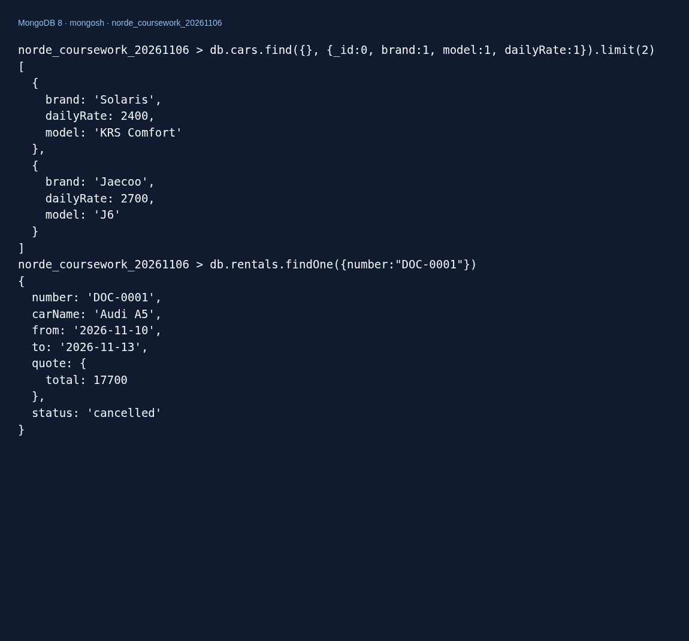
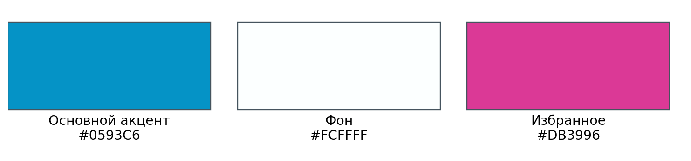
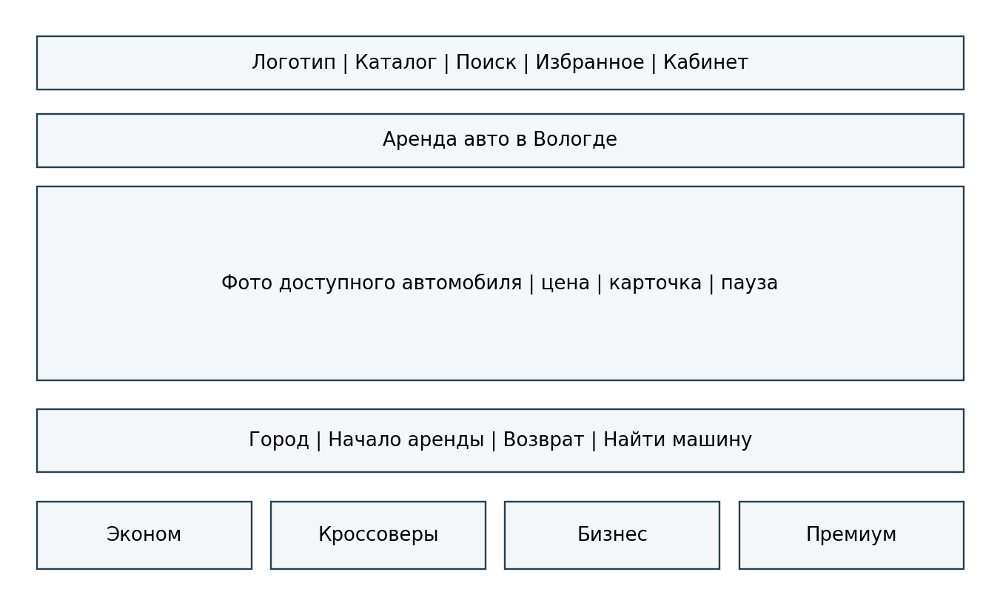
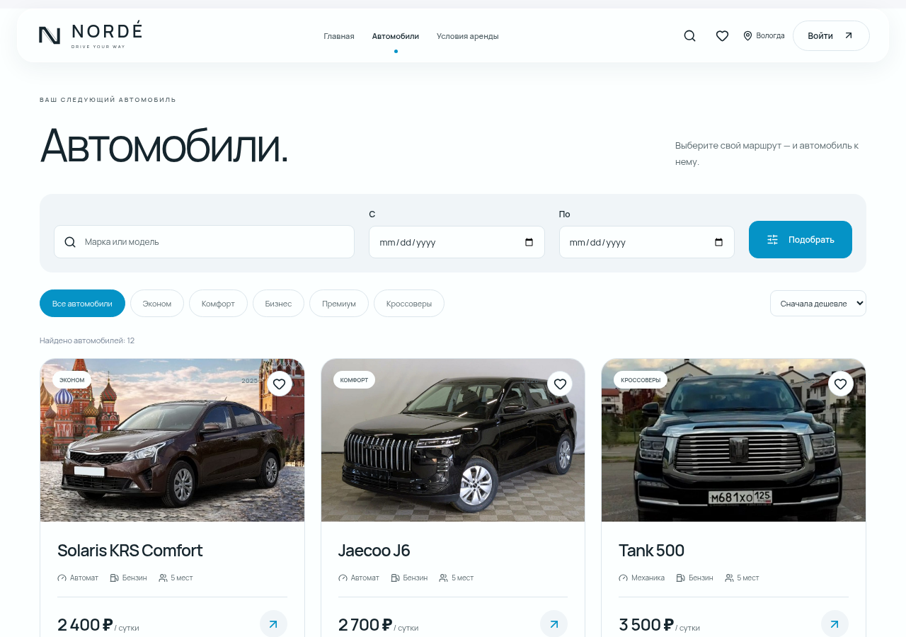
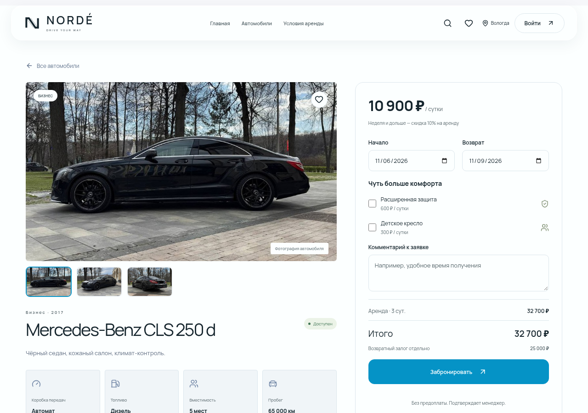
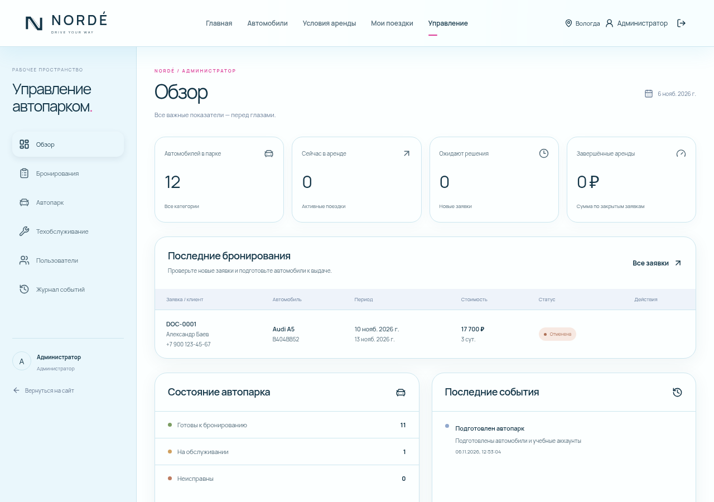
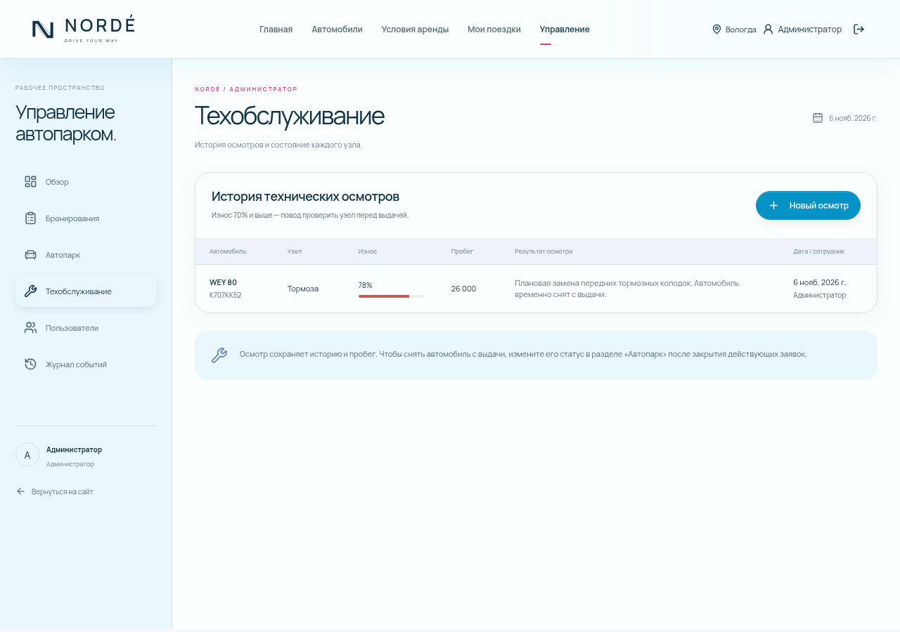
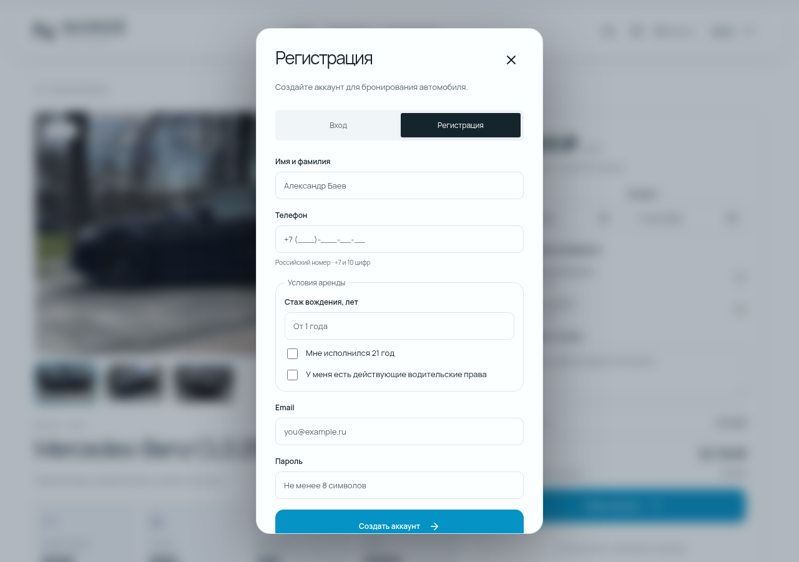
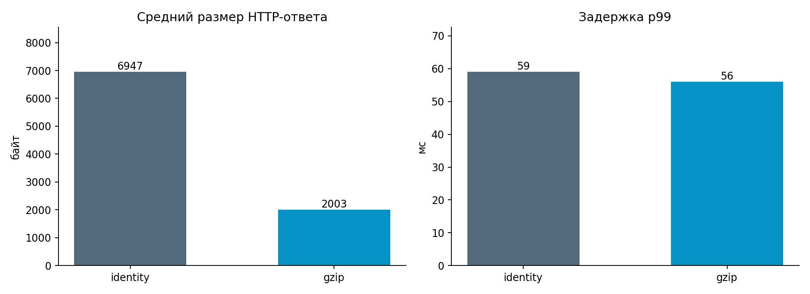

# ВВЕДЕНИЕ

Аренда автомобиля объединяет несколько взаимосвязанных процессов: публикацию сведений об автопарке, согласование срока использования, расчёт стоимости, передачу машины клиенту, приём после поездки и контроль технического состояния. Даже небольшой пункт проката должен одновременно учитывать интересы клиентов и ограничения каждой единицы транспорта. Если заявки записываются в отдельные таблицы, а сведения о ремонте передаются устно, согласованность данных зависит от внимательности сотрудников. Возникает риск двойного бронирования, неверной цены и выдачи автомобиля, который должен находиться на обслуживании.

Актуальность работы связана с потребностью в едином информационном пространстве для клиента и сотрудников автобазы. Клиенту нужен понятный каталог и возможность самостоятельно проверить стоимость поездки. Менеджеру необходимы актуальные заявки, доступные переходы статусов и история операций. Администратор должен управлять каталогом и правами доступа. Для устойчивой работы недостаточно создать набор экранов: требуется серверная проверка правил и постоянное хранилище данных.

Объект исследования — процессы аренды автомобилей и учёта состояния автопарка. Предмет исследования — программные методы автоматизации этих процессов и способы проверки качества веб-приложения. Разрабатываемый продукт получил название «NORDÉ».

Цель курсового проекта — разработать и проверить информационную систему автоматизации аренды и учёта состояния автопарка с клиентским интерфейсом, рабочим пространством сотрудников и базой данных MongoDB.

Для достижения цели поставлены задачи: исследовать предметную область и аналоги; определить функциональные и нефункциональные требования; спроектировать процессы, архитектуру и хранение данных; реализовать регистрацию и разграничение прав; разработать каталог и оформление аренды; реализовать управление автомобилями и техническими осмотрами; проверить расчёты, целостность данных и пользовательские сценарии; выполнить нагрузочное исследование и подготовить документацию.

В работе применены моделирование IDEF0, DFD и UML, анализ граничных значений, разделение входных данных на классы эквивалентности, автоматизированное модульное и интеграционное тестирование, браузерные проверки и измерение производительности. Для хранения документов и выполнения транзакций используется MongoDB [15]. Сервер разработан на Node.js и Express, интерфейс — на React [13, 16, 17].

Исходными материалами послужили описание темы «baev.docx», таблица распределения тем и методические рекомендации по МДК «Поддержка и тестирование программных модулей». Переданные HTML-примеры использованы как материал для анализа функций. Приложение реализовано заново с сервером и базой данных. Сведения об интервью с реальными клиентами не собирались; требования сформированы из задания и моделирования типового пункта аренды.

Практическая значимость проекта заключается в создании работающего учебного продукта, который можно запустить локально, исследовать, изменять и демонстрировать. Границы проекта исключают банковский эквайринг, юридически значимое подписание договора и автоматическую проверку водительских документов. Эти действия остаются за сотрудником при получении автомобиля. Такое ограничение позволяет сосредоточиться на согласованности данных, разделении ролей и проверяемой бизнес-логике.

# РАЗДЕЛ 1. АНАЛИЗ ТРЕБОВАНИЙ И ПРОЕКТИРОВАНИЕ

## 1.1. Описание предметной области и целевой аудитории

NORDÉ рассматривается как учебная служба проката автомобилей в Вологде. Демонстрационные адрес, телефон и сведения о владельце предоставлены для заполнения сайта и не подтверждают существование зарегистрированного предприятия. Требования получены из постановки учебной задачи и последовательных уточнений заказчика; интервью с реальной прокатной компанией и опрос клиентов не проводились. Автопарк и тарифы являются учебными данными.

Предметная область — небольшой пункт аренды легковых автомобилей. Автопарк включает несколько классов: эконом, комфорт, бизнес и кроссоверы. Для каждого автомобиля учитываются марка, модель, год выпуска, государственный номер, тариф, залог, пробег, вместимость, коробка передач и вид топлива. Технический статус отражает возможность эксплуатации, а занятость определяется заявками на конкретные даты.

Пользовательский сценарий начинается с выбора автомобиля. Посетитель просматривает характеристики, задаёт период и дополнительные услуги. После регистрации он отправляет заявку. Система фиксирует рассчитанную стоимость и резервирует выбранный интервал. Менеджер рассматривает заявку, подтверждает её, а затем оформляет фактическую выдачу. После возвращения вводится пробег, аренда завершается и её данные остаются в истории.

Клиенту важны предсказуемая стоимость, понятная форма бронирования и возможность проверить состояние своей заявки. Менеджеру важны отсутствие пересечений по времени, доступ к контактам клиента и ограничения, которые не позволяют случайно нарушить последовательность операций. Администратору нужны средства ведения каталога, тарифов и учётных записей. Все роли используют одну базу, но видят разные операции.

Заявка и фактическая аренда рассматриваются как стадии одной сущности Rental. Это упрощает отслеживание истории: пользователь видит один номер от создания до завершения. Новая заявка уже блокирует интервал. Такое решение исключает ситуацию, когда несколько клиентов ожидают подтверждения одного автомобиля на одинаковые даты. Обратная сторона — менеджер должен своевременно отменять неактуальные заявки; автоматическое истечение ожидания в текущую версию не включено.

Технический осмотр — самостоятельная запись о состоянии выбранного узла. В ней сохраняются автор, дата, пробег, процент износа и заключение. Результат осмотра не переписывает прошлые записи. Система сохраняет историю изменений, чтобы сотрудник мог восстановить основания принятых решений.

| Термин | Значение в проекте |
|---|---|
| Тариф | Стоимость одних суток без дополнительных услуг |
| Залог | Возвратная сумма, учитываемая отдельно от аренды |
| Интервал аренды | Период [дата начала, дата возврата), не включающий день возврата |
| Технический статус | Доступен, на обслуживании или неисправен |
| Активная аренда | Автомобиль фактически выдан и ещё не принят |
| Архивирование | Скрытие машины из каталога при сохранении истории |

До автоматизации эти сведения могут существовать в бумажных журналах и электронных таблицах. Проблема заключается не в самом формате таблицы, а в отсутствии единой точки проверки правил. Разработанное приложение переносит правила в серверные команды: браузер показывает результат, но окончательное решение о записи принимает сервер.

## 1.2. Исследование бизнес-процессов

Функциональное моделирование выполнено в нотации IDEF0. Контекстная диаграмма показывает систему как одну функцию. Входами являются запрос клиента и сведения об автомобиле. Управляющими воздействиями служат условия аренды, права пользователей и регламент обслуживания. Механизмы выполнения — люди и программное обеспечение. Выходами становятся оформленные аренды и история состояния.


На следующем уровне выделены ведение каталога, оформление бронирования, выдача и приём, учёт технического состояния. Такое разделение позволяет связать функции с интерфейсом и серверными маршрутами. Например, процесс A2 соответствует форме бронирования и команде POST /api/rentals, а A4 — разделу технического обслуживания.


Третий уровень детализирует наиболее критичный процесс — оформление бронирования. Сначала проверяется структура запроса и допустимость дат. Затем рассчитывается цена. После этого проверяются исправность автомобиля и отсутствие пересекающихся заявок. Последний шаг атомарно сохраняет заявку и запись журнала. Ошибка на любом этапе приводит к объяснимому отказу, а не к частично созданной аренде.


Контекст A−0, декомпозиция A0 и декомпозиция A2 образуют три уровня детализации. На диаграммах управляющие воздействия расположены сверху, механизмы снизу, входы слева и выходы справа. Последовательность операций внутри оформления дополнительно раскрывается диаграммами деятельности и последовательности.

DFD описывает движение данных между внешними участниками, процессами и хранилищами. Клиент передаёт даты и параметры заказа, а получает стоимость и номер заявки. Сотрудник передаёт решения о выдаче и возврате. Хранилища автомобилей, аренд и осмотров связаны через серверные процессы. Прямого доступа клиента к коллекциям MongoDB нет.


Диаграмма вариантов использования отражает роли. Менеджер может пользоваться клиентскими функциями, а администратор имеет функции менеджера и дополнительные операции с каталогом и пользователями. Наследование ролей в диаграмме выражает множество разрешённых действий, а не наследование JavaScript-классов.


Диаграмма классов представляет логическую модель предметной области. В реализации сущности описаны Mongoose-схемами, а операции находятся в функциях домена и обработчиках API. Методы reserveInterval, changeStatus и archive на схеме обозначают ответственность сущностей, а не дословные имена методов моделей. Объект Quote входит в аренду как неизменяемый снимок расчёта.


Последовательность успешного бронирования проходит через браузер, React, Express и MongoDB. Права и CSRF проверяются до изменения данных. Транзакция включает запись версии блокировки машины, проверку пересечений, создание аренды и события. Ответ 201 возвращается после фиксации. Если соединение оборвётся после фиксации, пользователь сможет найти созданную заявку в личном кабинете; отдельный ключ идемпотентности в текущей версии не реализован.


На диаграмме деятельности обозначены ветвления по корректности ввода и доступности. Отказ — полноценный результат операции, позволяющий изменить даты или выбрать другую машину. Сервер возвращает коды ошибок, которые интерфейс переводит в понятные сообщения.


Моделирование показало, что основной риск связан с конкурирующими изменениями одного автомобиля. Поэтому блокировка не ограничивается кнопкой в браузере: бизнес-операции сериализуются на уровне документа автомобиля внутри транзакции MongoDB.

## 1.3. Сравнительный анализ систем аналогов

Сравнение проведено по открытым клиентским страницам Яндекс Проката, Turo и SIXT, доступным при исследовании интерфейсов [2, 19, 20]. Внутренние алгоритмы бронирования, панели сотрудников и фактическое покрытие тестами этих сервисов не исследовались. Поэтому таблица характеризует наблюдаемые решения интерфейса, а не качество закрытого программного кода.

Яндекс Прокат объединяет предложения прокатных компаний. На первом экране показаны автомобиль и поиск по месту и датам, ниже расположены классы машин и предложения с ценами. В NORDÉ использован короткий путь от выбора дат к конкретной карточке, но отсутствуют функции агрегатора: договор с партнёрами, банковская оплата и обещания круглосуточной поддержки. Такой перенос ограничивает учебную задачу собственным автопарком [2].

Turo строит выбор вокруг места поездки и срока аренды; автомобили представлены отдельными карточками. Для учебного проекта полезны заметная форма поиска и сохранение интересных вариантов. В NORDÉ избранное хранится в браузере, а доступность и стоимость подтверждаются сервером. Отсутствие синхронизации избранного между устройствами указано как ограничение, а не скрывается за названием функции [20].

SIXT предлагает каталог классов и организацию аренды в разных пунктах. При исследовании была доступна открытая HTML-страница; некоторые интерактивные переходы ограничивались самим сервисом. В NORDÉ оставлен один город, а вместо сети пунктов выдачи менеджер согласует получение после подтверждения заявки. Избыточные для одного учебного пункта операции не включались в требования [19].

| Критерий | Яндекс Прокат | Turo | SIXT | NORDÉ |
|---|---|---|---|---|
| Поиск по месту и датам | Есть | Есть | Есть | Вологда и даты |
| Карточки с ценами | Есть | Есть | Есть | Есть |
| Назначение продукта | Агрегатор | Площадка аренды | Сеть проката | Учебный прокат |
| Граница исследования | Открытые страницы | Открытые страницы | Доступная страница | Открытый код и тесты |
| Рабочие роли | Не исследованы | Не исследованы | Не исследованы | Три роли |
| Учёт состояния | Не исследован | Не исследован | Не исследован | Осмотры и пробег |

Сравнение подтверждает целесообразность простой формы подбора, карточек с полной стоимостью и доступного личного кабинета. Собственное отличие учебного решения состоит в проверяемом сквозном процессе аренды и технического учёта. Коммерческая полнота трёх аналогов не заявляется целью курсового проекта.

## 1.4. Требования к программному продукту

Функциональные требования сформулированы так, чтобы результат можно было проверить запросом к API или действием в браузере. Каждый идентификатор используется в матрице покрытия. Сервер должен обеспечивать выполнение правил независимо от того, вызвана команда из штатного интерфейса или напрямую.

| Код | Требование | Проверяемый результат |
|---|---|---|
| FR-01 | Регистрация и вход | Создаётся клиент; пароль хранится как хеш |
| FR-02 | Роли клиент/менеджер/администратор | Недопустимые команды дают 401 или 403 |
| FR-03 | Каталог, поиск, класс, сортировка, даты | Возвращается подходящее подмножество машин |
| FR-04 | Характеристики автомобиля | Показаны тариф, залог, описание и параметры |
| FR-05 | Расчёт стоимости | Цена вычисляется сервером с услугами и скидкой |
| FR-06 | Создание аренды | Запись сохраняется в MongoDB с номером |
| FR-07 | Отсутствие двойной брони | При гонке один ответ 201, второй 409 |
| FR-08 | История и отмена своих заявок | Чужие заявки недоступны клиенту |
| FR-09 | Подтверждение, выдача, возврат | Допускаются только разрешённые переходы |
| FR-10 | Управление автомобилями | Администратор добавляет, меняет и архивирует |
| FR-11 | Учёт технического состояния | Осмотр и пробег сохраняются с автором |
| FR-12 | Назначение ролей и аудит | Новая роль действует в существующей сессии |
| FR-13 | Выгрузка списка аренд | CSV доступен только сотруднику |
| FR-14 | Профиль клиента | Сохраняются имя, телефон и условия допуска к аренде |
| FR-15 | Возраст, права и стаж | Требуются 21 год, действующие права и стаж от года |
| FR-16 | Фотографии и галереи | У 12 стандартных машин есть фото; загрузка проверяется |
| FR-17 | Карусель наличия и избранное | Показ соответствует датам; избранное сохраняется в браузере |
| FR-18 | Обновление демо | Заявки и пользовательские фотографии сохраняются |

Перед бронированием пользователь подтверждает, что ему исполнился 21 год и у него есть действующие водительские права; стаж вводится в полных годах, минимум один год. Флажки являются декларацией клиента, а не автоматической проверкой документов. Сервер проверяет допуск повторно; старый профиль должен дополнить условия. Паспорт и права проверяет сотрудник при выдаче.

Срок аренды составляет от одних до тридцати суток. Период задаётся календарными датами в формате YYYY-MM-DD. День возврата не включается в длительность. Новая заявка не может начинаться в прошлом. Даты должны существовать: например, 30 февраля не принимается, даже если стандартный конструктор Date способен нормализовать такое значение.

Итоговая стоимость аренды определяется формулой (1).

FORMULA: C = B × n × k + (I + S) × n | 1

где C — стоимость аренды, руб.; B — суточный тариф, руб.; n — число оплачиваемых суток; k — коэффициент базовой скидки, равный 0,9 при сроке от семи суток и 1 в остальных случаях; I — суточная стоимость выбранной защиты, руб.; S — суточная стоимость выбранного кресла, руб.

Суммы дополнительных услуг включаются только при выборе соответствующей опции. При сроке от семи суток базовая сумма уменьшается на 10%. Защита стоит 600 рублей в сутки, кресло — 300 рублей в сутки. Залог показан отдельно и не прибавляется к цене аренды. Все суммы этой учебной версии выражаются целыми рублями.

Новая и подтверждённая заявки могут быть отменены владельцем или сотрудником. Выданный автомобиль принимает только сотрудник, который вводит пробег. Завершённая и отменённая заявки не возвращаются в активное состояние. Это ограничивает неоднозначные повторные операции и сохраняет последовательность истории.

| Код | Нефункциональное требование | Критерий приёмки |
|---|---|---|
| NFR-01 | Постоянное хранение | Обновление страницы не теряет заказы; данные находятся в MongoDB |
| NFR-02 | Безопасность доступа | Проверяются роль, владелец, CSRF и длина входных полей |
| NFR-03 | Быстродействие каталога | p99 ответа API менее 2 секунд при 50 соединениях на учебном наборе |
| NFR-04 | Адаптивность | Нет горизонтальной прокрутки на ширине 390 px для основных клиентских страниц |
| NFR-05 | Повторяемость установки | Lockfile, Compose и seed позволяют повторить запуск |
| NFR-06 | Проверяемость | Автоматические тесты домена, API и ключевых UI-сценариев |

Критерии ограничены описанной средой и набором данных. Успешная проверка NFR-03 не означает, что все маршруты выдержат такую же нагрузку или что сайт готов к публичному запуску. Тест регистрации с bcrypt существенно отличается от чтения каталога. Многопользовательский учебный сценарий, а не промышленная эксплуатация, является границей текущего проекта.

## 1.5. Инструментальные средства разработки и тестирования

JavaScript выбран единым языком интерфейса и сервера. Это уменьшает количество разных синтаксисов, которые необходимо поддерживать в курсовой, и позволяет повторно использовать принципы проверки данных. При этом клиентский код не считается доверенным: общность языка не отменяет обязательную серверную валидацию.

Node.js предоставляет среду выполнения сервера и встроенный тестовый модуль node:test [16]. Express используется для маршрутизации HTTP-запросов и последовательного подключения middleware [17]. Mongoose описывает структуру документов, индексы и работу с транзакциями [3]. MongoDB выбрана в соответствии с заданием и хорошо подходит для документов с вложенным снимком цены и историей изменения статуса [15].

React отвечает за состояние форм и отображение данных [13]. Vite выполняет разработческую сборку и создание статических файлов [21]. React Router разделяет страницы без полной перезагрузки приложения. Отдельная библиотека глобального состояния не использовалась: для текущего объёма достаточно контекста сеанса и локального состояния компонентов.

Zod проверяет формы запросов на границе API [12]. bcryptjs хеширует пароли; длина ограничена 72 байтами UTF-8 с учётом особенностей алгоритма [5]. express-session и connect-mongo обеспечивают серверные сессии [6, 8]. Helmet задаёт защитные HTTP-заголовки [9]. Разграничение доступа проектировалось с учётом принципа проверки полномочий на каждом защищённом запросе [18].

Интеграционные тесты используют Supertest и отдельную настоящую MongoDB. Playwright запускает Chromium и проверяет взаимодействие через видимые элементы страницы [14]. Для нагрузочного эксперимента выбран Autocannon — инструмент измерения HTTP-производительности в экосистеме Node.js [4]. Он заменяет перечисленные в методичке варианты k6/JMeter по назначению, но не имитирует полноценное поведение браузера.

Docker Compose описывает локальную MongoDB и постоянный том [7]. Git используется как система контроля версий. Исходный репозиторий — alexander2007B/cursovaya. Внешняя публикация и отправка коммитов не выполнялись в рамках проверки; рабочие файлы подготовлены локально. Для редактирования подойдёт Visual Studio Code; факт использования конкретной версии этой IDE не заявляется.

Точные версии установленных зависимостей закреплены в package-lock.json и перечислены в приложении с результатами окружения. При проверке использовался Node.js 24.22.1. Такой подход точнее указания только названия технологии: результаты относятся к реально установленному набору, а не к абстрактной версии стека.

## 1.6. Проектирование архитектуры и хранения данных

Приложение разделено на три слоя. Представление включает React-компоненты, маршруты, формы и стили. Прикладной слой включает Express API, правила расчёта, управление доступом и последовательность операций. Слой хранения включает Mongoose-модели, индексы и MongoDB. Браузер не подключается к MongoDB напрямую и не может самостоятельно назначить роль.


В режиме разработки Vite направляет запросы /api серверу Express. После сборки Express раздаёт статические файлы из dist и API с одного origin. Это упрощает работу cookie и исключает необходимость открытого CORS. Файлы шрифтов и фотографий хранятся локально: просмотр интерфейса не зависит от внешнего сервиса изображений.

Структура каталогов отражает ответственность частей: client содержит интерфейс, server — сервер и модели, tests — проверки, scripts — вспомогательные команды, docs — схемы, отчёты и пояснительную записку. Файл .env хранит настройки экземпляра и исключён из Git. Файл .env.example содержит только образцы и не является рабочим секретом.

### 1.6.1. Концептуальная и инфологическая модели

Основными сущностями являются пользователь, автомобиль, аренда, осмотр и событие. Пользователь может иметь несколько аренд; автомобиль связан со многими арендами в разные периоды; осмотры относятся к конкретной машине и сотруднику. Внешние ссылки хранятся как ObjectId. Термин ER-модель используется для объяснения связей, хотя физическое хранение является документным.


| Коллекция | Ключевые поля | Назначение и ограничения |
|---|---|---|
| users | name, email, phone, passwordHash, role, drivingExperience | Уникальный email; роль только из разрешённого набора |
| cars | brand, model, plate, category, dailyRate, image, gallery, status | Уникальный номер; положительный тариф; неотрицательный пробег |
| rentals | number, user, car, from, to, quote, extras, status, history | Уникальный номер; ссылки; снимок цены и история |
| maintenances | car, author, node, wear, mileage, note | Износ 0–100; пробег не меньше текущего |
| events | actor, action, entity, details, createdAt | Хронология важных операций |
| sessions | идентификатор, содержимое, срок действия | Служебная коллекция connect-mongo с TTL |

Встроенный объект quote хранит длительность, тариф на момент оформления, базовую стоимость, услуги, общую сумму и залог. Это осознанное дублирование: актуальный тариф автомобиля может меняться, а историческая стоимость уже созданной заявки должна оставаться прежней. Поле carName аналогично сохраняет название на момент оформления.

Массив history принадлежит конкретной аренде и имеет небольшой ограниченный жизненным циклом размер. В него удобно включить статус, время и автора перехода. Технические осмотры вынесены в отдельную коллекцию, поскольку их количество растёт независимо от количества аренд и они нужны для отдельного журнала.

### 1.6.2. Физическая модель, индексы и целостность

MongoDB не обеспечивает внешние ключи так же, как реляционная СУБД. Поэтому приложение проверяет существование ссылочных документов до записи. Пользователи в текущей версии физически не удаляются. Автомобили архивируются логически, что сохраняет ссылки в истории. Структура и диапазоны проверяются схемами Mongoose и Zod; серверные SQL-ограничения в проекте не используются.

Уникальные индексы создаются для email, государственного номера и номера аренды. Составной индекс cars связывает archived, category и dailyRate. Индекс rentals по car, status, from и to поддерживает поиск пересечений. Отдельный индекс user и createdAt ускоряет получение истории клиента. Для осмотров используется car и createdAt, а для событий — createdAt.

Индекс не решает гонку между двумя запросами сам по себе. Проверка «найти пересечение, затем вставить» без согласования может пропустить два одновременных запроса. В проекте обе операции входят в транзакцию, а перед чтением пересечений выполняется запись lockVersion у автомобиля. Это заставляет конкурирующие команды конфликтовать на одном документе. Драйвер повторяет транзакцию после конфликта, и повторная проверка уже видит сохранённую заявку [15].

Два интервала пересекаются при выполнении условия (2).

FORMULA: f1 < t2 и t1 > f2 | 2

где f1 — начало существующей аренды; t2 — конец новой аренды; t1 — конец существующей аренды; f2 — начало новой аренды. Используется полуоткрытый интервал: дата возврата не оплачивается, поэтому соседние сроки без общих суток не пересекаются.

Все команды, способные изменить доступность машины, используют тот же порядок: сначала записывается документ автомобиля, затем проверяются и изменяются зависимые аренды. Иначе транзакция бронирования не была бы согласована с отправкой на обслуживание или архивированием. Журнал события для аренды записывается в той же транзакции, чтобы не получить заявку без аудита либо событие без заявки.

Технический статус хранит available, maintenance и broken. Значение «В аренде» вычисляется по активной записи Rental. Такое представление устраняет необходимость вручную синхронизировать одинаковую информацию в двух документах. При выдаче дополнительно проверяется отсутствие любой другой активной аренды, включая просроченную.

Третья нормальная форма (3НФ) относится к реляционным отношениям и не является формальным свойством набора BSON-документов. В проекте её цель учитывается через разделение самостоятельных сущностей: сведения пользователя не копируются в каждую машину, а осмотры хранятся отдельно от аренд. Снимок тарифа и название автомобиля в аренде — намеренная денормализация для сохранения исторического расчёта. Уникальные индексы предотвращают повторение бизнес-идентификаторов, архивирование сохраняет ссылки, а транзакции согласуют многодокументные изменения. Таким образом, исключение аномалий рассматривается по конкретным операциям, а не объявлением MongoDB «базой в 3НФ».

### 1.6.3. Операции с данными и аналогия DDL/DML/DQL/DCL

Методические рекомендации предлагают рассмотреть DDL, DML, DQL и DCL на примере SQL. Поскольку задание пользователя предусматривает MongoDB, ниже приведены функциональные аналоги команд mongosh. Они показывают соответствующие классы операций и не выдают MongoDB за SQL-систему. Основное приложение создаёт модели и индексы через Mongoose.

DDL-аналог задаёт коллекцию и уникальный индекс. В рабочей установке это выполняют модели, а не ручной повторный запуск команды.

```javascript
// Пример структуры и индекса, не команда миграции действующей базы.
db.createCollection('cars');
db.cars.createIndex({plate: 1}, {unique: true});
```

DML-аналог изменяет документ. В прикладной системе изменение тарифа проходит через API с проверкой роли и записью события, поэтому прямой запрос ниже предназначен только для объяснения синтаксиса.

```javascript
db.cars.updateOne(
  {plate: 'А101АА52'},
  {$set: {dailyRate: 2600}}
);
```

DQL-аналог получает доступные по техническому статусу машины. Сам по себе запрос не проверяет даты: для этого прикладной алгоритм использует коллекцию аренд.

```javascript
db.cars.find({archived: false, status: 'available'})
  .sort({dailyRate: 1});
```

DCL-аналог описывает разграничение прав на уровне СУБД. В локальном Compose доступ ограничен loopback-интерфейсом, а аутентификация MongoDB для учебного запуска не включена. Пример создания роли предназначен для отдельного защищённого развёртывания и не выполнялся в текущей базе.

```javascript
// Иллюстративный пример для развёртывания с включённой авторизацией.
db.createRole({role: 'fleetReader',
  privileges: [{resource: {db: 'avtobaza', collection: 'cars'},
                actions: ['find']}], roles: []});
```

Триггеры и представления MongoDB не используются. Правила записи сосредоточены в API и транзакциях. Это снижает число мест, где меняется бизнес-логика, и делает её доступной для интеграционных проверок.

### 1.6.4. Контрольное заполнение базы

Для фиксации результата создана отдельная учебная база norde_coursework_20261106 с 12 автомобилями и тремя ролевыми аккаунтами. Пример заявки DOC-0001 отменён, чтобы не блокировать автопарк во время нагрузки. Содержимое прочитано штатной консолью mongosh: на иллюстрации показаны фактический вывод команд поиска машин и сохранённой аренды. Для публикации исключены хеши паролей и содержимое сессий. Исходные JSON и текст консоли находятся в docs/reports/norde-final.



Отображение заполненных документов подтверждает, что приложение использует постоянное хранилище, а не только состояние React. В режиме с сервером закрытие браузера не удаляет машины и заявки. Отличающийся демонстрационный режим localStorage оставлен для предварительного просмотра интерфейса и не используется в серверных измерениях.

## 1.7. Проектирование пользовательского интерфейса

Интерфейс разделён на клиентские страницы и рабочую панель сотрудников. Клиенту доступны каталог, карточка авто, вход, регистрация и свои заявки. В рабочем пространстве менеджер оформляет выдачу, возврат и технический осмотр, а администратор дополнительно изменяет каталог и роли. Сервер остаётся источником правил; скрытие кнопки не рассматривается как средство защиты.

Окончательная визуальная система использует только светлую тему. Основные цвета: небесно-голубой #0593C6, белый #FCFFFF и розовый #DB3996; нейтральный тёмный текст обеспечивает читаемость. В интерфейсе применяется локальный Manrope; для пояснительной записки используется XO Thames 12 пт из официального пакета МойОфис в соответствии с Положением колледжа [1]. Стеклянная шапка закреплена сверху, содержит быстрый поиск, избранное, сведения о городе и переход в кабинет. Эффект размытия имеет непрозрачную альтернативу.



Макет фиксирует принятую структуру главной страницы: шапка, заголовок, изображение автомобиля с ценой, форма дат, классы и карточки. Схема подготовлена для документирования окончательного решения; она не выдаётся за сохранившийся первоначальный эскиз. На мобильном экране блоки перестраиваются в одну колонку, а навигация открывается кнопкой меню.



Карусель меняет изображение раз в две секунды и получает только доступные на выбранный срок автомобили с фото. Стрелки и пауза позволяют управлять просмотром; автоматическая смена приостанавливается при наведении, клавиатурном фокусе, скрытой вкладке и системном уменьшении анимации. При изменении дат список перечитывается. При этом показ является снимком наличия: окончательная проверка выполняется транзакционно при создании заявки.

Поля регистрации имеют подписи, маску телефона и явные обязательные подтверждения. Неизвестные данные не заполняются автоматически. Избранное позволяет вернуться к выбранным машинам, но относится к хранилищу браузера и не подменяет MongoDB. Деморежим отдельно помечен: его локальные данные не переносятся в рабочую базу автоматически.

Для единообразия использованы повторяемые компоненты полей, модальных окон, карточек, уведомлений и ошибок. Управление доступно с клавиатуры; значки имеют названия, состояния сопровождаются текстом. Учёт этих ограничений снижает риск ситуации, когда пользователь видит привлекательный экран, но не понимает, как исправить ошибку или продолжить бронирование.

## 1.8. Тестовая стратегия и тест-дизайн

Стратегия строится от рисков. Ошибка оформления аренды влияет сразу на клиента, сотрудника и доступность автомобиля, поэтому проверяется на нескольких уровнях. Формула стоимости проверяется модульно; создание документов и доступ — интеграционно; весь путь клиента и менеджера — в браузере. Нагрузочное испытание отдельно характеризует чтение каталога.

Модульные тесты не подключаются к MongoDB и проверяют чистые функции. Интеграционные тесты используют настоящий replica set и изолированную тестовую базу. Подмена MongoDB объектом в памяти не позволила бы проверить конфликты транзакций. E2E-тесты запускают отдельный сервер на порту 3001 и отдельную базу avtobaza_e2e. Основная пользовательская база не должна использоваться как хранилище тестовых фикстур.

| Объект | Класс эквивалентности / граница | Ожидаемый результат |
|---|---|---|
| Длительность | 0 суток | Отказ |
| Длительность | 1–6 суток | Базовый тариф без скидки |
| Длительность | 7–30 суток | Скидка 10% на базовую часть |
| Длительность | 31 и более суток | Отказ |
| Дата | Прошедшая / несуществующая | Отказ |
| Телефон | +7 и 10 цифр; допустим ввод с 8 | Нормализация в +7XXXXXXXXXX |
| Телефон | Только скобки и пробелы | Отказ |
| Пароль | Менее 8 символов / более 72 байт | Отказ |
| Износ | 0–100% | Допустим |
| Износ | Меньше 0 или больше 100% | Отказ |
| Пробег | Ниже сохранённого значения | Отказ |
| Интервалы | Соприкасаются, но не пересекаются | Допустимы обе аренды |

Для переходов статусов применяется таблица решений. Клиент не может подтверждать заявку или выдавать автомобиль. Менеджер не может назначать роли и добавлять машину. Для просмотра своей истории недостаточно знания номера чужой заявки: сервер сверяет владельца.

Критерии окончания проверки: все реализованные автоматические сценарии проходят; ошибки расчёта и прав доступа устранены; зафиксированы условия нагрузочного опыта; документы соответствуют текущему поведению. Покрытие кода рассматривается как дополнительная метрика, а не самостоятельное доказательство качества.

Вывод по первому разделу: спроектирована система с ясной областью ответственности, тремя ролями и документным хранилищем. Ключевой архитектурный выбор — серверное выполнение правил и транзакционная защита от конкурирующих операций с автомобилем. Модели и требования определяют проверяемые сценарии последующей реализации.
# РАЗДЕЛ 2. РАЗРАБОТКА ЧЕРЕЗ ТЕСТИРОВАНИЕ (TDD)

## 2.1. Применение цикла Red–Green–Refactor

Разработка сопровождалась созданием проверок поведения. Подход Red–Green–Refactor означает три действия: сформулировать проверяемое ожидание, получить подтверждённый отказ, внести минимальное исправление и затем улучшить структуру без изменения поведения. В проекте сохранены реальные результаты падения и последующего прохождения тестов. При этом утверждение, что весь интерфейс разработан строго через TDD, было бы неточным: браузерные проверки добавлялись после реализации соответствующих экранов.

Первый набор контрольных сценариев касается формулы аренды: стоимость трёх суток с услугами, недельная скидка, ошибочные даты и запрещённые переходы статусов. Четыре теста для calculateQuote и validateTransition проходят в текущем прогоне. Доменная логика вынесена из HTTP-обработчика и проверяется без базы и браузера. Отдельный протокол первого запуска этого модуля не сохранён, поэтому данный набор описывается как контроль поведения, а подтверждённые красные результаты рассматриваются для следующих двух дефектов валидации.

Контрольный расчёт для тарифа 4000 рублей, трёх суток, расширенной защиты и кресла составляет: 4000 × 3 + 600 × 3 + 300 × 3 = 14700 рублей. Возвратный залог 20000 рублей хранится отдельно. Для семи суток без услуг результат равен 4000 × 7 × 0,9 = 25200 рублей. В тесте проверяется весь объект расчёта, а не только наличие ответа.

Второй пример связан с телефонным номером. Первоначальная проверка ограничивала допустимые символы и общую длину строки. Однако строка «()()()()()» удовлетворяла регулярному выражению, хотя не содержала цифр. Интеграционный тест ожидал HTTP 400 и фактически получил HTTP 200. Это свидетельствовало об ошибке правила, а не о неполадке окружения.

Исправление добавило отдельную проверку количества цифр после удаления разделителей. В окончательной версии правило уточнено: российский номер приводится к виду +7XXXXXXXXXX. Ввод с 8 и десять национальных цифр нормализуются; неполные и иностранные номера отклоняются. В интерфейсе используется маска +7 (XXX)-XXX-XX-XX. Общая функция shared/phone.js применяется в деморежиме и через схему phone на сервере [10].

Третий пример касается пароля с кириллицей. bcrypt ограничивает обрабатываемый ввод 72 байтами, а не 72 символами [5]. Пароль из сорока букв «Я» содержит 80 байт в UTF-8. Первоначальная схема принимала такой ввод, и тест получил HTTP 201 вместо ожидаемого 400. Исправление использует Buffer.byteLength и отвергает строку до хеширования. Это предотвращает скрытое усечение пароля.

| Пример | Красный результат | Изменение | Зелёный результат |
|---|---|---|---|
| Расчёт и переходы | Отдельный протокол не сохранён | Чистые функции расчёта и переходов | 4 unit-теста проходят |
| Телефон | 200 вместо 400 для одних скобок | Подсчёт цифр после нормализации | Интеграционный тест проходит |
| Пароль UTF-8 | 201 вместо 400 для 80 байт | Ограничение длины в байтах | Интеграционный тест проходит |

Последние два примера были выявлены в одном красном прогоне: 20 тестов прошли, два упали. Файл docs/reports/tdd-validation-red.txt сохраняет исторические ожидания и фактические результаты раннего этапа. Итоговый зелёный прогон текущей версии находится в docs/reports/norde-final/tests-coverage.txt. Эти протоколы относятся к разным этапам: ранний прогон содержит 22 проверки, итоговый — 32. Не заявляется, что каждая поздняя правка интерфейса выполнялась через полный цикл TDD.

## 2.2. Модульные тесты и бизнес-правила

Модульный слой содержит девять тестов node:test: четыре проверки домена, две проверки телефона и три проверки набора автопарка и его обновления. Их предмет — детерминированные функции домена. calculateQuote не обращается к сети и принимает контрольную текущую дату параметром. Это исключает зависимость теста от дня запуска. В обычном приложении используется текущая календарная дата в часовом поясе Europe/Moscow; локализованное представление даты выполняет интерфейс.

Функция parseDate проверяет формат, создаёт дату и сравнивает её обратное представление с исходным значением. При несовпадении отклоняется нормализованная дата, например несуществующее число месяца. Проверка длительности выполняется на разности полуночей UTC, поэтому переходы часового пояса не меняют количество суток.

Функция calculateQuote возвращает объект с раздельными компонентами стоимости. Такая структура полезна для пользователя и теста: цена прозрачна, а ошибка услуги не скрывается в итоговой сумме. Округление применяется к базовой сумме после скидки. Если понадобятся дробные цены, модель следует перевести на целые копейки с единым правилом округления.

validateTransition использует таблицу допустимых состояний. Из новой заявки можно перейти к подтверждению или отмене, из подтверждённой — к выдаче или отмене, из активной — только к завершению. Завершённая и отменённая заявки терминальны. Ограничения календарного периода, пробега и владельца проверяются интеграционно в API, поскольку требуют данных других сущностей.


Модульные проверки включают несколько значений внутри одного сценария. Например, тест дат перебирает несуществующую дату, нулевую длительность, прошлый период и превышение максимального срока. Итоговый счётчик runner равен четырём тестам; отдельные проверки внутри цикла не представляются как дополнительные независимые тесты.

Функции домена имеют полное покрытие исполняемых строк в итоговом отчёте, однако покрытие ветвей меньше 100%. В частности, нельзя делать вывод о полном переборе всех комбинаций ролей и состояний только по покрытию строк. План дальнейшего развития тестов включает параметризованную матрицу переходов и проверки календарных границ года.

К модульным проверкам добавлены нормализация российского номера и безопасное обновление учебного автопарка. Последняя проверка подтверждает наличие локальных JPG для всех 12 машин, сохранение идентификатора, пробега и статуса при замене старой иллюстрации, а также отсутствие перезаписи пользовательской фотографии. Эти сценарии воспроизводят риск обновления уже используемого демо.

## 2.3. Интеграционные тесты и согласованность данных

Интеграционный набор содержит 18 тестов. Он создаёт отдельную базу с именем avtobaza_test_<pid>, подключает настоящие Mongoose-модели и формирует тестовые аккаунты трёх ролей. После завершения удаляется только эта база. Это позволяет выполнять проверки, не изменяя данные основного сайта.

Supertest отправляет запросы непосредственно в экземпляр Express. Для каждого участника используется отдельный агент с cookie. Перед изменяющей командой получается CSRF-токен. Такой подход проверяет не только тело ответа, но и взаимодействие сессии, ролей и данных MongoDB.

Проверка регистрации убеждается, что email нормализуется в нижний регистр, роль назначается как client, а сохранённая строка не совпадает с паролем и проходит bcrypt.compare. Попытка передать role=admin при публичной регистрации отклоняется строгой схемой. Повторная регистрация с существующим email приводит к конфликту уникального индекса.

Проверка доступа охватывает гостя, клиента и менеджера. Гость не получает рабочую панель, клиент не получает служебные данные, менеджер не получает список пользователей и не добавляет автомобиль. Изменение роли администратором проверяется с существующей сессией пользователя: API читает роль из MongoDB заново, поэтому новые полномочия действуют сразу.

Особое значение имеет тест конкурирующих бронирований. Он одновременно отправляет две одинаковые заявки на одну машину. Ожидается ровно одна запись Rental, одно событие создания и набор кодов ответа [201, 409]. Проверка количества документов необходима: два разных HTTP-ответа сами по себе не доказывают отсутствие лишней записи.

Соседние интервалы проверяются отдельно. Возврат в дату начала следующей аренды не считается пересечением. Это соответствует полуоткрытым интервалам и исключает искусственное блокирование дополнительного дня. Завершённые и отменённые аренды не участвуют в проверке занятости.

| Группа интеграционных проверок | Проверяемые последствия |
|---|---|
| Авторизация и регистрация | Роль, хеш, нормализация email, повторный email, неверный пароль |
| Доступ | Гость, клиент, менеджер; CSRF; чужие заявки; изменение роли |
| Бронирование | Серверная цена, гонка, фильтр дат, соседние интервалы, отмена |
| Жизненный цикл | Запрещённые переходы, подтверждение, выдача, возврат, пробег |
| Автопарк | Добавление, редактирование, архив, запрет работы с занятым авто |
| Техсостояние | Запись осмотра, предел износа, запрет брони неисправного авто |
| Сервисные функции | CSV, неверный ObjectId, завершение сессии |
| Границы ввода | Телефон без цифр, слишком длинный пароль UTF-8 |

Итоговый прогон 6 ноября 2026 года включает 32 успешно выполненных модульных и интеграционных теста. Покрытие инструментированных файлов server и shared составляет 97,89% строк, 84,92% ветвей и 94,74% функций. Отчёт сформирован штатным механизмом Node.js. Из области измерения исключены React-компоненты, сценарии наполнения базы и вспомогательная инфраструктура, поэтому процент не следует трактовать как покрытие всего пользовательского интерфейса [16].

Непокрытые пути преимущественно связаны с обработкой непредвиденных внутренних ошибок и отдельными ветвями ответов. Положительный результат не означает независимого аудита безопасности. Не проверялись распределённый отказ кластера, атаки большого масштаба, компрометация администраторского аккаунта и восстановление резервной копии.

## 2.4. Реализация графического интерфейса

Интерфейс реализован на React с маршрутизацией по страницам. Общий контекст содержит текущего пользователя, управление окном входа и уведомления. API-клиент отправляет cookie автоматически и добавляет CSRF-токен. После авторизации токен обновляется. Пароль используется только при отправке формы и не сохраняется в localStorage.

Главная страница содержит форму дат, фотографии доступных автомобилей и переходы по классам. Наличие на ней каталога и условий помогает посетителю перейти к целевому действию без знакомства с внутренним устройством проекта. Технические детали сервера и базы вынесены в документацию, а не в поток оформления аренды.


Каталог отражает параметры в строке запроса. Это позволяет обновить страницу, сохранив фильтр, либо передать ссылку с выбранными датами. При изменении фильтра выполняется новый запрос к серверу; ответы устаревших запросов не подменяют более позднее состояние. Поиск экранируется перед построением регулярного выражения на сервере.



В карточке автомобиля расчёт обновляется при изменении дат и услуг. Пока актуальная цена не получена, отправка отключена. Недоступность на выбранный период показывается явно. Оформление требует входа, а окончательная цена снова вычисляется в команде создания аренды. Поэтому изменение клиентского JavaScript не позволяет отправить произвольную сумму.



Рабочая панель сотрудников сочетает обзорные показатели и подробные таблицы. В обзоре считаются автомобили, активные аренды, новые заявки и сумма завершённых аренд. Последний показатель рассчитан по заказам и не подтверждает движение денег по банковскому счёту. Журнал показывает автора и время операции.



Раздел автопарка позволяет редактировать тариф, залог, пробег, описание и технический статус. Менеджер видит только разрешённое изменение статуса. При архивировании машина исчезает из клиентского каталога, но её документ и история остаются в MongoDB. Физическое удаление не используется.


Журнал техобслуживания отображает автомобиль, узел, износ, пробег, замечание, дату и сотрудника. Высокий износ выделяется визуально, но окончательное решение о ремонте принимает менеджер. Осмотр сам по себе не меняет статус машины: это отдельная явная операция с проверкой незавершённых аренд.



Вывод по второму разделу: реализованы серверная бизнес-логика, постоянное хранение и интерфейсы трёх ролей. Проверки подтвердили расчёт, разграничение доступа, основные операции и устойчивость к двум одновременным заявкам. Найденные ошибки ввода исправлены и закреплены регрессионными тестами.

На форме регистрации обязательны имя, телефон, email, пароль, стаж и подтверждения возраста и прав. После регистрации из карточки выбранный автомобиль и даты остаются на странице; отправка заявки требует отдельного нажатия, чтобы пользователь подтвердил действие.



Фотографии стандартного автопарка хранятся локально. Новая фотография загружается администратором, проверяется по формату, размеру и разрешению, затем перекодируется в WebP. Сервер использует sharp и не принимает произвольный исполняемый путь в поле image. В базе сохраняется путь к файлу; резервное копирование включает MongoDB и uploads/ [11].

В итоговом интерфейсе работают избранное, быстрый поиск из закреплённой шапки, галереи и контактный подвал. Контакты владельца и адрес обозначены демонстрационными. Смена темы исключена из принятого объёма, чтобы документация соответствовала окончательному светлому варианту.

# РАЗДЕЛ 3. АВТОМАТИЗАЦИЯ UI И НАГРУЗОЧНОЕ ТЕСТИРОВАНИЕ

## 3.1. Сквозное (E2E) тестирование интерфейса

Сквозные проверки выполняются Playwright в Chromium [14]. Для них запускается отдельный сервер с отдельной базой и одинаковыми исходными данными. Рабочая база не очищается. Каждая проверка начинается из определённого состояния и обращается к элементам по доступным пользователю ролям и названиям.

Первый сценарий проверяет полный цикл аренды. Клиент входит, открывает карточку Kia Rio, оформляет заявку и видит её в личном кабинете. В отдельном контексте браузера менеджер входит со своими cookie, подтверждает найденную по номеру заявку, выдаёт автомобиль и оформляет возврат. После обновления клиентской страницы отображается завершённая аренда. Такой сценарий доказывает связь двух интерфейсов через общую базу.

Второй сценарий выбирает кроссоверы, проверяет количество результатов, вводит несуществующее название и получает пустое состояние. После сброса фильтров возвращается полный каталог. Третий сценарий проверяет добавление, изменение тарифа и архивирование автомобиля администратором. Тестовая машина существует только в базе E2E.

Четвёртый сценарий устанавливает ширину окна 390 пикселей, открывает главную страницу, каталог и условия, проверяет отсутствие горизонтальной прокрутки документа и раскрывает мобильное меню. Это полезная геометрическая проверка, но она не заменяет оценку доступности экранным диктором и проверку на реальном мобильном устройстве.

| E2E | Сценарий | Итог |
|---|---|---|
| E2E-01 | Клиент → бронь → менеджер → выдача → возврат | Пройден |
| E2E-02 | Класс, поиск без совпадений, сброс | Пройден |
| E2E-03 | Добавление, изменение и архив автомобиля | Пройден |
| E2E-04 | Узкий экран и мобильная навигация | Пройден |
| E2E-05 | Регистрация, профиль, отказ в админ-доступе и отмена | Пройден |

Пятый сценарий дополнительно проверяет регистрацию через форму с кириллическим именем, изменение профиля, отказ клиенту в доступе к панели и отмену своей заявки. После перезагрузки отменённый статус сохраняется в базе.

Первый запуск обнаружил неоднозначность локатора: слово «Новая» присутствовало в бейдже и скрытой истории заявки. Это была ошибка самого теста, а не двойной статус приложения. Локатор уточнён до бейджа. Одновременно E2E перенесены на выделенный сервер и базу, чтобы повторный запуск не оставлял блокирующие заявки в основном наборе данных.

После исправления все пять сценариев прошли. При отдельном сборе скриншотов не зафиксировано ошибок pageerror JavaScript. Это наблюдение ограничено открытыми страницами и не приравнивается к отсутствию всех возможных ошибок приложения. HTML-отчёт и трассировки доступны через стандартные средства Playwright.

## 3.2. Нагрузочное тестирование

Измерен публичный маршрут GET /api/cars, формирующий JSON каталога. Это проверка HTTP API чтения, а не измерение времени полной загрузки страницы с фотографиями и не тест одновременного оформления аренд. Для последнего отдельно применяется интеграционная проверка конфликтующих транзакций.

Эксперимент выполнен 6 ноября 2026 года на выделенной учебной базе из 12 автомобилей. Node.js, MongoDB, Express и генератор Autocannon работают в одной облачной среде. Запросы отправляются без клиентской сессии по loopback. Для каждого режима использованы 10 и 50 соединений, конвейеризация равна единице, заданная длительность — пять секунд. Фактическая длительность и полные результаты записаны в JSON [4].

Для сравнения объёма трафика выполнены два режима одного и того же сервера: Accept-Encoding: identity запрашивает несжатый ответ, Accept-Encoding: gzip разрешает сжатие. Не изменяются код, набор документов и маршрут. Такой опыт измеряет включение согласованного с клиентом сжатия; его нельзя описывать как две разные реализации базы или как исторический прогон старого коммита.

| Режим / соединения | Запросов/с | Среднее, мс | p99, мс | Байт/ответ | Ошибки |
|---|---|---|---|---|---|
| identity / 10 | 1107.60 | 8.54 | 18 | 6948 | 0 |
| identity / 50 | 1340.80 | 36.87 | 59 | 6947 | 0 |
| gzip / 10 | 1194.00 | 7.87 | 16 | 2003 | 0 |
| gzip / 50 | 1347.60 | 36.55 | 56 | 2003 | 0 |


Число байтов на ответ оценено отношением измеренных байтов в секунду к запросам в секунду и включает накладные расходы HTTP. Для всех четырёх прогонов сумма errors, timeouts и non2xx равна нулю. Файлы load-identity.json и load-gzip.json находятся в docs/reports/norde-final; они позволяют проверить каждое число таблицы.

## 3.3. Анализ узких мест и оптимизация

При 50 соединениях средняя задержка составила 36.87 мс без сжатия и 36.55 мс с gzip; p99 — соответственно 59 и 56 мс. Результат укладывается в установленный для локального каталога критерий p99 менее 500 мс при отсутствии ошибочных ответов. Критерий относится к этому набору данных и маршруту, а не ко всем операциям системы.

Средний размер ответа при 50 соединениях уменьшился примерно на 71.2%. Подтверждённый эффект оптимизации — снижение объёма передаваемых данных. Разница задержек невелика; по одному короткому прогону нельзя доказывать устойчивое ускорение. Сжатие расходует процессорное время, а loopback почти не ограничивает пропускную способность. Для мобильной сети необходим отдельный опыт с заданной скоростью и задержкой канала.



Индексы cars и rentals поддерживают предусмотренные выборки, но 12 документов недостаточно для доказательства существенного ускорения от индексирования. В работе не приводится вымышленный эффект SQL-оптимизации. Следующим экспериментом может стать расширенный синтетический набор, explain-план и сценарий конкурентной записи. Профилирование задержек по функциям и испытание отказа репликации в текущий объём не входят.

Результат измерений интерпретируется с учётом ограничений: одна среда, общий процессор для генератора и сервера, последовательные прогоны, отсутствие статистического ряда повторов. Поэтому значения не переносятся на производственную эксплуатацию или весь интернет. Корректность API и транзакций подтверждается функциональными тестами, а не только высокой частотой ответов.

## 3.4. Регистрация дефектов и регрессионное тестирование

Журнал дефектов разделяет ошибки продукта и ошибки тестового инструментария. Это важно для достоверной оценки качества: падение локатора Playwright не означает сбой сервера, а успешный повтор без исправления причины не означает устранения дефекта.

| ID | Дефект и шаги воспроизведения | Ожидание / факт | Решение и регрессия |
|---|---|---|---|
| BUG-01 | Изменить телефон на ()()()()() | 400 / получен 200 | Добавлен подсчёт цифр; API-тест проходит |
| BUG-02 | Зарегистрировать пароль из 40 букв Я | 400 / получен 201 | Проверка UTF-8 длины ≤72 байт; API-тест проходит |
| TEST-01 | Найти «Новая» во всей карточке | Один элемент / найдено два | Локатор ограничен бейджем; E2E проходит |
| TEST-02 | Выполнить E2E на основной базе | Изоляция / остаётся заявка | Отдельная БД и сервер, сброс только тестовой БД |

Дополнительно к пяти основным E2E-сценариям используется scripts/check-full-catalog.js: он проверяет 12 фотографий, сохранность данных при обновлении, контакты подвала и отсутствие горизонтальной прокрутки на ширине 320, 390 и 1440 пикселей. Результат фиксируется отдельно от покрытия серверного кода.

Для BUG-01 приоритет средний: неверные контактные данные затрудняли работу менеджера, но не давали дополнительных прав. Для BUG-02 приоритет высокий в контексте корректности аутентификации: скрытое усечение могло привести к неожиданному совпадению длинных паролей. Оба дефекта закрыты после получения зелёного результата тех тестов, которые воспроизводили ошибку.

Регрессия включает неизменённые проверки ролей, расчёта, бронирования и истории. После добавления оптимизации трафика повторяется набор целиком, поскольку middleware влияет на обработку HTTP-ответов. Снимки интерфейса дополнительно используются для визуальной проверки расположения основных блоков.

| Требования | Автоматизированное доказательство |
|---|---|
| FR-01, FR-02, FR-12, FR-14 | Регистрация, хеширование, прямые запросы разных ролей, профиль |
| FR-03, FR-04 | Каталог API, фильтры дат, каталог и карточка в E2E |
| FR-05 | Unit-расчёт и отказ от присланной суммы |
| FR-06, FR-07 | Создание записи, параллельные транзакции, количество документов |
| FR-08, FR-09 | Чужие заявки, отмена, полный жизненный цикл |
| FR-10, FR-11 | CRUD, архив, осмотр, пробег и недоступность неисправной машины |
| FR-13 | Ответ CSV через сотрудника |
| FR-15 | Отказ регистрации без подтверждений, граница стажа, старый профиль |
| FR-16 | Проверка байтов фото, прав загрузки, локальных файлов набора |
| FR-17 | Дополнительные браузерные проверки карусели и избранного |
| FR-18 | Модульная проверка безопасного обновления фото |
| NFR-03, NFR-04 | Нагрузочный отчёт и проверка ширины страницы |

Матрица показывает наличие хотя бы одного доказательства для группы требований, но не означает исчерпывающего покрытия всех комбинаций. Например, проверка мобильного меню не доказывает соответствие всем требованиям WCAG, а тест CSRF не заменяет моделирование всех угроз.

Вывод по третьему разделу: ключевой пользовательский путь подтверждён в браузере; обнаруженные дефекты имеют воспроизводимые сценарии и регрессионные проверки; проведён локальный нагрузочный опыт и измерено влияние сжатия. Границы эксперимента и непроверенные области отделены от подтверждённых результатов.

Руководство по запуску вынесено в Приложение 1, основные фрагменты и пути к исходным артефактам — в Приложение 2. План выступления приведён в Приложении 3.

# ЗАКЛЮЧЕНИЕ

В ходе курсового проекта разработана информационная система «NORDÉ» для автоматизации аренды и учёта состояния автопарка. Система включает клиентский сайт, рабочую панель менеджера и администратора, сервер Express и постоянную базу MongoDB. Реализован связанный процесс от просмотра автомобиля до завершения аренды и сохранения технической истории.

Задача анализа выполнена через описание ролей, словарь предметной области и сравнение трёх открытых аналогов. Для проектирования использованы три уровня IDEF0, DFD, UML-варианты использования, классы, последовательность и деятельность. Спроектированы коллекции, ссылки и индексы MongoDB. Выбор документного хранилища согласован с вложенным снимком стоимости и историей заявки.

Задача реализации выполнена в виде работающего приложения. Клиент регистрируется, выбирает автомобиль, получает рассчитанную сервером цену, отправляет и отменяет заявку. Менеджер подтверждает, выдаёт и принимает автомобиль, фиксирует пробег и осмотры. Администратор управляет каталогом, тарифами и ролями. Права проверяются при каждом защищённом запросе.

Основной риск двойного бронирования решён через транзакции MongoDB и запись общего документа автомобиля до проверки пересечений. Интеграционный сценарий подтвердил, что при двух одновременных одинаковых запросах сохраняется одна аренда. Другие проверки подтвердили защиту чужих данных, последовательность статусов и сохранение истории при архивировании.

Итоговый автоматизированный набор содержит девять модульных, двадцать три интеграционных и пять браузерных сценариев. Они выполнены, а не только описаны. Два дефекта проверки ввода выявлены и исправлены; ошибка локатора и проблема изоляции тестовых данных учтены отдельно как дефекты тестовой инфраструктуры. Отчёты сохранены в проекте.

Нагрузочное исследование текущего каталога из 12 автомобилей дало ноль ошибок в четырёх коротких прогонах. При 50 соединениях p99 составил 56 мс с gzip. Средний размер ответа снизился примерно на 71.2% относительно режима identity. Эти данные подтверждают результат для локального чтения каталога; границы воспроизводимости и отсутствие статистической серии повторов явно обозначены.

Практическим результатом является приложение с инструкциями запуска, схемами, тестами и пояснительной запиской. Дальнейшее развитие может включать автоматическое истечение новых заявок, восстановление доступа, уведомления, почасовую аренду, оплату и дополнительные отчёты. Эти функции не заявляются реализованными в текущей версии.

Поставленная цель достигнута в границах учебного проекта: создана и проверена информационная система с реальной базой данных, клиентским сценарием и управлением автопарком. Подготовленные материалы позволяют повторить запуск, изучить принятые решения и продемонстрировать результат на защите.

# СПИСОК ИСПОЛЬЗОВАННЫХ ИСТОЧНИКОВ

1. Новые облачные технологии. МойОфис: шрифты XO : [сайт]. — URL: https://myoffice.ru/products/fonts/ (дата обращения: 06.11.2026). — Текст : электронный.

2. Яндекс. Яндекс Прокат: аренда автомобилей : [сайт]. — URL: https://rentacar.yandex.ru/russia/moscow (дата обращения: 06.11.2026). — Текст : электронный.

3. Automattic and contributors. Mongoose 8: Schemas : [сайт]. — URL: https://mongoosejs.com/docs/guide.html (дата обращения: 06.11.2026). — Текст : электронный.

4. Collina, M. and contributors. Autocannon: HTTP/1.1 benchmarking tool : [сайт]. — URL: https://github.com/mcollina/autocannon (дата обращения: 06.11.2026). — Текст : электронный.

5. dcodeIO and contributors. bcrypt.js: Optimized bcrypt in JavaScript : [сайт]. — URL: https://github.com/dcodeIO/bcrypt.js (дата обращения: 06.11.2026). — Текст : электронный.

6. Desboeufs, J. and contributors. connect-mongo: MongoDB session store : [сайт]. — URL: https://github.com/jdesboeufs/connect-mongo (дата обращения: 06.11.2026). — Текст : электронный.

7. Docker Inc.. Docker Compose: How Compose works : [сайт]. — URL: https://docs.docker.com/compose/intro/compose-application-model/ (дата обращения: 06.11.2026). — Текст : электронный.

8. Express contributors. express-session: Session middleware : [сайт]. — URL: https://github.com/expressjs/session (дата обращения: 06.11.2026). — Текст : электронный.

9. Helmet contributors. Helmet: HTTP security headers : [сайт]. — URL: https://helmetjs.github.io/ (дата обращения: 06.11.2026). — Текст : электронный.

10. IMask contributors. IMask: JavaScript input mask : [сайт]. — URL: https://imask.js.org/guide.html (дата обращения: 06.11.2026). — Текст : электронный.

11. Lovell, L. and contributors. sharp: High performance Node.js image processing : [сайт]. — URL: https://sharp.pixelplumbing.com/ (дата обращения: 06.11.2026). — Текст : электронный.

12. McDonnell, C. and contributors. Zod 3: Schema validation : [сайт]. — URL: https://v3.zod.dev/ (дата обращения: 06.11.2026). — Текст : электронный.

13. Meta Platforms, Inc.. React 19: Reference : [сайт]. — URL: https://react.dev/reference/react (дата обращения: 06.11.2026). — Текст : электронный.

14. Microsoft. Playwright: Writing tests : [сайт]. — URL: https://playwright.dev/docs/writing-tests (дата обращения: 06.11.2026). — Текст : электронный.

15. MongoDB, Inc.. MongoDB 8.0: Transactions : [сайт]. — URL: https://www.mongodb.com/docs/v8.0/core/transactions/ (дата обращения: 06.11.2026). — Текст : электронный.

16. Node.js contributors. Node.js 24: Test runner : [сайт]. — URL: https://nodejs.org/docs/latest-v24.x/api/test.html (дата обращения: 06.11.2026). — Текст : электронный.

17. OpenJS Foundation. Express 5: Web framework for Node.js : [сайт]. — URL: https://expressjs.com/en/5x/api.html (дата обращения: 06.11.2026). — Текст : электронный.

18. OWASP Foundation. Authorization Cheat Sheet : [сайт]. — URL: https://cheatsheetseries.owasp.org/cheatsheets/Authorization_Cheat_Sheet.html (дата обращения: 06.11.2026). — Текст : электронный.

19. SIXT SE. SIXT: Car rental : [сайт]. — URL: https://www.sixt.com/ (дата обращения: 06.11.2026). — Текст : электронный.

20. Turo Inc.. Turo: Car rental marketplace : [сайт]. — URL: https://turo.com/ (дата обращения: 06.11.2026). — Текст : электронный.

21. Vite contributors. Vite: Getting Started : [сайт]. — URL: https://vite.dev/guide/ (дата обращения: 06.11.2026). — Текст : электронный.

# Приложение 1

APPENDIX_TITLE: Руководство по запуску и демонстрации

Для запуска требуются Node.js версии 22 или выше, Docker с Compose и свободные порты 3000 и 27017. Зависимости устанавливаются командой npm ci. Команда npm run setup:env создаёт .env со случайным секретом сессии не короче 32 символов. Рабочий файл не включается в репозиторий и архив поставки.

Последовательность запуска: npm run db:up, npm run seed, npm run build, npm start. Первая команда поднимает MongoDB с replica set и проверкой готовности. Seed создаёт учебные записи только вне production и при SEED_DEMO=true. Сборка формирует каталог dist. Сервер запускается на порту 3000. Для разработки используется npm run dev.

Демонстрационные аккаунты: admin@avtobaza.test, manager@avtobaza.test и client@avtobaza.test. Общий учебный пароль — Avtobaza2026!. Эти реквизиты намеренно открыты и предназначены только для локальной демонстрации. Для реального сервиса нужна отдельная база без таких аккаунтов.

Сценарий защиты: показать каталог и фильтры; открыть карточку и изменить услуги; войти клиентом и создать заявку; открыть отдельный сеанс менеджера; подтвердить и выдать автомобиль; оформить возврат с пробегом; показать клиенту завершённую заявку; открыть осмотры; показать API-тест гонки и итоговые отчёты. Для выдачи начало аренды должно приходиться на текущий день.

Интеграционные тесты запускаются npm test, отчёт покрытия — npm run test:coverage. Для Playwright требуется Chromium; стандартная установка — npx playwright install chromium. В подготовленной облачной среде используется PLAYWRIGHT_CHROMIUM_PATH=/usr/bin/chromium. E2E запускаются npm run test:e2e, нагрузка — npm run test:load при работающем основном сервере.

Команда docker compose down сохраняет постоянный том. Удаление тома с параметром -v уничтожает данные, поэтому для обычной остановки этот параметр не используется. При невозможности транзакции нужно проверить, что MongoDB работает как replica set, а не standalone.

# Приложение 2

APPENDIX_TITLE: Основные фрагменты и исходные артефакты

Условие пересечения двух полуоткрытых интервалов:

```javascript
existing.from < requested.to && existing.to > requested.from
```

Схема критической части операции бронирования:

```javascript
await mongoose.connection.transaction(async session => {
  const car = await Car.findOneAndUpdate(
    {_id: carId, archived: false},
    {$inc: {lockVersion: 1}}, {new: true, session});
  // Проверка состояния, даты и пересечения выполняется здесь.
  // Rental и Event сохраняются с той же session.
});
```

Фрагмент отражает порядок операции, а полный код с проверками находится в server/app.js. Доменный расчёт расположен в server/domain.js. Подменять полный алгоритм сокращённым фрагментом при запуске нельзя.

| Артефакт | Расположение |
|---|---|
| Исходный код | client/, server/ |
| Схемы и изображения | docs/diagrams/, docs/screenshots/ |
| Красный прогон валидации | docs/reports/tdd-validation-red.txt |
| Зелёный прогон и покрытие | docs/reports/norde-final/tests-coverage.txt |
| Браузерные результаты | docs/reports/norde-final/e2e.txt |
| Нагрузка до сжатия | docs/reports/load-before-compression.json |
| Нагрузка после сжатия | docs/reports/norde-final/load-gzip.json |
| Точные версии | docs/reports/versions.json |
| Проверенные адреса источников | docs/reports/sources.json |
| Описание API и руководства | docs/API.md, docs/USER_GUIDE.md |

{{VERSIONS}}

# Приложение 3

APPENDIX_TITLE: План выступления на защите

Первый слайд: название работы, ВКСИИТ, Баев Александр. Поля группы, специальности и руководителя заполняются после получения данных. Второй слайд: проблема разрозненного учёта, цель и три роли. Третий: архитектура и MongoDB-модель. Четвёртый: клиентский сценарий и экран карточки. Пятый: работа менеджера и технические осмотры. Шестой: транзакция и тест двойного бронирования. Седьмой: 32 модульных и интеграционных теста и 5 браузерных сценариев, найденные ошибки. Восьмой: нагрузочные результаты, ограничения и дальнейшее развитие.

Ключевой тезис выступления: ценность системы состоит в согласованности процессов и данных. Красивая страница сама по себе не решает проблему аренды; её решают проверяемые правила, единое хранилище и интерфейсы, которые отражают реальное состояние заявки.

При ответах следует различать технический статус машины и занятость на период, стоимость аренды и залог, функциональный тест и нагрузочный эксперимент, подтверждение менеджера и реальную оплату. Эти различия позволяют объяснить архитектуру предметно и избежать завышенных заявлений о возможностях продукта.
